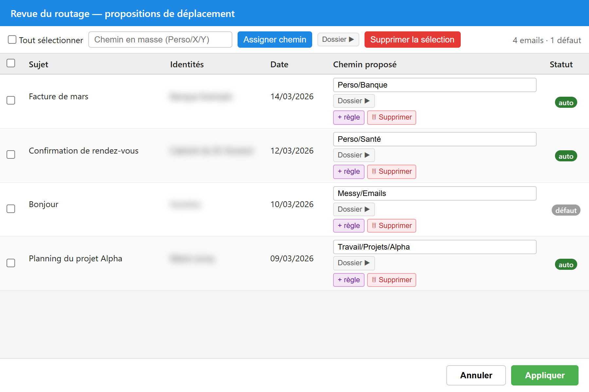
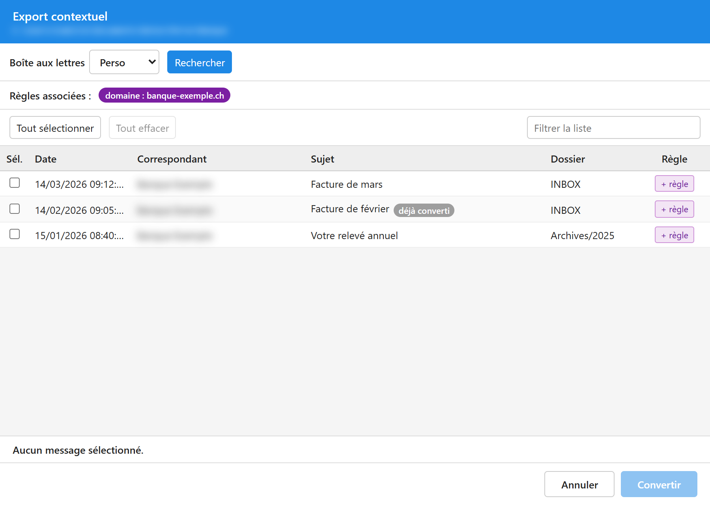

# Email to Markdown Exporter

> *Exporte vos boîtes IMAP en Markdown à métadonnées YAML et range les notes dans votre arborescence, plutôt que de les laisser dans un client mail.*

Application Rust en ligne de commande, avec une icône de barre système en option (feature `tray`). Trois guides PDF l'accompagnent : [utilisateur](aidd_docs/guides/output/pdf/guide-utilisateur-v0.29.0.pdf), [contributeur](aidd_docs/guides/output/pdf/guide-contributeur-v0.29.0.pdf) et [développeur](aidd_docs/guides/output/pdf/guide-developpeur-v0.29.0.pdf).

- [État du projet](#état-du-projet)
- [Aperçu](#aperçu)
- [Prérequis](#prérequis)
- [Démarrage rapide](#démarrage-rapide)
- [Documentation](#documentation)
- [Contribuer](#contribuer) · [Licence](#licence)

## État du projet

**Statut : 🧰 Beta.** Version 0.29.0, sous SemVer, pas encore de 1.0.

- *Ça marche aujourd'hui :* export IMAP vers Markdown ; import des comptes Thunderbird ; routage déterministe par `destinations.yaml` ; fenêtre de revue du routage dans la barre système ; recherche contextuelle depuis un dossier ; audit en lecture seule des messages restés sur le serveur
- *Pas encore :* connexion OAuth2 (un compte Gmail demande un mot de passe d'application)

| Plateforme | État | Note |
|---|---|---|
| Windows | ✅ Build et tests en CI, binaire de release | — |
| macOS | ✅ Build et tests en CI, binaire de release | — |
| Linux | ✅ Build et tests en CI (Ubuntu 24.04), binaire de release | Dépendances GTK et WebKit pour la barre système |

## Aperçu

Après chaque export, la fenêtre de revue propose un chemin de rangement par email. Vous le gardez, le corrigez ou l'ignorez, et rien ne bouge avant d'avoir cliqué **Appliquer**.



Depuis un dossier de vos notes, l'export contextuel retrouve les messages d'un correspondant et ne convertit que ceux que vous cochez.



Les captures montrent des données fictives. Le [guide de l'utilisateur](aidd_docs/guides/output/pdf/guide-utilisateur-v0.29.0.pdf) détaille les autres écrans.

## Prérequis

- Binaire précompilé : aucun prérequis
- Compilation depuis les sources : Rust 1.93.0, épinglé dans `rust-toolchain.toml` (aucune version inférieure n'a été essayée)
- Accès IMAP activé sur le serveur email
- Gmail avec 2FA : [mot de passe spécifique à l'application](https://support.google.com/accounts/answer/185833)
- Pour `--extract-passwords` : Thunderbird installé et **fermé**

## Démarrage rapide

### Binaire précompilé

Téléchargez le binaire de votre système sur la [page des releases](https://github.com/RebelliousSmile/email2markdown.app/releases) : `email-to-markdown-<version>-windows-x86_64.exe`, `email-to-markdown-<version>-macos-native` ou `email-to-markdown-<version>-linux-x86_64`. Un fichier `SHA256SUMS` accompagne chaque release. Ces binaires incluent la barre système.

### Depuis les sources

```bash
# Installer Rust
curl --proto '=https' --tlsv1.2 -sSf https://sh.rustup.rs | sh

# Compiler en mode release
cargo build --release

# Compiler avec la barre système et les fenêtres
cargo build --release --features tray
```

**Linux** — dépendances système requises pour la barre système et les fenêtres :
```bash
sudo apt-get install build-essential pkg-config libssl-dev libgtk-3-dev \
  libwebkit2gtk-4.1-dev libayatana-appindicator3-dev librsvg2-dev libxdo-dev
```

### Première configuration

```bash
# 1. Importer automatiquement les comptes depuis Thunderbird
./target/release/email-to-markdown import --extract-passwords

# 2. Choisir le répertoire d'export et le répertoire de notes dans settings.yaml
# Voir le chapitre 11 du guide du développeur (référence de la configuration)

# 3. Définir votre arborescence de rangement dans destinations.yaml
#    (à la main, ou via `dest add` / `dest suggest` — voir les chapitres 10 et 11 du guide du développeur)

# 4. Vérifier que les comptes sont vus
./target/release/email-to-markdown export --list-accounts
```

> Les fichiers de configuration sont stockés dans le répertoire système :
> - **Windows** : `%APPDATA%\email-to-markdown\`
> - **macOS** : `~/Library/Application Support/email-to-markdown/`
> - **Linux** : `~/.config/email-to-markdown/`

---

## Documentation

Trois guides PDF (version 0.29.0), à lire ou à télécharger :

| Guide | Pour qui | PDF |
|-------|----------|-----|
| Guide de l’utilisateur | Installer et utiliser l’application au quotidien, dépannage compris | [guide-utilisateur-v0.29.0.pdf](aidd_docs/guides/output/pdf/guide-utilisateur-v0.29.0.pdf) |
| Guide du contributeur | Participer au projet | [guide-contributeur-v0.29.0.pdf](aidd_docs/guides/output/pdf/guide-contributeur-v0.29.0.pdf) |
| Guide du développeur | Comprendre l’architecture et le code ; référence des commandes, de la configuration et du dépannage (chapitres 10 à 12) | [guide-developpeur-v0.29.0.pdf](aidd_docs/guides/output/pdf/guide-developpeur-v0.29.0.pdf) |

Les problèmes de compilation ou de système (linker Windows, icône de barre système, certificats TLS) sont dans [TROUBLESHOOTING.md](TROUBLESHOOTING.md).

---

## Note sur l'outillage Python

Les scripts Python d'analyse (`tools/`) qui existaient dans les versions précédentes ont été archivés dans un dépôt séparé et ne font plus partie du périmètre de cette application. Le routage est désormais entièrement déterministe via `destinations.yaml`, avec une option IA désactivée par défaut.

---

## Contribuer

Les contributions sont les bienvenues ! Consultez [CONTRIBUTING.md](CONTRIBUTING.md) pour les directives.

## Licence

MIT — voir [LICENSE](LICENSE).
