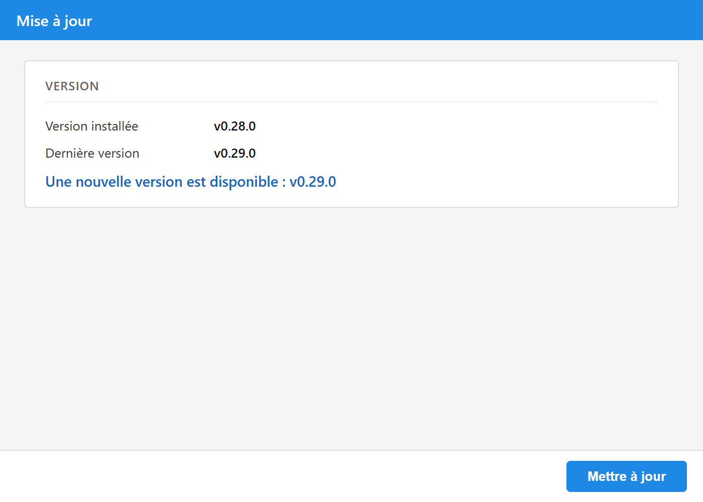

# Installation et mise à *jour*

Ce chapitre explique comment installer Email to Markdown sous Windows, le lancer, puis le maintenir à jour. L'installation ne demande aucun droit d'administrateur.

## Installer l'application

L'application est distribuée sous la forme d'un programme d'installation nommé `email-to-markdown-0.29.0-setup.exe` (le numéro correspond à la version). Double-cliquez sur ce fichier et suivez l'assistant.

L'installation est faite **pour l'utilisateur courant** : elle n'exige pas de droits d'administrateur et n'affecte pas les autres sessions de l'ordinateur. Elle est prévue pour Windows 64 bits.

| Élément | Valeur |
| --- | --- |
| Dossier d'installation par défaut | `%LOCALAPPDATA%\Programs\Email to Markdown` |
| Programme principal | `email-to-markdown.exe` |
| Ressources | Sous-dossier `Assets` (fenêtres de l'interface) |
| Raccourci | Menu Démarrer, sous le nom « Email to Markdown » |
| Éditeur affiché | FX Guillois |

À la fin de l'installation, l'application démarre automatiquement en arrière-plan en mode « zone de notification » : une icône apparaît près de l'horloge.

> **Bon à savoir** Le programme principal pèse une dizaine de mégaoctets. Il contient à la fois l'interface de la zone de notification et la ligne de commande.

## Lancer l'application

### Depuis le menu Démarrer

Le raccourci « Email to Markdown » lance le programme avec l'argument `tray`. Il n'ouvre pas de fenêtre classique : l'application s'installe dans la zone de notification, et c'est son icône qui donne accès à toutes les actions. Si l'icône n'est pas visible, déployez la flèche « Afficher les icônes cachées » de la barre des tâches.

Au survol, l'icône affiche l'infobulle « Email to Markdown ». Quand une mise à jour est détectée, l'infobulle devient « Email to Markdown — mise à jour X disponible », où X est le numéro de la nouvelle version.

### Depuis un terminal

Le même programme sert aussi de ligne de commande, pour les usages avancés ou automatisés. Elle est décrite dans le chapitre « Commandes en ligne » ; elle n'est pas nécessaire pour une utilisation courante.

> **Attention** La commande `tray`, la commande `contextual` et les fenêtres de l'interface ne sont disponibles que dans la version « zone de notification » de l'application, celle qui est fournie par l'installateur.

## Où l'application range ses fichiers

Les réglages de l'utilisateur ne sont pas dans le dossier d'installation, mais dans un dossier de configuration propre à chaque système :

| Système | Dossier de configuration |
| --- | --- |
| Windows | `%APPDATA%\email-to-markdown\` |
| macOS | `~/Library/Application Support/email-to-markdown/` |
| Linux | `~/.config/email-to-markdown/` |

C'est dans ce dossier que se trouvent les fichiers `accounts.yaml`, `settings.yaml`, `.env` (mots de passe) et `destinations.yaml`, que l'application écrit à votre place depuis ses fenêtres (voir le chapitre « Configurer ses comptes ») ; leur contenu est détaillé dans le chapitre « Fichiers de configuration ». Ils sont donc conservés lors d'une mise à jour ou d'une réinstallation.

## Mettre à jour

### Vérification automatique

Quand l'application tourne dans la zone de notification, elle interroge les publications officielles du projet toutes les 12 heures. Si une version strictement plus récente que la vôtre existe, le menu **Outils** affiche l'entrée « Mise à jour X disponible… » à la place de « Mise à jour… ».

Vous pouvez aussi déclencher la vérification vous-même : ouvrez le menu de l'icône, puis **Outils**, puis **Mise à jour…**.

### Ce que fait la mise à jour

Pour protéger votre ordinateur, l'application applique plusieurs garde-fous avant de remplacer son programme :

1. Elle lit la dernière publication et compare son numéro de version au vôtre, en tenant compte des numéros à plusieurs chiffres (la version 0.10.0 est bien reconnue comme plus récente que la 0.9.0).
2. Elle exige que la publication contienne un fichier de sommes de contrôle nommé `SHA256SUMS`, ainsi qu'un programme adapté à votre système (pour Windows, un fichier dont le nom se termine par `windows-x86_64.exe`).
3. Elle télécharge le programme, avec une limite de taille de 100 Mo.
4. Elle calcule l'empreinte SHA-256 du fichier téléchargé et la compare à celle publiée.
5. Seulement si les deux empreintes sont identiques, elle remplace le programme en cours d'exécution.
6. Elle relance l'icône de la zone de notification avec la nouvelle version ; l'ancienne instance se ferme.

> **Attention** Si l'empreinte ne correspond pas, ou si le fichier dépasse la taille limite, la mise à jour est abandonnée et votre version actuelle reste en place. Rien n'est remplacé silencieusement.

### Si la mise à jour échoue

Les messages d'erreur les plus courants et leur sens :

| Message | Cause probable |
| --- | --- |
| `GitHub API error: …` | Le service de publication est injoignable ou refuse la requête (réseau, proxy, limite d'appels) |
| `No SHA256SUMS asset found in release …` | La publication ne contient pas le fichier de sommes de contrôle : la mise à jour est refusée |
| `No compatible asset found in release …` | La publication ne contient pas de programme pour votre système |
| `Invalid remote version` | Le numéro de version publié n'est pas lisible |
| `Download error` / `Checksums download error` | Le téléchargement a échoué ou a expiré |
| `failed to replace the running binary` | Le remplacement du programme a été refusé (fichier verrouillé, droits insuffisants) |
| `update download exceeds … bytes, refuse to install it` | Le fichier téléchargé est plus gros que la limite autorisée |

Dans tous les cas, réessayez plus tard, ou téléchargez le nouvel installateur et lancez-le par-dessus l'installation existante.

> **Renvoi** Le chapitre « Dépannage » reprend les erreurs de connexion et d'export les plus fréquentes.

## Désinstaller

L'application est inscrite dans la liste des applications de Windows sous le nom « Email to Markdown ». Utilisez **Paramètres, puis Applications** pour la désinstaller comme n'importe quel autre programme.

La désinstallation retire le programme, mais ne supprime ni vos notes, ni vos fichiers de configuration, ni votre registre de messages traités. Si vous souhaitez repartir de zéro, supprimez à la main le dossier `%APPDATA%\email-to-markdown\`.
