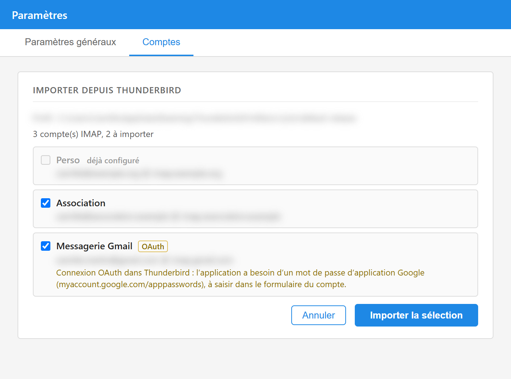
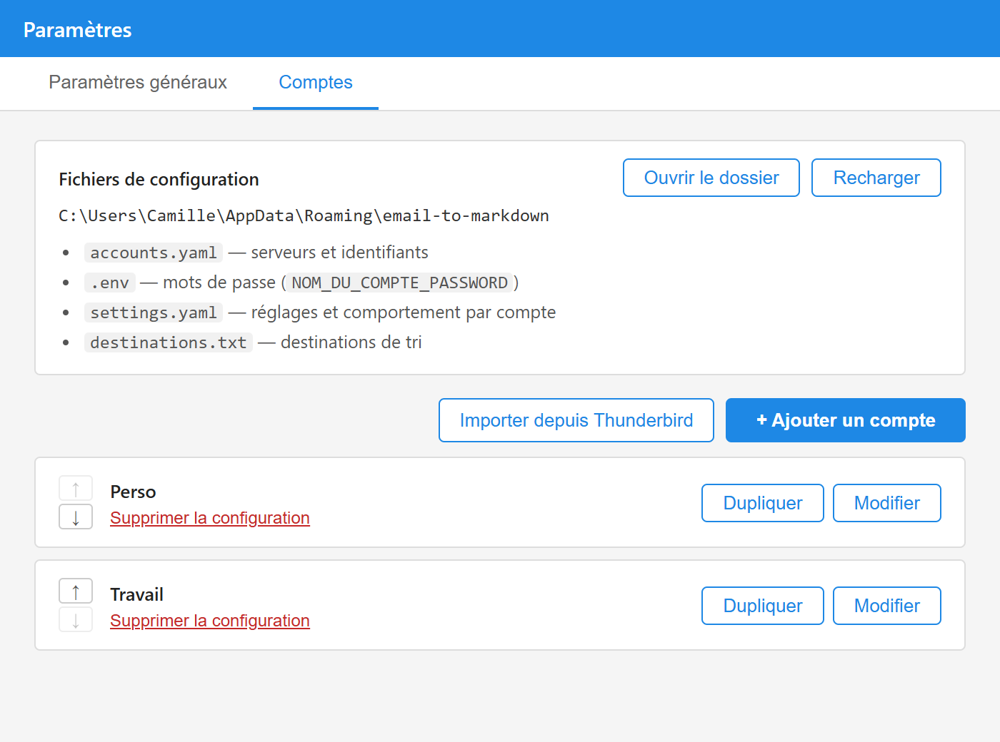
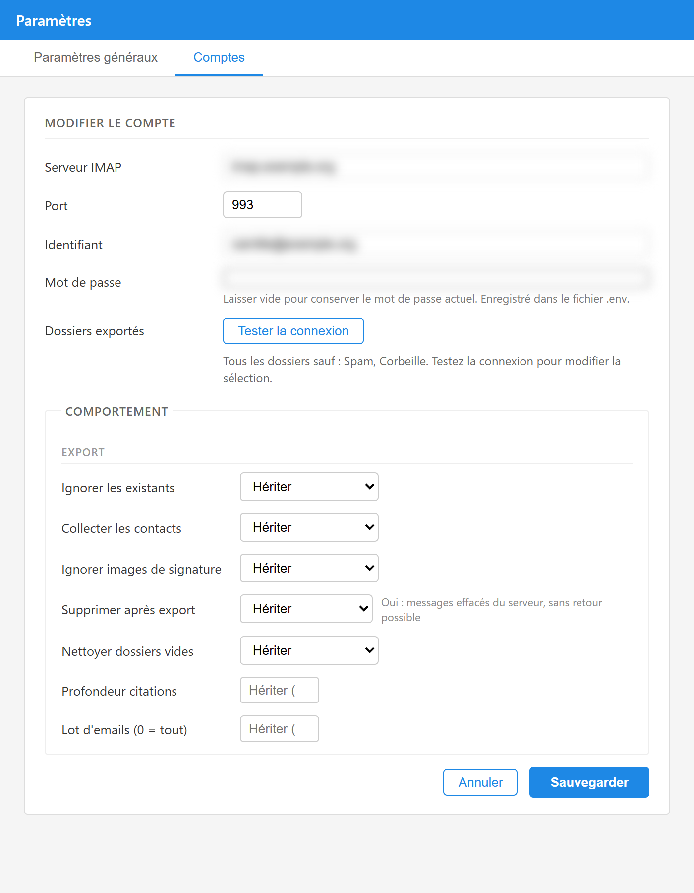
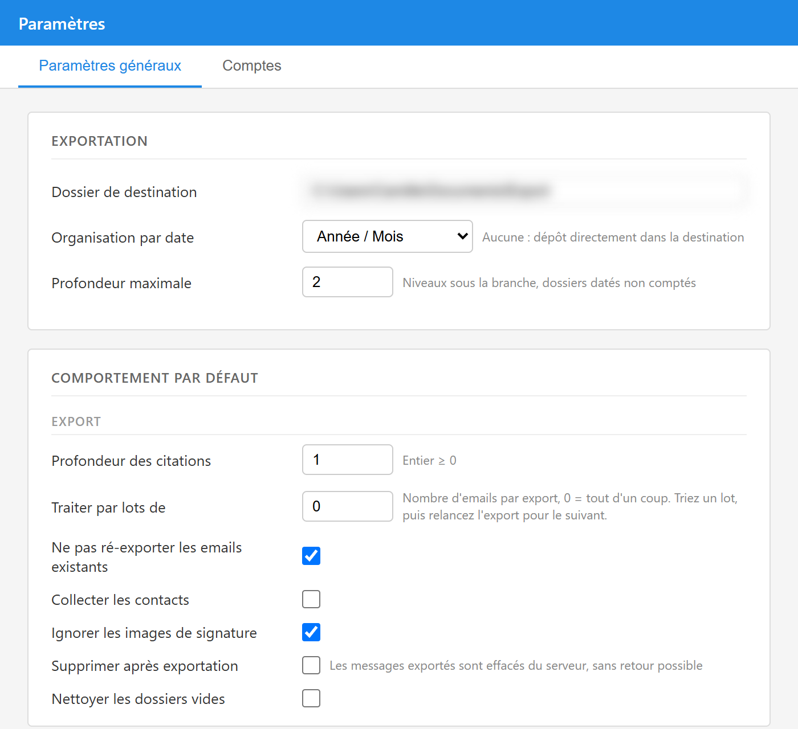

# Configurer ses *comptes*

Avant le premier export, l'application doit connaître vos boîtes mail, leurs mots de passe et l'endroit où écrire les notes. Tout se fait depuis la fenêtre **Paramètres…** de l'icône de la zone de notification : aucun fichier à éditer. Ce chapitre présente l'import depuis Thunderbird, l'ajout d'un compte et les réglages généraux.

## Ouvrir la fenêtre de paramètres

1. Faites un clic droit sur l'icône de la zone de notification.
2. Ouvrez **Outils**, puis **Paramètres…**.

La fenêtre comporte deux onglets : **Comptes** et **Paramètres généraux**. Vos choix sont enregistrés dans le dossier de configuration de l'application, `%APPDATA%\email-to-markdown\` sous Windows. Les mots de passe y sont conservés à part des autres informations, ce qui permet de sauvegarder la liste des comptes sans exposer d'identifiants.

> **Bon à savoir** Pour modifier ces fichiers à la main, par exemple pour automatiser une installation, voir le chapitre « Fichiers de configuration », dans la partie consacrée à l'utilisation avancée.

## Importer ses comptes depuis Thunderbird

Si vos comptes sont déjà configurés dans Thunderbird, vous pouvez les reprendre sans les ressaisir. L'import ne remplace jamais un compte existant : les nouveaux comptes sont simplement ajoutés.

1. Dans la fenêtre **Paramètres…**, ouvrez l'onglet **Comptes** et cliquez sur **Importer depuis Thunderbird**.
2. Si votre profil Thunderbird est protégé, saisissez le **Mot de passe principal Thunderbird**.
3. Cochez les comptes à reprendre et cliquez sur **Importer la sélection**.

Le menu **Outils** de l'icône propose aussi une entrée **Import Thunderbird**.

L'application teste la connexion des comptes sélectionnés, avec une attente d'une vingtaine de secondes au plus. Un compte dont la connexion échoue est signalé à la fin de l'import ; un compte ajouté sans connexion vérifiée reste à contrôler.

> **Attention** Si l'extraction des mots de passe échoue, fermez Thunderbird puis recommencez, ou saisissez simplement les mots de passe vous-même dans le formulaire du compte.

## Ajouter ou modifier un compte

L'onglet **Comptes** de la fenêtre **Paramètres…** offre un formulaire complet. Le bouton **+ Ajouter un compte** ouvre un formulaire vierge ; **Modifier** reprend un compte existant.

| Champ | Contenu |
| --- | --- |
| Nom du compte | Le nom affiché et utilisé dans les menus |
| Serveur IMAP | Par exemple `imap.gmail.com` |
| Port | Généralement 993 |
| Identifiant | Votre adresse mail ou votre identifiant |
| Mot de passe | Conservé à part des autres informations du compte |
| Dossiers exportés | Sélection des dossiers à lire |
| Comportement | Réglages propres au compte (voir plus bas) |

> **Attention** Gmail refuse le mot de passe habituel du compte pour les applications externes. Il faut créer un « mot de passe d'application » dans les paramètres de sécurité de votre compte Google, et le saisir dans le champ **Mot de passe**. Ce mot de passe d'application est aussi requis pour la suppression sur le serveur.

Chaque ligne de la liste des comptes propose aussi : **Dupliquer**, **Supprimer la configuration** (avec confirmation), et les flèches pour monter ou descendre le compte dans la liste. La suppression retire le compte de la configuration et efface son mot de passe ; les notes déjà exportées restent sur le disque.

Lors de la modification d'un compte, un mot de passe laissé vide conserve le mot de passe actuel.

### Tester la connexion et choisir les dossiers

Le bouton **Tester la connexion** contacte le serveur avec les informations saisies. Pendant le test, l'état « Test de la connexion en cours… » s'affiche. En cas de réussite, vous voyez « Connexion réussie » suivi du nombre de dossiers trouvés, et le sélecteur de dossiers se remplit. En cas d'échec, le message « Échec de la connexion » apparaît avec la raison de l'erreur.

Tant que le test n'a pas été réalisé, la zone des dossiers indique qu'il faut tester la connexion pour choisir les dossiers à exporter. Par défaut, la boîte de réception et les messages envoyés sont retenus.

Si le test échoue mais que vous voulez conserver le compte, par exemple parce que le serveur est temporairement hors ligne, le bouton **Enregistrer quand même** permet de sauvegarder sans connexion vérifiée.

### Le bloc Comportement

Le fieldset **Comportement** reprend les réglages par compte. Chaque liste propose trois choix : **Hériter** (la valeur des réglages généraux s'applique), **Oui** ou **Non**. Les champs numériques **Profondeur citations** et **Lot d'emails (0 = tout)** fonctionnent de la même manière.

## Les réglages généraux

L'onglet **Paramètres généraux** regroupe les réglages communs à tous les comptes :

| Champ de la fenêtre | Effet |
| --- | --- |
| Dossier de destination | Dossier de transit : chaque compte y reçoit un sous-dossier |
| Organisation par date | Sous-dossiers datés : Aucune, Année, Année / Mois, Année / Mois / Jour |
| Profondeur maximale | Nombre de niveaux autorisés sous la branche d'une destination (entier supérieur ou égal à 1) |
| Profondeur des citations | Niveaux de citations conservés dans le corps (entier supérieur ou égal à 0) |
| Traiter par lots de | Nombre de messages par export ; 0 signifie tout d'un coup |
| Ne pas ré-exporter les emails existants | Un message déjà exporté n'est pas recréé |
| Collecter les contacts | Constitue un fichier CSV des contacts rencontrés |
| Ignorer les images de signature | Écarte les logos et images de signature |
| Supprimer après exportation | Supprime du serveur les messages archivés |
| Nettoyer les dossiers vides | Supprime les dossiers vides après chaque export |

Quatre boutons complètent la fenêtre : **Ouvrir le dossier**, **Recharger**, **Ouvrir le fichier brut** et **Sauvegarder**.

Le menu **Outils** propose aussi deux raccourcis : **Choisir répertoire d'export…** définit le dossier de transit, et **Choisir répertoire de notes…** définit le dossier racine où les notes sont classées.

> **À retenir** Renseignez le dossier de notes avant votre premier export : c'est dans ce dossier que les notes sont classées.

> **Renvoi** La suppression sur le serveur a des conséquences irréversibles. Lisez le chapitre « Nettoyage du serveur » avant d'activer l'option **Supprimer après exportation**.
