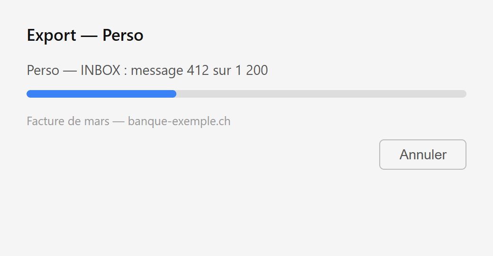
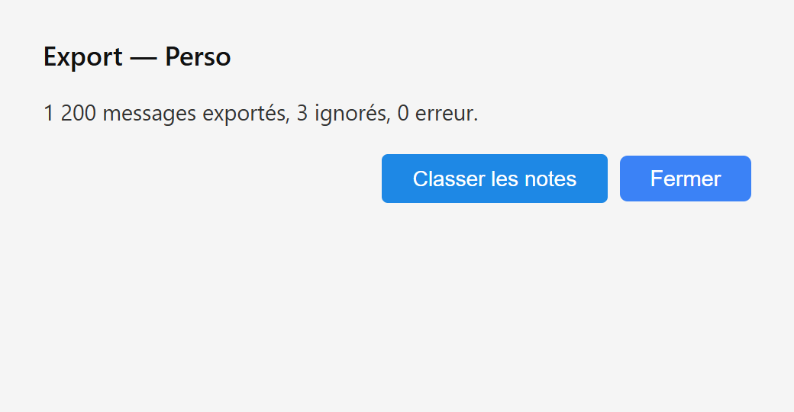
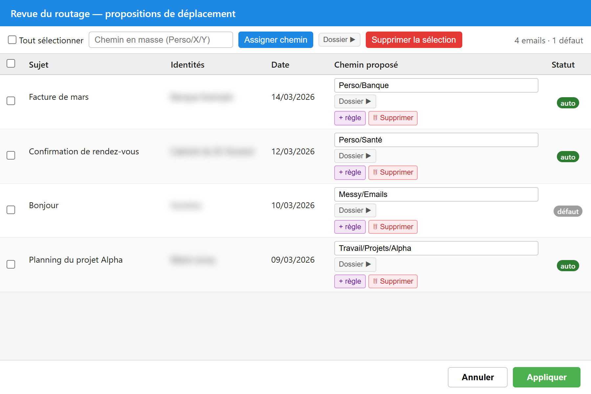

# La zone de *notification*

L'icône d'Email to Markdown, près de l'horloge de Windows, donne accès à toutes les actions courantes : exporter un compte, classer les notes, régler l'application. Ce chapitre décrit le menu, le déroulement d'un export et la fenêtre de revue du classement.

## Le menu de l'icône

Un clic droit sur l'icône ouvre le menu. Son contenu dépend de votre configuration.

| Entrée | Rôle |
| --- | --- |
| **Export compte** | Sous-menu : un élément par compte configuré ; lance l'export de ce compte |
| **Reprendre le tri** | Sous-menu par compte : rouvre la revue du classement pour les notes restées en transit |
| **Nettoyer le serveur** | Sous-menu par compte ; présent seulement si au moins un compte a la suppression activée |
| **Outils** | Sous-menu de réglages et d'utilitaires (voir ci-dessous) |
| **Quitter** | Ferme l'application |

Le sous-menu **Outils** contient :

| Entrée | Rôle |
| --- | --- |
| **Fix HTML→Markdown** | Par compte : reconvertit les notes issues de messages en HTML |
| **Import Thunderbird** | Reprend les comptes d'un profil Thunderbird |
| **Choisir répertoire d'export…** | Définit le dossier de transit des notes |
| **Choisir répertoire de notes…** | Définit le dossier racine où les notes sont classées |
| **Gérer les destinations…** | Ouvre la fenêtre de gestion des règles de classement |
| **Paramètres…** | Ouvre la fenêtre de réglages et de comptes |
| **Mise à jour…** | Vérifie les mises à jour (devient « Mise à jour X disponible… » le cas échéant) |

> **Bon à savoir** Si le fichier des comptes est illisible, le menu affiche à la place des comptes une ligne grisée : « Comptes illisibles — voir Paramètres ». Ouvrez alors **Outils**, puis **Paramètres…** pour corriger le problème.

## Lancer un export

Choisissez **Export compte**, puis le nom du compte. Le déroulement est le suivant :

1. L'application se connecte au serveur avec le mot de passe du fichier `.env`.
2. Elle parcourt les dossiers retenus pour ce compte et lit les messages.
3. Elle écrit chaque message sous forme de note dans le dossier de transit du compte, avec ses pièces jointes.
4. Elle ouvre la fenêtre de revue du classement, qui propose un dossier de destination pour chaque note.
5. Après votre validation, les notes sont déplacées vers leur destination.

Un message d'état affiche le résultat de l'opération. Selon le cas, il commence par « Export terminé », « Lot terminé » ou « Export annulé ».

### Les messages déjà exportés

Quand l'option **Ne pas ré-exporter les emails existants** est active, l'application reconnaît un message déjà exporté par sa date, son expéditeur, ses destinataires, l'empreinte de son sujet et son identifiant de message. Un deuxième export du même compte ne recrée donc pas de doublons.

### Exporter par lots

Pour une grande boîte mail, il est confortable de traiter les messages par paquets. Renseignez **Traiter par lots de** dans les réglages, par exemple 200. L'export s'arrête alors après 200 messages, avec le message « Lot terminé » qui vous invite à trier le lot, puis à relancer l'export pour obtenir le suivant. La valeur 0 désactive le découpage.

### Les images de signature et les erreurs

Les images jugées décoratives (logos de signature) sont mises de côté, dans un sous-dossier `_skipped`, lorsque l'option **Ignorer les images de signature** est active. Les messages impossibles à convertir sont placés dans un dossier `_failed`. Ces dossiers spéciaux ne sont jamais proposés au classement.

## La fenêtre de revue du classement

Après l'export, la fenêtre « Revue du routage — propositions de déplacement » liste les notes avec le dossier proposé par vos règles.

| Colonne | Contenu |
| --- | --- |
| Sujet | L'objet du message |
| Identités | Les expéditeurs et destinataires |
| Date | La date du message |
| Chemin proposé | Le dossier de destination suggéré |
| Statut | Un badge : « règle » (une règle a désigné ce dossier), « auto » (chemin proposé d'après le fichier des destinations), « défaut » (destination par défaut) ou « conflit » (plusieurs destinations correspondent) |

Le badge « conflit » signale que plusieurs destinations conviennent à la même note. Le dossier retenu est le premier de votre liste ; les autres sont proposées comme alternatives.

### Corriger le classement

Chaque ligne se modifie individuellement : vous pouvez saisir un autre chemin, choisir l'une des alternatives en cas de conflit, ou choisir un dossier existant avec le bouton **Dossier ▶**. Les actions de la barre d'outils agissent sur les lignes cochées :

| Action | Effet |
| --- | --- |
| **Tout sélectionner** | Coche toutes les lignes |
| **Chemin en masse (Perso/X/Y)** puis **Assigner chemin** | Applique le même chemin aux lignes cochées |
| **Supprimer la sélection** | Écarte les emails cochés sans les classer |

### Créer une règle depuis une ligne

Le bouton **+ règle** transforme le classement d'une note en règle durable : la prochaine fois, un message semblable sera dirigé automatiquement vers ce dossier. Si la nouvelle règle entre en conflit avec une règle existante, une fenêtre vous propose trois choix :

| Choix | Conséquence |
| --- | --- |
| Garder les deux (le premier de la liste gagne) | Les deux règles coexistent ; l'ordre du fichier décide |
| Déplacer la règle ici | La règle quitte son ancienne destination pour rejoindre la nouvelle |
| Annuler | Aucun changement |

### Écarter un message

Le bouton **Supprimer** d'une ligne demande confirmation : « Supprimer cet email ? ». Le message précise que l'email ne sera pas classé et que, si votre compte est configuré pour supprimer les emails après export, il sera aussi supprimé de la boîte mail. La note est effacée, et ses pièces jointes sont déplacées dans un dossier `_deleted` plutôt que détruites.

> **Attention** Écarter une note ne supprime pas le message du serveur, sauf si la suppression après export est activée pour le compte. Dans ce cas, l'action est irréversible côté serveur.

### Valider

Le bouton **Appliquer** déplace les notes vers leur destination (il affiche « Application en cours… » pendant l'opération) ; **Annuler** ferme la fenêtre sans rien déplacer.

## Reprendre un tri interrompu

Si vous avez fermé la fenêtre de revue sans appliquer, ou si un export a été interrompu, les notes restent dans le dossier de transit du compte. Choisissez **Reprendre le tri**, puis le compte : l'application rescanne le dossier de transit et rouvre la fenêtre de revue pour les notes encore en attente. S'il n'y en a aucune, elle affiche « Aucun email à trier en attente pour » suivi du nom du compte.

## Les autres outils

### Fix HTML→Markdown

Cet outil reprend les notes d'un compte dont le corps était resté au format HTML et les convertit en Markdown. Il affiche un bilan de la forme « Compte : N convertis, N ignorés, N erreurs ». Utilisez-le surtout sur des notes produites par une ancienne version.

### Gérer les destinations

L'entrée **Gérer les destinations…** ouvre une fenêtre qui permet de consulter et de modifier les dossiers de destination et leurs règles, sans éditer le fichier à la main.

### Nettoyer le serveur

Cette entrée sert à supprimer du serveur des messages déjà archivés. Elle est décrite dans le chapitre « Nettoyage du serveur ».

## Les réglages et les fenêtres

L'entrée **Paramètres…** ouvre la fenêtre de configuration décrite dans le chapitre sur la configuration des comptes. Les raccourcis **Choisir répertoire d'export…** et **Choisir répertoire de notes…** ouvrent le sélecteur de dossier de Windows. Le premier affiche ensuite le nombre de comptes concernés et le chemin retenu ; le second affiche le chemin défini.

> **Renvoi** Le détail des règles de classement se trouve dans le chapitre « Destinations et tri ».
