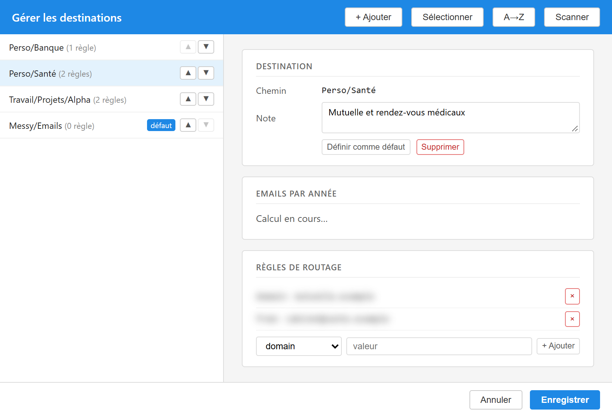

# Destinations et *tri*

Le tri range chaque note dans le bon dossier de votre coffre, sans intervention de votre part dès que les règles sont en place. Ce chapitre explique comment décrire vos destinations depuis la fenêtre dédiée, écrire des règles et contrôler le résultat.

## Le principe

Une **destination** est un dossier de votre coffre de notes, désigné par un chemin relatif comme `Perso/Banque`. À chaque destination, vous associez des **règles** : « les messages de tel domaine », « les messages dont le sujet contient tel mot ». Quand une note correspond à une règle, elle est dirigée vers la destination concernée.

Le tri s'applique à l'issue d'un export : dans l'icône de la zone de notification, vous validez le résultat dans la fenêtre de revue.

## Gérer les destinations avec la fenêtre

L'entrée **Outils**, puis **Gérer les destinations…** de l'icône ouvre la fenêtre « Destinations ». Elle permet de travailler sans toucher à aucun fichier.

| Action | Effet |
| --- | --- |
| **+ Ajouter** | Crée une destination : champ **Chemin** (avec le bouton **Parcourir…**) et champ **Note** facultatif |
| **Définir comme défaut** | Marque la destination sélectionnée comme destination par défaut |
| **+ Ajouter** (dans le détail) | Ajoute une règle : choix du type et de la valeur |
| **Supprimer** | Supprime la destination sélectionnée |
| **Sélectionner** | Passe en mode de sélection multiple, pour supprimer plusieurs destinations d'un coup |
| **A→Z** | Trie les destinations par ordre alphabétique |
| **Scanner** | Examine les dossiers du coffre pour proposer des destinations, et repère celles dont le dossier a disparu |
| **Enregistrer** / **Annuler** | Valide ou abandonne les changements |

> **Attention** Le bouton **A→Z** change l'ordre des destinations, et donc leur priorité. Si deux destinations peuvent correspondre au même message, l'ordre alphabétique peut modifier la destination retenue.

## Les types de règles

Quand vous ajoutez une règle, vous choisissez son type dans une liste, puis vous saisissez la valeur.

| Règle | Condition | Exemple |
| --- | --- | --- |
| `domain` | Le domaine de l'expéditeur est celui indiqué, ou l'un de ses sous-domaines (sans tenir compte des majuscules) | `domain: ubs.ch` |
| `from` | L'adresse de l'expéditeur est exactement celle-ci | `from: noreply@banque.ch` |
| `correspondent` | L'adresse figure exactement parmi l'expéditeur, les destinataires, la copie ou la copie cachée | `correspondent: marie@exemple.org` |
| `subject` | L'objet contient ce texte (sans tenir compte des majuscules) | `subject: facture` |
| `account` | Le message vient du compte portant exactement ce nom (majuscules comprises) | `account: Gmail` |

Une destination peut porter plusieurs règles ; une seule suffit à la désigner.

> **Bon à savoir** Une règle `domain: ubs.ch` couvre aussi `mail.ubs.ch`, mais pas `faux-ubs.ch`. Pour un seul expéditeur précis, préférez `from`.

## Comment une destination est choisie

L'application applique ces étapes dans l'ordre :

1. Elle parcourt les destinations **dans l'ordre de la liste** et retient la première dont une règle correspond.
2. Les autres destinations qui correspondent aussi sont gardées comme **alternatives** ; la fenêtre de revue les signale par le badge « conflit ».
3. Si aucune règle ne correspond, la note va à la destination marquée comme destination par défaut.
4. S'il n'existe pas de destination par défaut, la note va à `Perso/Messy/Emails`.

Une seule destination peut être marquée comme destination par défaut. Si la liste des destinations est absente, l'application le signale par un avertissement et dirige toutes les notes vers la destination par défaut.

> **À retenir** L'ordre des destinations a de l'importance : mettez les règles les plus précises en premier, et les plus générales en dernier.

## Les sous-dossiers datés

Après le chemin de la destination, l'application peut ajouter des dossiers datés, selon le champ **Organisation par date** de l'onglet **Paramètres généraux**.

| Valeur | Résultat pour une note du 14 mars 2026 |
| --- | --- |
| Aucune | `Perso/Banque/` |
| Année | `Perso/Banque/2026/` |
| Année / Mois | `Perso/Banque/2026/03/` |
| Année / Mois / Jour | `Perso/Banque/2026/03/14/` |

Si le réglage est absent, le rangement par année et par mois est appliqué. Si vous saisissez à la main, dans la fenêtre de revue, un chemin qui se termine déjà par une date (par exemple `Perso/Banque/2026/03`), l'application ne rajoute pas une seconde fois les dossiers datés.

## Les règles de forme des chemins

Pour votre sécurité, l'application contrôle chaque segment d'un chemin de destination. Sont autorisés les lettres (accents compris), les chiffres, l'espace, le tiret bas, le point et le tiret. Sont refusés :

- les segments `.` et `..` ;
- les barres obliques inverses `\` ;
- les segments terminés par un point ;
- les noms réservés de Windows (`CON`, `NUL`, `COM1`, etc.).

Un chemin qui enfreint ces règles produit une erreur de la forme « notes destination segment contains forbidden characters » ou « invalid routing path ».

### La profondeur maximale

Le champ **Profondeur maximale** limite le nombre de niveaux d'une destination sous sa branche : `Perso/Banque` compte pour 1 niveau et `Perso/Banque/BNP` pour 2. Les dossiers datés ne comptent pas. La valeur par défaut est 2. Un chemin trop profond est accepté mais fait l'objet d'un avertissement.

## Contrôler le tri

### Créer une règle depuis la revue

Dans la fenêtre de revue, le bouton **+ règle** d'une ligne crée la règle correspondant à ce que vous venez de décider. C'est la méthode la plus simple pour faire grandir peu à peu vos règles : triez à la main les premiers messages, puis laissez les règles faire le reste.

### Reprendre un tri

Si vous n'avez pas terminé, l'entrée **Reprendre le tri** de l'icône rouvre la fenêtre de revue pour les notes encore en attente dans le dossier de transit.

### Relier les notes qui se citent

Lors du classement, une note qui cite un message déjà présent dans votre coffre est reliée à la note correspondante. Pour traiter des notes déjà classées, ou réparer les liens de pièces jointes d'anciennes notes, des commandes existent dans la partie consacrée à l'utilisation avancée (chapitre « Commandes en ligne »).

## Exemple complet

Supposons que vous receviez des factures de `facturation@energie-exemple.ch` et des relevés de `ubs.ch`.

1. Vous ajoutez une destination `Perso/Banque` avec la règle `domain: ubs.ch`.
2. Vous ajoutez une destination `Perso/Factures` avec la règle `from: facturation@energie-exemple.ch`.
3. Vous gardez `Perso/Messy/Emails` comme destination par défaut.
4. Avec l'organisation par date Année / Mois, une facture du 14 mars 2026 arrive dans `Perso/Factures/2026/03/`.
5. Un message d'un inconnu arrive dans `Perso/Messy/Emails/2026/03/`, où vous pouvez le trier ensuite.

> **Renvoi** Pour décrire vos destinations dans un fichier, ou les gérer en ligne de commande, voir les chapitres « Fichiers de configuration » et « Commandes en ligne ».
