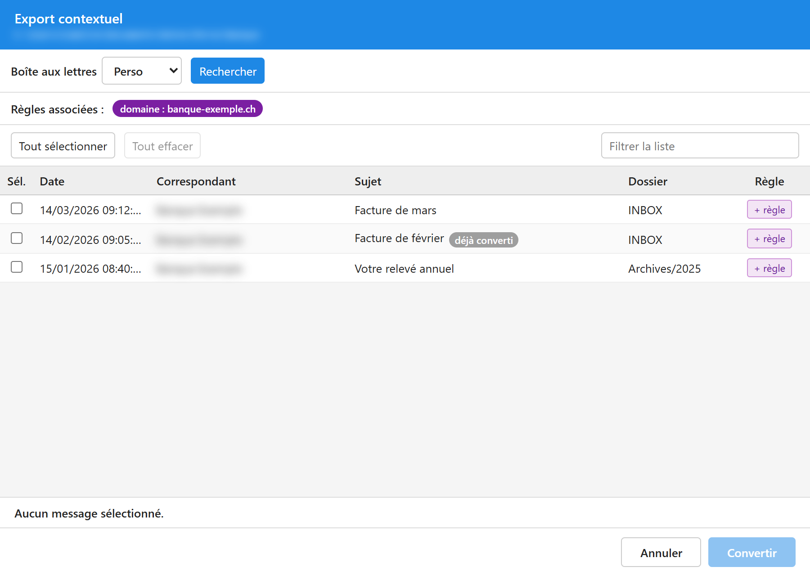

# Commandes en *ligne*

Ce chapitre relève de l'utilisation avancée. Tout ce que l'icône de la zone de notification propose existe aussi en ligne de commande, ce qui permet de programmer un export ou de l'enchaîner avec d'autres outils. Il passe en revue chaque commande et ses options.

## Principes généraux

Le programme s'appelle `email-to-markdown` : c'est le même programme que celui de l'icône de la zone de notification. Ouvrez un terminal PowerShell, placez-vous dans le dossier d'installation (`%LOCALAPPDATA%\Programs\Email to Markdown` par défaut) ou ajoutez ce dossier à la variable d'environnement `PATH`, puis tapez la commande voulue.

`email-to-markdown --version`\
`email-to-markdown --help`\
`email-to-markdown export --help`

`--help` affiche l'aide de n'importe quelle commande. Les fichiers de configuration sont ceux du dossier de configuration de l'application, exactement comme pour l'icône de la zone de notification : ils sont décrits dans le chapitre « Fichiers de configuration ».

| Commande | Rôle |
| --- | --- |
| `import` | Reprend les comptes d'un profil Thunderbird |
| `export` | Exporte les messages d'un ou plusieurs comptes |
| `dest` | Gère les destinations de classement |
| `repair-attachments` | Répare les liens de pièces jointes d'anciennes notes |
| `link-quotes` | Relie entre elles les notes qui se citent |
| `audit-server` | Diagnostique l'état des messages restés sur le serveur |
| `contextual` | Convertit les messages liés à un dossier de destination (clic droit) |
| `tray` | Démarre l'icône de la zone de notification |

## import : reprendre ses comptes Thunderbird

`email-to-markdown import --list-profiles`\
`email-to-markdown import --extract-passwords`

| Option | Effet |
| --- | --- |
| `-p`, `--profile <CHEMIN>` | Profil Thunderbird à utiliser |
| `--list-profiles` | Affiche les profils disponibles, puis s'arrête |
| `-o`, `--output <CHEMIN>` | Chemin du fichier de comptes à écrire |
| `--generate-env` | Écrit un fichier modèle `.env.template` à côté du fichier de sortie |
| `--extract-passwords` | Extrait les mots de passe enregistrés par Thunderbird (Thunderbird doit être fermé) |
| `--master-password <MOT_DE_PASSE>` | Mot de passe principal du profil |

La commande fusionne les comptes trouvés dans `accounts.yaml` : un compte existant n'est jamais écrasé. Elle affiche le profil utilisé (« Using Thunderbird profile »), le nombre de comptes IMAP trouvés (« Found N IMAP account(s) »), puis, si l'extraction est demandée, le nombre de mots de passe déchiffrés et écrits.

> **Bon à savoir** Si aucun compte IMAP n'est trouvé, le message « No IMAP accounts found in Thunderbird profile » s'affiche. Vérifiez alors le profil avec `--list-profiles`.

## export : exporter les messages

`email-to-markdown export`\
`email-to-markdown export --list-accounts`\
`email-to-markdown export -a Gmail`\
`email-to-markdown export -a "Gmail,Outlook" --debug`

| Option | Effet |
| --- | --- |
| `-a`, `--account <NOMS>` | Limite l'export à un ou plusieurs comptes, séparés par des virgules, sans distinction de casse |
| `--list-accounts` | Liste les comptes configurés, puis s'arrête |
| `--delete-after-export` | Force la suppression sur le serveur pour cet export (dangereux) |
| `-c`, `--config <CHEMIN>` | Fichier de comptes à utiliser à la place de celui par défaut |
| `-d`, `--debug` | Affiche le détail des échanges avec le serveur IMAP |

Sans option, la commande exporte tous les comptes.

### Ce que vous voyez à l'écran

Pour chaque compte, la commande affiche sa progression, puis un bilan de la forme :

`Export completed for Gmail: 124 exported, 31 skipped, 0 errors`

Les messages « skipped » sont ceux déjà exportés. Si la configuration comporte un dossier de notes, la commande classe ensuite les notes selon vos règles et indique « Routing: N moved to notes_dir, N errors ».

> **Attention** Si le dossier de notes (`notes_dir`) n'est pas renseigné dans `settings.yaml`, les notes ne sont pas classées. Elles restent dans le dossier de transit, et la commande l'indique ainsi : « notes_dir not configured in settings.yaml — N emails remain in staging (not routed) ». Pour les classer ensuite, utilisez **Reprendre le tri** depuis l'icône de la zone de notification.

### Les messages d'erreur courants

| Message | Signification |
| --- | --- |
| `No accounts configured.` | Le fichier `accounts.yaml` ne contient aucun compte |
| `No accounts selected for export` | Le nom passé à `-a` ne correspond à aucun compte |
| `Error for X: No password found. Check your .env file.` | Aucun mot de passe trouvé pour le compte X dans `.env` |
| `Connection failed for X: …` | Connexion au serveur impossible (réseau, identifiants, mot de passe d'application) |
| `Export failed for X: …` | Échec pendant la lecture ou l'écriture |

> **Attention** L'option `--delete-after-export` efface des messages du serveur sans retour possible, quel que soit le réglage du compte. Ne l'utilisez qu'en connaissance de cause, après avoir lu le chapitre « Nettoyage du serveur ».

## dest : gérer les destinations

La commande `dest` lit et modifie le fichier `destinations.yaml`.

`email-to-markdown dest`\
`email-to-markdown dest list`\
`email-to-markdown dest add Perso/Banque --domain ubs.ch --note "relevés bancaires"`\
`email-to-markdown dest add Perso/Messy/Emails --default`\
`email-to-markdown dest suggest`

### Sans sous-commande : l'éditeur guidé

Lancée seule, `dest` ouvre un éditeur interactif dans le terminal. Il liste les destinations, demande un filtre (« Filter [Enter=all] » : Entrée pour tout afficher), puis propose les actions suivantes :

| Touche | Action |
| --- | --- |
| `a` | Ajouter une destination |
| `e` suivi d'un numéro | Modifier la note d'une destination |
| `s` suivi d'un numéro | Supprimer la destination (confirmation « Delete? [y/N] ») |
| `r` suivi d'un numéro | Ajouter ou retirer une règle |
| `d` suivi d'un numéro | Définir comme destination par défaut |
| `f` | Changer le filtre |
| `q` | Quitter |

Chaque modification est enregistrée immédiatement.

### list, add et suggest

| Sous-commande | Effet |
| --- | --- |
| `dest list` | Affiche les destinations et signale les anomalies du fichier ; si le fichier est vide ou absent : « No destinations configured » |
| `dest add <CHEMIN>` | Ajoute une destination, ou ajoute des règles à une destination existante |
| `dest suggest` | Examine le dossier par défaut sous le dossier de notes et propose des règles de domaine |

Options de `dest add` :

| Option | Règle créée |
| --- | --- |
| `--domain <DOMAINE>` | Les messages de ce domaine (et de ses sous-domaines) |
| `--from <ADRESSE>` | Les messages envoyés par cette adresse précise |
| `--correspondent <ADRESSE>` | Les messages où cette adresse figure en expéditeur, destinataire, copie ou copie cachée |
| `--subject <TEXTE>` | Les messages dont le sujet contient ce texte |
| `--account <NOM>` | Les messages reçus par ce compte |
| `--note <TEXTE>` | Une description libre de la destination |
| `--default` | Fait de cette destination la destination par défaut |

Un chemin plus profond que `destination_max_depth` provoque un avertissement.

## repair-attachments : réparer d'anciennes notes

Cette commande est utile après une montée de version : elle corrige les liens de pièces jointes de notes déjà déplacées, qui pointaient encore vers l'ancien emplacement centralisé.

`email-to-markdown repair-attachments -a Gmail --dry-run`\
`email-to-markdown repair-attachments -a Gmail`

| Option | Effet |
| --- | --- |
| `-a`, `--account <NOM>` | Compte concerné (obligatoire) |
| `--dry-run` | Simule : annonce « N attachment(s) would be repaired » sans rien modifier |
| `-c`, `--config <CHEMIN>` | Chemin du fichier de réglages (`settings.yaml`) |

Attention à la nature de `--config` : pour cette commande seulement, il désigne le fichier de réglages et non le fichier de comptes. Si le dossier du compte est introuvable, la commande répond « account root not found ».

## link-quotes : relier les messages cités

Quand une note cite un message qui existe aussi dans votre coffre, cette commande ajoute un lien entre les deux notes. Elle prend en argument le dossier du coffre.

`email-to-markdown link-quotes C:\Users\Prenom\Documents\Notes`\
`email-to-markdown link-quotes C:\Users\Prenom\Documents\Notes --apply --backup C:\Sauvegardes\notes`

| Option | Effet |
| --- | --- |
| `<COFFRE>` | Dossier à analyser (obligatoire) |
| `--apply` | Applique réellement les modifications ; exige `--backup` |
| `--backup <DOSSIER>` | Dossier de sauvegarde, situé en dehors du coffre, qui reçoit une copie des notes modifiées |

Par défaut, la commande ne modifie rien : elle annonce « N notes scanned, would link N quoted messages in N notes » et termine par « (dry-run — no files were changed) ». Elle indique aussi, par motif, les citations laissées en texte simple.

## audit-server : comprendre ce qui reste sur le serveur

Cette commande en lecture seule dresse un bilan des messages d'un compte encore présents sur le serveur.

`email-to-markdown audit-server Gmail`\
`email-to-markdown audit-server Gmail --folder INBOX --details`

| Option | Effet |
| --- | --- |
| `<COMPTE>` | Nom du compte à examiner (obligatoire) |
| `--folder <NOM>` | Limite l'audit à un dossier (nom affiché ou nom brut) |
| `--details` | Détaille les messages un par un |
| `--uid <N>` | Examine un message précis (exige `--folder`) |
| `-c`, `--config <CHEMIN>` | Fichier de comptes à utiliser |

L'audit classe chaque message selon son sort : traité avec preuve, traité sans preuve, en attente de tri, ou jamais exporté. Voir le chapitre « Nettoyage du serveur ».

## contextual : convertir un dossier par clic droit

`email-to-markdown contextual C:\Users\Prenom\Documents\Notes\Perso\Banque`

La commande prend exactement un argument : le chemin exact d'un dossier de destination configuré, tel qu'on le sélectionne dans l'explorateur de fichiers. Elle recherche les messages liés à ce dossier et les convertit en notes dans ce même dossier, puis affiche un bilan (par exemple « Traitement terminé » avec le nombre d'images écartées mises en quarantaine). Sous Windows, elle se détache de la console. Elle n'existe que dans la version « zone de notification » de l'application.

Cette commande est pensée pour être appelée par une intégration au menu contextuel de l'explorateur, pas pour un usage manuel courant.

## tray : lancer l'icône

`email-to-markdown tray`

Cette commande affiche « Starting system tray application… » puis place l'icône dans la zone de notification. C'est la commande utilisée par le raccourci du menu Démarrer. Après une mise à jour automatique, l'application se relance avec un argument interne supplémentaire, `--after-update`, qu'il n'est pas nécessaire d'utiliser soi-même.

## Compiler soi-même

Les utilisateurs avancés peuvent compiler l'application à partir de son code source avec l'outil Rust. La version complète, avec la zone de notification, s'obtient ainsi :

`cargo build --release --features tray`

La compilation sans l'option `--features tray` produit une version en ligne de commande seule, plus légère, sans icône ni fenêtres. Les commandes `tray` et `contextual` n'y existent pas.

> **Renvoi** Les chapitres « Destinations et tri » et « Nettoyage du serveur » détaillent les concepts derrière `dest`, `link-quotes` et `audit-server`.
