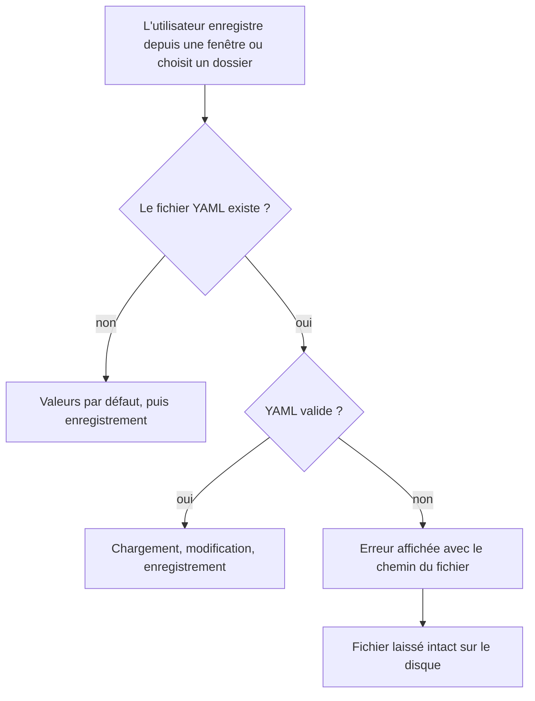
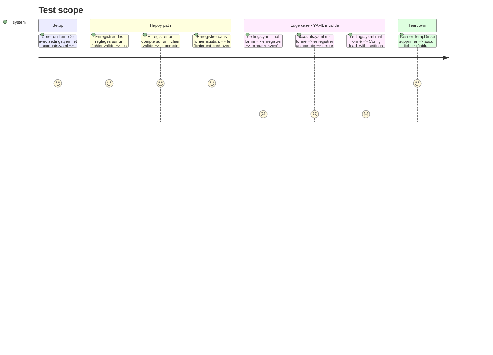

# Instruction: Ne plus écraser la configuration après un échec de chargement

Résout code-quality 🔴 `src/tray/ipc.rs:601` (et ses sites frères) et code-quality 🟡 `src/config.rs:315`.

Le défaut : six endroits chargent un fichier YAML avec `.unwrap_or_default()`, modifient la valeur, puis l'enregistrent. Les chargeurs renvoient `Ok(défaut)` seulement quand le fichier est absent, et `Err` quand le YAML est invalide. Un fichier simplement mal formé est donc remplacé par une configuration vide au premier enregistrement.

## Architecture projection

> Tree of the final files. ✅ create · ✏️ modify · ❌ delete

```txt
.
├── src
│   ├── config.rs            ✏️ propager l'erreur de Settings::load (ligne 315)
│   ├── tray_actions.rs      ✏️ set_export_dir, set_notes_dir : erreur propagée, variante paramétrée par chemin, tests
│   └── tray
│       ├── ipc.rs           ✏️ handle_config_ipc : logique extraite, erreur propagée, tests
│       ├── event_loop.rs    ✏️ handle_open_dest_gui : échec d'ouverture remonté à l'utilisateur
│       └── windows.rs       ✏️ build_config_window, build_dest_gui_window : refuser d'ouvrir sur fichier invalide
└── tests
    └── rust_tests.rs        ✏️ config_tests : cas « settings.yaml invalide »
```

## User Journey



## Test Scope



## Tasks to do

### `1)` Extraire la logique d'enregistrement de `handle_config_ipc`

> Rendre testable ce qui écrit sur le disque, sans changer le protocole IPC.

1. Dans `src/tray/ipc.rs`, extraire deux fonctions privées prenant les chemins en paramètre : une pour l'action `save` (réglages), une pour `save_account` (comptes puis réglages).
2. `handle_config_ipc` ne fait plus que décoder le message, résoudre `config::settings_path()` et `config::accounts_yaml_path()`, puis appeler ces fonctions.
3. Garder les valeurs de retour `(Option<ActionResult>, bool)` identiques.

### `2)` Propager l'erreur de chargement aux cinq sites qui enregistrent

> Aucun `save` ne suit un chargement en échec.

1. Remplacer `.unwrap_or_default()` par `?` avec `.with_context(...)` nommant le fichier, à `ipc.rs:560`, `:601`, `:629`.
2. Faire de même dans `tray_actions.rs` pour `set_export_dir` (`:849`) et `set_notes_dir` (`:884`), en introduisant une variante prenant `settings_path` en paramètre.
3. Dans `save_account`, charger comptes **et** réglages avant le premier `save`, pour ne pas écrire `accounts.yaml` puis échouer sur `settings.yaml`.
4. Message de contexte en minuscules, à l'impératif, sans ponctuation (règle `2-rust-errors.md`).

### `3)` Refuser d'ouvrir une fenêtre d'édition sur un fichier invalide

> Ne pas présenter un formulaire vide qui, enregistré, détruirait le fichier.

1. Dans `build_config_window` (`windows.rs:150`, `:152`), propager l'erreur de chargement au lieu de `unwrap_or_default()`.
2. Dans `build_dest_gui_window` (`windows.rs:297`), faire de même pour `destinations::load_yaml`.
3. Paramètres : l'appelant (`event_loop.rs:265-275`) transmet déjà l'erreur en `ActionResult::Error`, rien à ajouter.
4. Destinations : l'appelant (`event_loop.rs:433-436`) ne fait qu'un `eprintln!`. Lui donner accès au canal de résultats et émettre `ActionResult::Error`, sans quoi le refus d'ouvrir serait silencieux.
5. Laisser tels quels les chargements en lecture seule qui n'enregistrent rien (`ipc.rs:390`, `windows.rs:457`). Celui de `ipc.rs:281` est traité en phase 8, avec les faux états vides de l'analyse.

### `4)` Ne plus ignorer un `settings.yaml` invalide dans `Config::load_with_settings`

> Un export ne tourne pas avec des réglages par défaut à l'insu de l'utilisateur.

1. À `config.rs:315`, propager l'erreur de `Settings::load` avec `?` (elle est déjà de type `ConfigError`).
2. Passer en revue les onze appels de `Config::load` hors tests (`main.rs:351`, dix dans `tray_actions.rs`) : chacun doit afficher l'erreur, pas la remplacer par une liste de comptes vide. Seul `tray_actions.rs:855` avale l'erreur (`unwrap_or(0)`, simple décompte pour le message) ; il devient inatteignable sur un `settings.yaml` invalide, puisque `set_export_dir` échoue désormais avant.
3. Conséquence voulue à vérifier à la main : avec un `settings.yaml` mal formé, les actions du tray qui chargent les comptes échouent avec un message qui nomme le fichier, au lieu de tourner avec les réglages par défaut.

### `5)` Couvrir par des tests

> Chaque cas « YAML invalide » est verrouillé.

1. Tests en ligne (`#[cfg(test)] mod tests`) dans `ipc.rs` et `tray_actions.rs`, puisque les fonctions sont privées au module.
2. Cas `config.rs:315` dans `tests/rust_tests.rs`, module `config_tests`.
3. Nommage `test_<fonction>_<condition>`, `TempDir` partout.
4. Pour chaque cas invalide : vérifier l'erreur **et** que le contenu du fichier est identique octet pour octet.

## Test acceptance criteria

| Task | Acceptance criteria |
| ---- | ------------------- |
| 1    | Les messages IPC `save`, `save_account` et `open_raw` produisent les mêmes retours qu'avant sur des fichiers valides. |
| 2    | Avec un `settings.yaml` ou un `accounts.yaml` mal formé, l'enregistrement renvoie une erreur qui nomme le fichier, et le fichier garde son contenu d'origine. Sans fichier, l'enregistrement le crée. |
| 2    | Un `settings.yaml` invalide pendant `save_account` laisse `accounts.yaml` non modifié. |
| 3    | Ouvrir Paramètres ou Destinations sur un fichier mal formé affiche une erreur au lieu d'un formulaire vide (vérification manuelle, GUI). |
| 4    | `Config::load_with_settings` renvoie une erreur quand `settings.yaml` est mal formé, et renvoie toujours les comptes quand `settings.yaml` est absent. |
| 5    | La suite de tests passe avec et sans la feature `tray`, avec au moins un test par cas invalide. |
