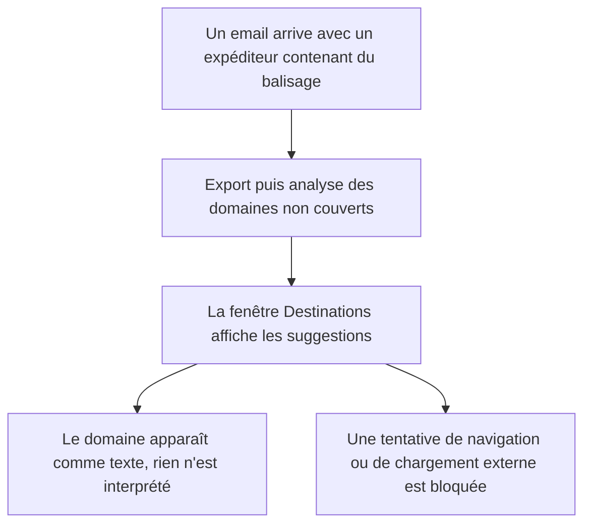
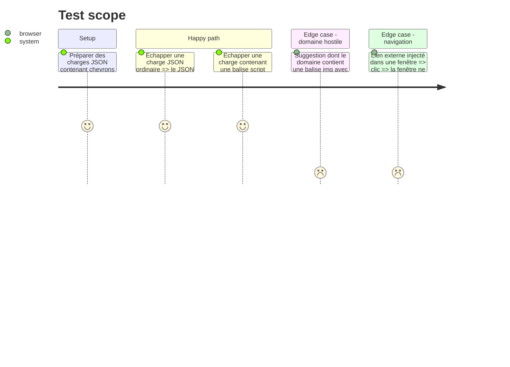

# Instruction: Échapper les données injectées dans les fenêtres

Résout security 🔴 `assets/destinations_window.html:837`, architecture 🟡 `src/tray/windows.rs:158-160`, security 🟢 `src/tray/windows.rs:41-43`.

Le défaut : dans la fenêtre Destinations, `item.domain` et `e.path` sont concaténés dans `innerHTML`. `item.domain` vient de l'en-tête `from` d'emails reçus (`dest_cmd.rs:611-619`), donc d'un tiers. Par ailleurs, trois charges JSON sont insérées dans du HTML sans passer par `escape_json_for_script`, et aucune fenêtre ne restreint ce que la page peut charger ni vers où elle peut naviguer.

## Architecture projection

> Tree of the final files. ✅ create · ✏️ modify · ❌ delete

```txt
.
├── assets
│   ├── destinations_window.html   ✏️ renderSuggestions construit le DOM sans innerHTML ; CSP
│   ├── config_window.html         ✏️ CSP
│   ├── contextual_export.html     ✏️ CSP
│   ├── progress_window.html       ✏️ CSP
│   ├── route_review.html          ✏️ CSP
│   └── update_window.html         ✏️ CSP
└── src
    └── tray
        └── windows.rs             ✏️ escape_json_for_script sur trois charges ; gestionnaire de navigation ; commentaire sur build_progress_window ; tests
```

## User Journey



## Test Scope



## Tasks to do

### `1)` Construire les suggestions sans `innerHTML`

> Aucune donnée venue d'un email n'est interprétée comme du HTML.

1. Dans `renderSuggestions` (`destinations_window.html:821-842`), créer `td`, `select` et `option` avec `document.createElement`.
2. Renseigner les textes par `textContent` et les valeurs par la propriété `value`.
3. Chercher dans le même fichier les autres concaténations de `e.path` ou de données d'état dans `innerHTML` et les traiter de la même façon.

### `2)` Échapper les trois charges JSON restantes

> Toute charge insérée dans une page passe par `escape_json_for_script`.

1. `windows.rs:158-160` : appliquer `escape_json_for_script` à `settings_json` et `accounts_json`.
2. `windows.rs:300-302` : faire de même pour `initial_path_json`.
3. Les trois jetons sont dans un bloc `<script>` (`config_window.html:340-341`, `destinations_window.html:414`) : l'échappement JSON suffit, pas besoin de déplacer l'injection.
4. `progress_window.html:130-131` reçoit `__ACTION_NAME__` et `__WARNING__` dans le corps HTML sans échappement, mais les trois émetteurs (`tray_actions.rs:446`, `:739`, `:946`) n'y passent que des libellés fixes. Aucune donnée externe n'y parvient : ne rien changer au code, et l'écrire en commentaire au-dessus de `build_progress_window` (`windows.rs:108`) pour qu'un futur appelant n'y injecte pas un nom de compte ou de dossier.

### `3)` Restreindre chargement et navigation

> Une page de l'application ne charge rien d'extérieur et ne navigue nulle part.

1. Ajouter à chaque gabarit une balise `<meta http-equiv="Content-Security-Policy">` : `default-src 'none'`, scripts et styles en ligne autorisés, images `data:`. Les six gabarits ne chargent aujourd'hui aucune ressource externe, donc rien d'autre à autoriser.
2. Portée à garder en tête : les pages reposent sur des scripts et des `onclick` en ligne, la politique doit donc les autoriser. Elle empêche une page de charger ou d'envoyer quoi que ce soit sur le réseau ; elle n'empêche pas l'exécution d'un script injecté. C'est la tâche 1 qui ferme l'injection.
3. Avant d'écrire le gestionnaire de navigation, lire dans la documentation de wry 0.44 son nom et sa signature exacts, puis journaliser l'URL du chargement initial de `with_html` sur chaque plateforme : elle n'a pas été relevée pendant la planification.
4. Dans `attach_webview` (`windows.rs:41-43`), poser le gestionnaire : il accepte cette URL initiale et refuse le reste.
5. Ouvrir les six fenêtres et vérifier qu'aucune ne casse (scripts d'initialisation, gestionnaires `onclick` en ligne, styles en ligne).
6. Repli : si le gestionnaire bloque un chargement légitime sur une plateforme, ou si la politique empêche le script d'initialisation de `build_route_window`, livrer la phase sans l'élément fautif et le signaler. Ce sont des durcissements de niveau mineur ; les tâches 1 et 2 portent le défaut critique.

### `4)` Tests

> L'échappement est verrouillé par des assertions inclusives et exclusives.

1. Compléter le module de tests de `windows.rs` (`:631`) : la sortie se décode vers le JSON d'origine, et ne contient ni `<` ni `>` ni `&`.
2. Cas dédié : chaîne contenant `</script>`.

## Test acceptance criteria

| Task | Acceptance criteria |
| ---- | ------------------- |
| 1    | Un domaine suggéré contenant du balisage s'affiche tel quel dans le tableau ; aucun élément supplémentaire n'apparaît dans le DOM (vérification manuelle, GUI). |
| 1    | Le choix d'une destination dans la liste déroulante et la confirmation des suggestions fonctionnent comme avant. |
| 2    | Un nom de compte ou un chemin contenant `</script>` n'interrompt pas le script de la fenêtre Paramètres ni de la fenêtre Destinations. |
| 2    | Le commentaire de `build_progress_window` dit que ses deux textes sont insérés sans échappement et doivent rester des libellés fixes. |
| 3    | Les six fenêtres s'ouvrent et répondent ; une requête réseau ou une navigation déclenchée depuis la page n'aboutit pas. Tout élément écarté par le repli est nommé avec sa raison. |
| 4    | Les tests d'échappement passent avec la feature `tray`. |
