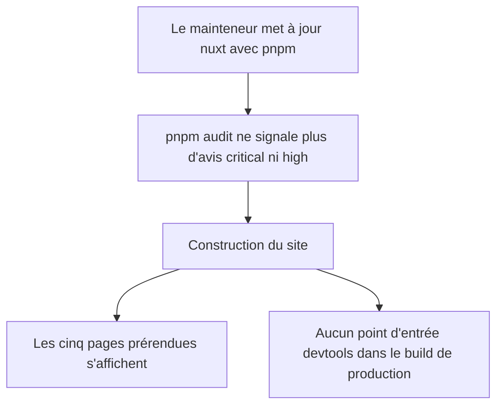
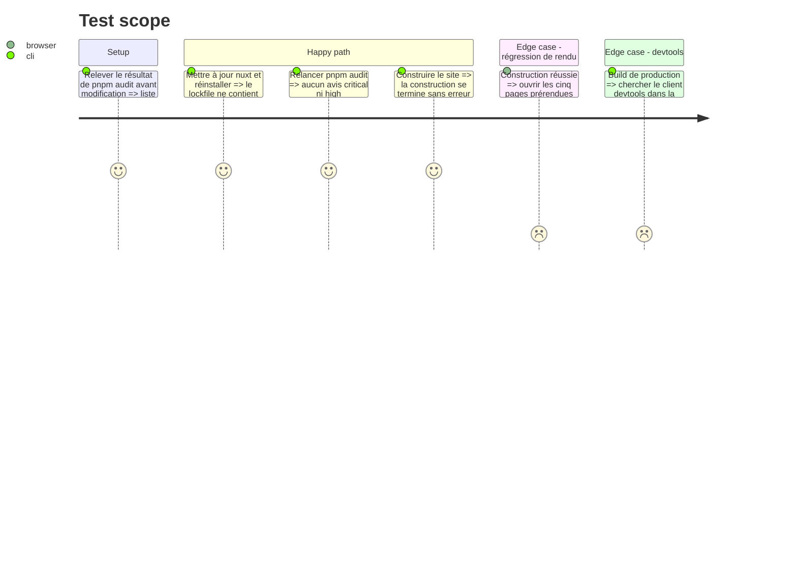

# Instruction: Mettre à jour Nuxt et couper les devtools en production

Résout dependencies 🔴 `site/package.json:14` et dependencies 🔴 `site/pnpm-lock.yaml:430`, ainsi que les lignes dependencies 🟡 sur les dépendances transitives du site.

Cette phase travaille dans `../site/`, un dépôt git distinct de `app/`, actuellement sur `main`. Le site est servi par un serveur Nitro en production (`ssr: true`, `nuxt build`), donc les avis qui touchent le serveur le concernent. Réserve héritée de l'audit : l'exploitabilité réelle de chaque avis sur ce site n'a pas été démontrée, seule la présence des versions vulnérables l'est.

## Architecture projection

> Tree of the final files. ✅ create · ✏️ modify · ❌ delete

```txt
../site
├── package.json      ✏️ nuxt relevé à une version corrigée
├── pnpm-lock.yaml    ✏️ régénéré par pnpm
└── nuxt.config.ts    ✏️ devtools désactivés hors développement
```

## User Journey



## Test Scope



## Tasks to do

### `1)` Relever l'état de départ

> Savoir exactement quels avis doivent disparaître.

1. Depuis `../site/`, lancer `pnpm audit` et noter les avis et la version corrigée annoncée pour `nuxt` (l'audit indiquait `>=4.5.1`).
2. Créer une branche dédiée avant toute modification.

### `2)` Mettre à jour Nuxt

> Sortir des versions visées par les avis.

1. Relever `nuxt` dans `package.json` à la version corrigée la plus récente de la ligne 4.x.
2. Réinstaller avec pnpm pour régénérer `pnpm-lock.yaml`.
3. Vérifier que `@nuxt/devtools` n'est plus résolu dans la version signalée (`3.2.2`).
4. Ne pas toucher à `vue-router` (passage en version majeure, hors périmètre).

### `3)` Conditionner les devtools

> Les devtools ne sont actifs qu'en développement.

1. Avant de modifier, construire le site tel quel et chercher le client devtools dans la sortie. Ce point n'a pas été vérifié pendant la planification : il est possible que Nuxt n'active déjà les devtools qu'en développement.
2. Dans `nuxt.config.ts:4`, remplacer `enabled: true` par une condition sur l'environnement de développement.
3. Si la tâche 1 montre que le build de production ne contenait déjà rien, le dire : la modification est alors une clarification d'intention, pas une correction.

### `4)` Vérifier

> La mise à jour ne casse ni la construction ni le rendu.

1. Relancer `pnpm audit` et comparer au relevé de la tâche 1.
2. Construire le site et le prévisualiser.
3. Parcourir `/`, `/inbox-zero`, `/trier`, `/about`, `/telecharger`.
4. Lire les notes de version de Nuxt entre 4.3.1 et la version cible pour repérer un changement cassant ; le signaler s'il en existe un.

## Test acceptance criteria

| Task | Acceptance criteria |
| ---- | ------------------- |
| 2    | `pnpm audit` ne rapporte plus d'avis critical ni high. Tout avis restant est listé avec sa raison (pas de correctif publié, ou dépendance hors de portée). |
| 3    | Le build de production ne contient pas le client devtools ; en développement, les devtools restent disponibles. |
| 4    | Le site se construit sans erreur et les cinq pages prérendues s'affichent avec leur contenu et leurs styles. |
