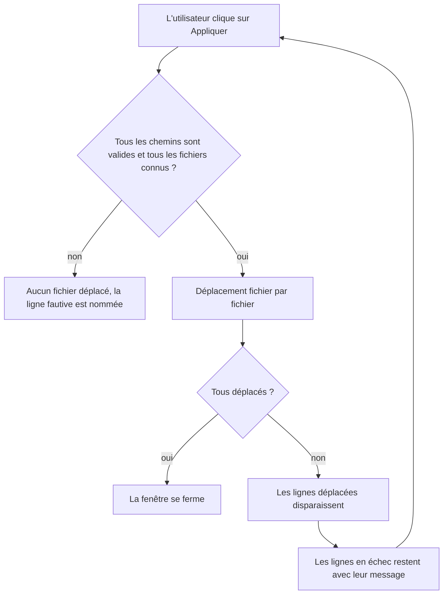
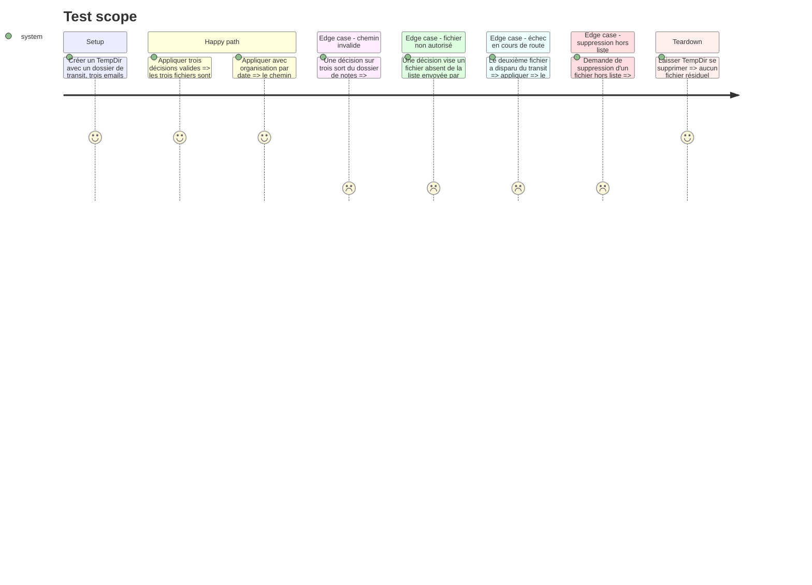

# Instruction: Rendre « Appliquer » véridique dans la revue de routage

Résout ui 🔴 `assets/route_review.html:822-844`, architecture 🟡 `src/tray/ipc.rs:370-438`, security 🟡 `src/tray/ipc.rs:395` et `:445-446`, et donne une surface testable pour tests 🔴 `src/tray/ipc.rs:370`.

Le défaut : `apply_route_decisions` déplace les emails un par un et s'arrête à la première erreur (`?` dans la boucle). Les fichiers déjà déplacés le restent, la fenêtre reste ouverte avec toutes ses lignes, et un second clic échoue sur les fichiers qui n'existent plus. De plus, la fonction déplace ou supprime n'importe quel chemin reçu de la webview, et elle recopie le corps de `route::apply_decision` au lieu de l'appeler.

## Architecture projection

> Tree of the final files. ✅ create · ✏️ modify · ❌ delete

```txt
.
├── assets
│   └── route_review.html    ✏️ retire les lignes appliquées, affiche les échecs, désactive le bouton pendant l'envoi
└── src
    └── tray
        ├── ipc.rs           ✏️ validation préalable, appel de route::apply_decision, compte rendu par fichier, tests
        └── windows.rs       ✏️ build_route_window : liste des fichiers autorisés, renvoi du compte rendu à la page
```

## User Journey



## Test Scope



## Tasks to do

### `1)` Séparer décodage, validation et déplacement

> Une fonction pure, testable avec `TempDir`, qui rend compte fichier par fichier.

1. Dans `ipc.rs`, extraire de `apply_route_decisions` une fonction prenant les décisions décodées, `notes_dir`, la liste des fichiers autorisés et `organize_by_date`.
2. Lui faire renvoyer un compte rendu : fichiers déplacés, et échecs avec leur message.
3. Retirer les paramètres inutilisés `_window_id` et `_proxy`.
4. Remplacer le triplet `join_safe_segments` + `create_dir_all` + `move_email` par un appel à `route::apply_decision` (`route.rs:1114`).

### `2)` Valider tout avant le premier déplacement

> Un chemin invalide ne laisse pas un lot à moitié appliqué.

1. Première passe sans effet de bord : fichier présent dans la liste autorisée, destination non vide, `join_safe_segments` accepte le chemin final (suffixe année/mois inclus).
2. Si une ligne échoue, renvoyer l'erreur qui la nomme, sans rien déplacer.
3. Seconde passe : déplacer ; un échec n'interrompt pas les suivantes, il est consigné.
4. L'existence du fichier source n'est pas vérifiée en première passe : un fichier disparu entre l'affichage et le clic ne doit pas bloquer tout le lot. Il est consigné comme « introuvable » en seconde passe, et sa ligne est retirée de la fenêtre puisqu'il n'y a plus rien à router.

### `3)` Borner les fichiers à ceux envoyés par l'hôte

> La webview ne peut ni déplacer ni supprimer un chemin qu'on ne lui a pas confié.

1. Dans `build_route_window`, conserver l'ensemble des chemins de `decisions`, sous la forme exacte de la chaîne envoyée à la page, pour que la comparaison ne dépende pas d'une normalisation de chemin.
2. Le capturer dans le gestionnaire IPC derrière une mutabilité intérieure (`RefCell` ou `Mutex`), le gestionnaire étant une fermeture `Fn`.
3. Le passer à la fonction d'application et à `delete_staged_emails`, qui refuse tout fichier absent de l'ensemble.
4. Retirer de l'ensemble les fichiers déplacés, supprimés ou introuvables.

### `4)` Rendre compte dans la fenêtre

> L'écran reflète l'état réel du disque après chaque clic.

1. Côté hôte (`windows.rs:612-623`) : fermer seulement si tout est déplacé ; sinon envoyer à la page la liste des fichiers déplacés puis le message d'erreur, par `AppCommand::EvalScript` avec `escape_json_for_script`.
2. Côté page : retirer les lignes déplacées (même mécanisme que `route_review_deleted`), afficher les échecs dans le bandeau.
3. Désactiver « Appliquer » entre l'envoi et la réponse pour empêcher un double clic.

### `5)` Tests

> Les chemins destructeurs de la revue de routage sont couverts.

1. Tests en ligne dans `ipc.rs` sur la fonction extraite et sur `delete_staged_emails`.
2. Un test par section du périmètre ci-dessus, avec assertions inclusives (fichier présent à destination) et exclusives (fichier absent du transit, ou toujours présent en cas de refus).

## Test acceptance criteria

| Task | Acceptance criteria |
| ---- | ------------------- |
| 1    | Un lot de décisions valides aboutit au même placement de fichiers et de pièces jointes qu'avant. |
| 2    | Un lot contenant une destination invalide ne déplace aucun fichier, et le message nomme la ligne en cause. |
| 3    | Une décision ou une suppression visant un chemin que l'hôte n'a pas envoyé est refusée, et le fichier visé reste en place. |
| 2    | Un fichier disparu du transit n'empêche pas le déplacement des autres ; il est signalé une fois et sa ligne disparaît. |
| 4    | Après un échec partiel, la fenêtre ne montre plus que les emails encore à router ; un nouveau clic ne signale pas de fichier introuvable pour ceux déjà traités (vérification manuelle, GUI). |
| 4    | Quand tout est déplacé, la fenêtre se ferme. |
| 5    | Les tests passent avec la feature `tray`. |
