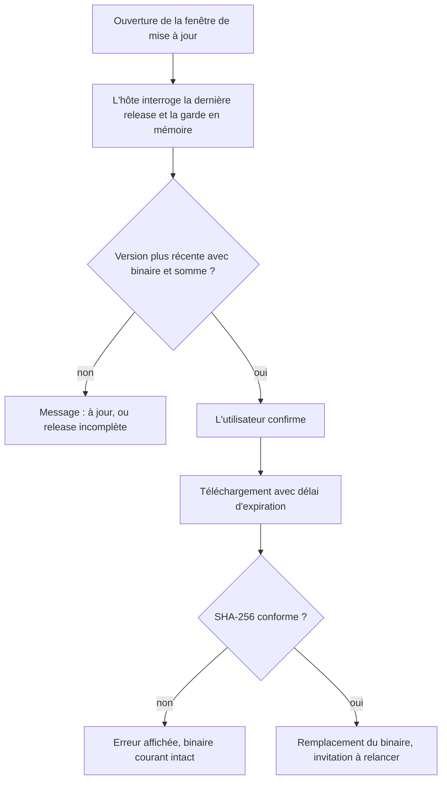
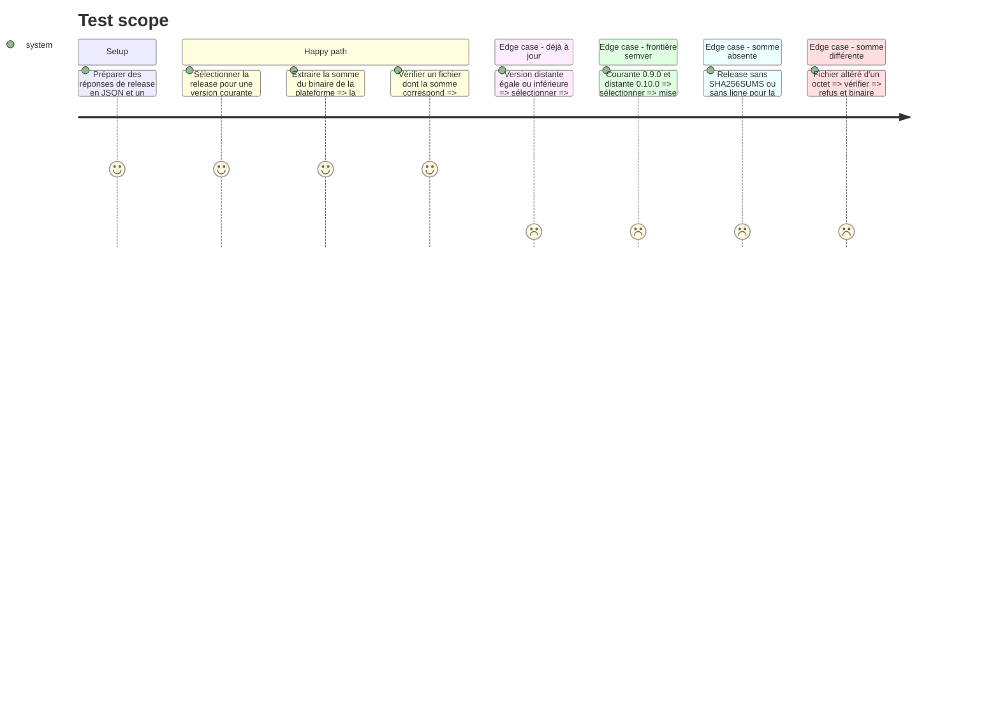

# Instruction: Sécuriser la mise à jour automatique

Résout security 🟡 `src/updater.rs:81` et `:95`, security 🟡 `src/tray/windows.rs:215-219`, tests 🔴 `src/updater.rs:78`. Prépare security 🟡 `.github/workflows/release.yml:7-8` en publiant les sommes ; le resserrement des permissions du workflow est en phase 6.

Le défaut : `download_and_apply` télécharge un exécutable et remplace le binaire courant sans vérifier son intégrité, sans délai d'expiration, et à partir d'une URL que la webview lui fournit. Ni `check_update` ni `download_and_apply` ne sont testés.

Limite assumée (voir les décisions du plan) : la somme SHA-256 vient de la même release que le binaire. Elle détecte un téléchargement altéré ou tronqué, pas une release publiée par un compte compromis.

## Architecture projection

> Tree of the final files. ✅ create · ✏️ modify · ❌ delete

```txt
.
├── Cargo.toml                   ✏️ sha2, optionnel, rattaché à la feature tray
├── .github
│   └── workflows
│       └── release.yml          ✏️ génère et publie SHA256SUMS avec les binaires
├── assets
│   └── update_window.html       ✏️ n'envoie plus asset_url, affiche un échec de vérification
└── src
    ├── updater.rs               ✏️ sélection de release pure, somme attendue, vérification, délai, tests
    └── tray
        └── windows.rs           ✏️ build_update_window : la release reste côté hôte
```

## User Journey



## Test Scope



## Tasks to do

### `1)` Publier les sommes dans la release

> Chaque release porte un fichier `SHA256SUMS` couvrant ses binaires.

1. Dans le job `publish` de `release.yml`, après le téléchargement des artefacts dans `release-assets/`, générer `SHA256SUMS` depuis ce dossier (format `sha256sum` : somme, deux espaces, nom de fichier sans chemin).
2. Le fichier est écrit dans `release-assets/`, donc déjà couvert par le motif `release-assets/*` de l'étape de publication.
3. Compatibilité : les versions déjà installées ignorent ce fichier et continuent de se mettre à jour. La première version qui embarque la vérification exige que la release suivante porte les sommes : la modification du workflow doit donc être livrée au plus tard avec elle.

### `2)` Isoler la logique pure de `updater.rs`

> Tout ce qui ne touche pas au réseau devient testable.

1. Extraire de `check_update` une fonction qui reçoit la release décodée et la version courante, et renvoie la release retenue ou `None`.
2. Ajouter à `Release` l'URL de `SHA256SUMS` ; erreur explicite si l'asset manque.
3. Ajouter une fonction qui extrait d'un contenu `SHA256SUMS` la somme d'un nom de fichier donné.
4. Ajouter une fonction qui calcule le SHA-256 d'un fichier et le compare à la somme attendue, sans tenir compte de la casse.

### `3)` Vérifier avant de remplacer

> Aucun binaire non vérifié n'atteint `self_replace`.

1. `download_and_apply` reçoit la `Release` et non plus une URL nue.
2. Ajouter un délai d'expiration au téléchargement du binaire et à celui des sommes.
3. Télécharger les sommes, écrire le binaire dans le fichier temporaire, vérifier, puis seulement appeler `tmp.keep()` et `self_replace` (règle `03-tempfile-keep-before-self-replace.md`).
4. En cas d'échec de vérification, le fichier temporaire est supprimé et l'erreur nomme les deux sommes.

### `4)` Garder la release côté hôte

> La webview ne choisit plus ce qui est téléchargé.

1. Dans `build_update_window`, stocker le résultat de `check_update` dans un état partagé entre le fil de vérification et le gestionnaire IPC.
2. Sur `update-confirm`, ignorer tout champ `asset_url` et utiliser la release stockée ; ne rien faire s'il n'y en a pas.
3. Dans `update_window.html`, ne plus envoyer `asset_url`.
4. Afficher l'échec de vérification comme une erreur dans la fenêtre, pas comme un simple message de progression.

### `5)` Tests

> `check_update` et la vérification d'intégrité sont couverts hors réseau.

1. Tests en ligne dans `updater.rs`, un par section du périmètre ci-dessus.
2. Le téléchargement réel et `self_replace` restent en vérification manuelle (service externe, pas de mock).

## Test acceptance criteria

| Task | Acceptance criteria |
| ---- | ------------------- |
| 1    | Une release produite par le workflow contient `SHA256SUMS`, avec une ligne par binaire publié. |
| 2    | Pour une version courante `0.9.0` et une release `0.10.0`, une mise à jour est proposée ; pour une version égale ou supérieure, aucune. |
| 2    | Une release sans `SHA256SUMS`, ou sans ligne pour le binaire de la plateforme, produit une erreur lisible et aucune proposition de mise à jour. |
| 3    | Un binaire dont la somme ne correspond pas n'est pas installé ; l'exécutable courant est inchangé. |
| 3    | Un serveur qui ne répond pas fait échouer le téléchargement après le délai, au lieu de bloquer indéfiniment. |
| 4    | Un message `update-confirm` portant une URL arbitraire déclenche le téléchargement de l'asset de la release vérifiée par l'hôte, pas de cette URL. |
| 5    | Les tests passent avec la feature `tray`. Une mise à jour réelle de bout en bout est vérifiée à la main sur une release de test. |
