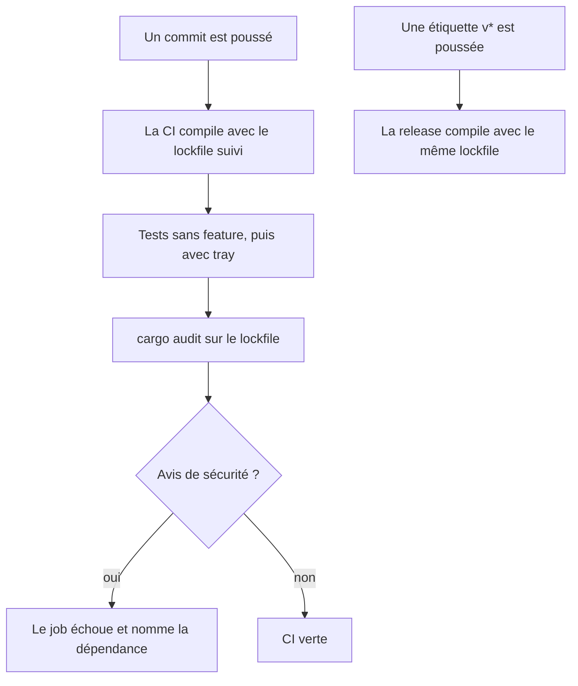
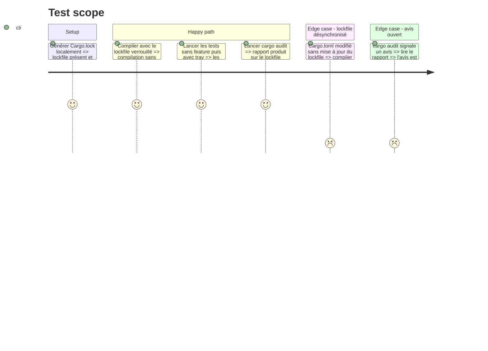

# Instruction: Builds reproductibles et CI plus stricte

Résout dependencies 🟡 `.gitignore:5`, dependencies 🟡 `.github/workflows/release.yml:42` et `:64`, security 🟡 `.github/workflows/release.yml:7-8`, security 🟢 `.github/workflows/ci.yml:1-14`, tests 🟡 `.github/workflows/ci.yml:42`, et lève la réserve « CVE Rust non scannées » de l'audit.

Le défaut : `Cargo.lock` est ignoré par git, donc chaque build de release résout ses dépendances au moment de la compilation. Les actions GitHub sont référencées par étiquette mutable, les workflows n'ont pas de permissions minimales, et la CI ne teste que la variante `--features tray`.

## Architecture projection

> Tree of the final files. ✅ create · ✏️ modify · ❌ delete

```txt
.
├── .gitignore                 ✏️ retirer les deux lignes qui ignorent Cargo.lock
├── Cargo.lock                 ✏️ désormais suivi par git (le fichier existe déjà localement ou est régénéré)
├── rust-toolchain.toml        ✅ canal Rust versionné
├── Cargo.toml                 ✏️ rust-version
└── .github
    └── workflows
        ├── ci.yml             ✏️ permissions, actions épinglées, --locked, tests sans feature, cargo audit, pytest
        └── release.yml        ✏️ permissions par job, actions épinglées, --locked
```

## User Journey



## Test Scope



## Tasks to do

### `1)` Suivre `Cargo.lock`

> Deux builds du même commit résolvent les mêmes dépendances.

1. Retirer de `.gitignore` les lignes `Cargo.lock` et `app/Cargo.lock`.
2. Générer ou rafraîchir `Cargo.lock`, vérifier qu'il compile avec et sans `tray`.
3. Changer la clé de cache des deux workflows pour `hashFiles('Cargo.lock')`.
4. Ajouter `--locked` aux commandes `cargo` de `ci.yml` et de `release.yml`.

### `2)` Fixer la toolchain

> La version de Rust ne change pas à l'insu du projet.

1. Créer `rust-toolchain.toml` avec un canal versionné (poste local relevé par l'audit : `rustc 1.93.0`) et le composant `clippy`, que la CI utilise.
2. Ajouter `rust-version` dans `Cargo.toml`, à la même valeur que le canal. La version minimale réellement supportée n'a pas été recherchée : ne pas annoncer une valeur plus basse sans l'avoir compilée.
3. Vérifier que l'étape `dtolnay/rust-toolchain` des deux workflows installe bien la version du fichier et non `stable` ; sinon lui passer la version explicitement.

### `3)` Durcir les workflows

> Jeton minimal et actions non modifiables après coup.

1. `ci.yml` : `permissions: contents: read` en tête.
2. `release.yml` : `contents: read` par défaut, `contents: write` seulement sur le job `publish`.
3. Épingler chaque action par SHA de commit, avec la version en commentaire. Relever les SHA sur les dépôts des actions, ne pas les deviner.

### `4)` Élargir la CI

> La variante CLI seule et les avis de sécurité sont contrôlés à chaque commit.

1. Ajouter `cargo test --all-targets` sans feature au job `portable`.
2. Ajouter un job `cargo audit` sur `Cargo.lock`.
3. Traiter le premier rapport : corriger ce qui a un correctif, consigner le reste.
4. Ajouter un job pytest sur `tools/` seulement après avoir identifié pourquoi la collecte dépassait 140 s pendant l'audit ; si la cause n'est pas trouvée, le signaler et laisser ce job hors de la phase.

## Test acceptance criteria

| Task | Acceptance criteria |
| ---- | ------------------- |
| 1    | `Cargo.lock` apparaît dans les fichiers suivis par git ; une compilation verrouillée réussit sans le modifier. |
| 1    | Modifier une dépendance dans `Cargo.toml` sans régénérer le lockfile fait échouer la compilation verrouillée. |
| 2    | La version de Rust utilisée en CI est celle du fichier de toolchain. |
| 3    | Aucune action n'est référencée par étiquette ; le job de build de la release n'a pas le droit d'écriture sur le dépôt. |
| 4    | La CI exécute les tests sans feature et avec `tray`, et un job d'audit de sécurité dont le premier résultat est traité ou consigné. |
| 4    | Le sort du job pytest est explicite : ajouté et vert, ou écarté avec la cause du blocage. |
