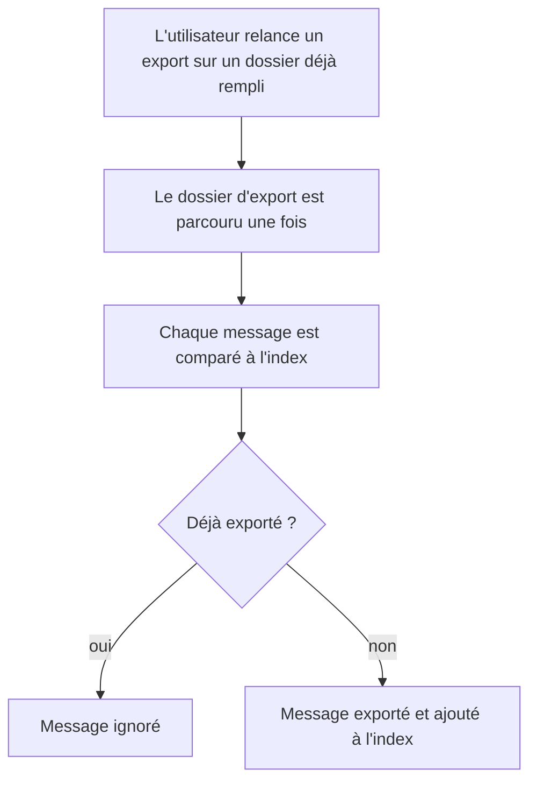
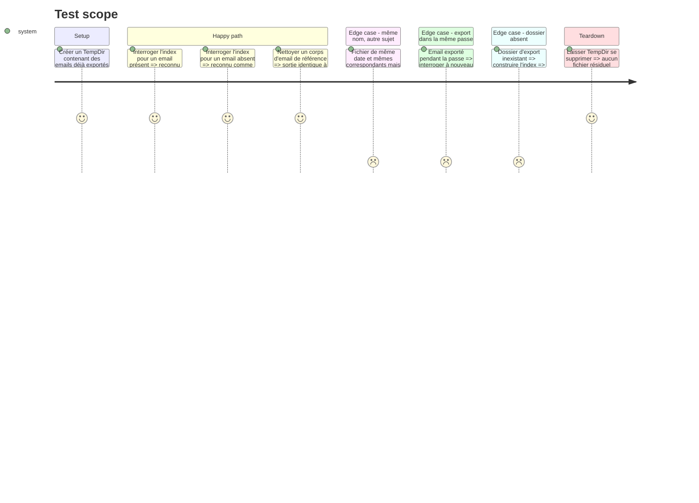

# Instruction: Réduire les deux coûts d'export dominants

Résout performance 🟡 `src/email_export.rs:231` et code-quality 🟡 `src/cleaner.rs:129` (avec ses sites frères).

Le défaut : `email_already_exported` parcourt tout le dossier d'export, compile un motif glob et lit des fichiers, **pour chaque message** (`email_export.rs:283`, `:365`). Par ailleurs, douze expressions régulières sont compilées à chaque appel au lieu d'une fois.

Réserve héritée de l'audit : aucun profilage n'a été fait. Le gain est attendu par raisonnement sur la complexité, il n'est pas mesuré. La tâche 1 pose donc une mesure avant de modifier.

## Architecture projection

> Tree of the final files. ✅ create · ✏️ modify · ❌ delete

```txt
.
└── src
    ├── email_export.rs    ✏️ index des fichiers déjà exportés, construit une fois par dossier
    ├── cleaner.rs         ✏️ six regex en static LazyLock (lignes 129, 181, 186, 403, 473, 641)
    ├── utils.rs           ✏️ quatre regex en static LazyLock (lignes 104, 112, 119, 432)
    └── thunderbird.rs     ✏️ deux regex en static LazyLock (lignes 186, 249)
```

Les tests de l'index sont écrits en ligne dans `email_export.rs`, à côté du test existant.

## User Journey



## Test Scope



## Tasks to do

### `1)` Mesurer avant de modifier

> Disposer d'un chiffre de référence, faute de profilage dans l'audit.

1. Chronométrer un second export (tout déjà exporté) sur un dossier de quelques centaines de messages.
2. Noter la durée ; elle sert de point de comparaison en tâche 4.

### `2)` Indexer les fichiers déjà exportés

> Un seul parcours du dossier par export, au lieu d'un par message.

1. Introduire une structure d'index construite une fois par dossier d'export, à partir du même parcours `WalkDir` sans suivi de liens symboliques.
2. L'index ne retient que les **noms et chemins** des fichiers `.md`. Il ne lit aucun contenu à la construction : lire tous les fichiers d'avance coûterait plus cher que le code actuel dès que peu de messages correspondent.
3. Conserver exactement le critère actuel : le nom de fichier correspond au motif `email_<date>_<expéditeur>*to_<destinataire>*.md`, **et** le contenu contient l'empreinte du sujet. Le motif est appliqué en mémoire sur les noms indexés ; le contenu n'est lu que pour les noms qui correspondent, comme aujourd'hui.
4. Remplacer les deux appels (`:283`, `:365`) par une interrogation de l'index.
5. Ajouter à l'index chaque email exporté pendant la passe.
6. Faire de `email_already_exported` une enveloppe qui construit l'index puis l'interroge : son test existant (`:1743`) continue de vérifier le même comportement, sans double implémentation du critère.

### `3)` Passer les regex en `static LazyLock`

> Chaque expression est compilée une fois par processus.

1. Appliquer la règle `02-regex-static-lazylock.md` aux douze sites listés dans la projection : un `static` par regex, au niveau du module, près de son consommateur.
2. Utiliser `.expect("static regex")` ; supprimer au passage les `.unwrap()` de `utils.rs` et `thunderbird.rs`.
3. `thunderbird.rs:186` propage aujourd'hui l'erreur avec `?` : la regex étant constante, la passer aussi en `expect`.
4. Ne pas modifier le texte des motifs.

### `4)` Vérifier

> Même résultat, moins de travail.

1. Ajouter des tests sur l'index, un par section du périmètre ci-dessus.
2. Faire tourner la suite existante : les tests du nettoyeur servent de garde-fou pour la tâche 3.
3. Refaire la mesure de la tâche 1 et rapporter les deux chiffres.

## Test acceptance criteria

| Task | Acceptance criteria |
| ---- | ------------------- |
| 2    | Un second export sur un dossier déjà rempli n'écrit aucun nouveau fichier et ignore les mêmes messages qu'avant. |
| 2    | Un message de mêmes date et correspondants qu'un fichier existant, mais de sujet différent, est exporté. |
| 2    | Un lien symbolique dans le dossier d'export n'est pas suivi. |
| 3    | Le Markdown produit pour les emails de test est identique à celui d'avant la modification. |
| 4    | Les deux durées (avant, après) sont rapportées ; si le gain est nul ou négatif, c'est dit tel quel. |
