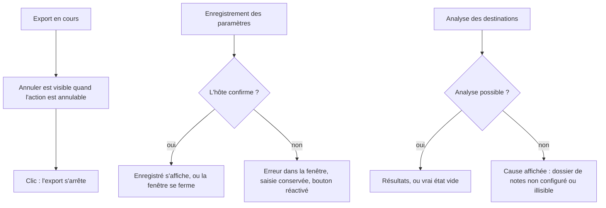
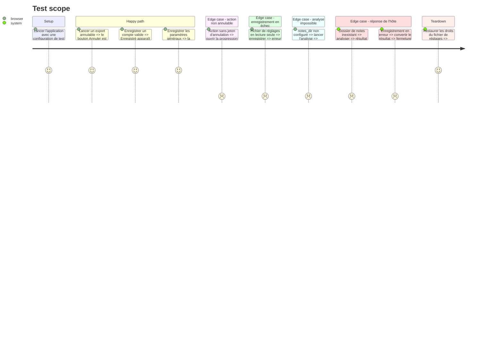

# Instruction: Fiabiliser les retours des fenêtres

Résout ui 🟡 `assets/progress_window.html:138`, ui 🟡 `assets/config_window.html:778-780`, ui 🟡 `assets/config_window.html:560`, ui 🟡 `src/tray/ipc.rs:282-306`, code-quality 🟡 `src/tray/event_loop.rs:294`.

Quatre défauts de même nature, où l'écran affirme autre chose que ce qui s'est passé :

| Fenêtre      | Ce que l'écran dit                         | Ce qui se passe réellement                                                                    |
| ------------ | ------------------------------------------ | --------------------------------------------------------------------------------------------- |
| Progression  | Affiche le mot `true` ou `false`           | `__HAS_CANCEL__` est remplacé par du texte : le bouton « Annuler » n'existe jamais.            |
| Paramètres   | « Enregistré ✓ » dès le clic               | Le message s'affiche avant toute réponse de l'hôte, même si l'enregistrement échoue.           |
| Paramètres   | La fenêtre se ferme                        | Elle se ferme aussi sur erreur (`should_close` vrai), et les valeurs saisies sont perdues.     |
| Destinations | « Aucun nouveau domaine détecté. »         | L'analyse a échoué ou `notes_dir` n'est pas configuré ; la liste vide est un faux résultat.    |

À faire après la phase 1, qui retouche aussi `handle_config_ipc`.

## Architecture projection

> Tree of the final files. ✅ create · ✏️ modify · ❌ delete

```txt
.
├── assets
│   ├── progress_window.html       ✏️ vrai bouton Annuler, largeur du corps alignée sur la fenêtre
│   ├── config_window.html         ✏️ confirmation et erreur pilotées par l'hôte
│   └── destinations_window.html   ✏️ affiche la cause d'une analyse impossible
└── src
    └── tray
        ├── windows.rs             ✏️ injection du bouton, renvoi du résultat d'enregistrement à la page
        ├── ipc.rs                 ✏️ should_close faux sur erreur, handle_scan renvoie une erreur distincte
        └── event_loop.rs          ✏️ échecs d'ouverture de fenêtre remontés à l'utilisateur
```

## User Journey



## Test Scope



## Wireframe

Fenêtre de progression, 480 × 220. La structure existe déjà ; seul l'élément (4) est rétabli.

```
┌──────────────────────────────────────────────┐
│ (1) Statut : étape en cours                   │
│ (2) ████████████░░░░░░░░░░  barre             │
│ (3) Dernier message · résumé                  │
│                                               │
│            (4) [ Annuler ]   (5) [ Fermer ]   │
└──────────────────────────────────────────────┘
```

1. Statut : nom de l'étape et avertissement éventuel.
2. Barre : avancement de l'action.
3. Détail : dernier message reçu, puis résumé en fin d'action.
4. Annuler : présent seulement quand l'action porte un jeton d'annulation ; masqué à la fin.
5. Fermer : ferme la fenêtre.

## Tasks to do

### `1)` Rétablir le bouton « Annuler »

> Une action annulable peut être annulée depuis sa fenêtre.

1. Dans `build_progress_window` (`windows.rs:119-122`), remplacer `__HAS_CANCEL__` par le balisage du bouton (`id="cancel"`, envoi du message `cancel`) ou par une chaîne vide.
2. Vérifier que les styles `#cancel` (`progress_window.html:101-112`) et le masquage en fin d'action (`:165`, `:177`) s'appliquent.
3. Aligner la largeur du corps (`progress_window.html:15`, 500 px) sur la fenêtre de 480 px.

### `2)` Confirmer l'enregistrement depuis l'hôte

> « Enregistré » ne s'affiche que si le fichier a été écrit.

1. Dans `ipc.rs`, `handle_config_ipc` renvoie `should_close` faux quand `save` échoue.
2. Dans `build_config_window`, renvoyer le résultat à la page par `AppCommand::EvalScript`, message passé par `escape_json_for_script`.
3. Dans `config_window.html`, retirer l'affichage immédiat (`:778-780`) ; l'afficher à la réception de la confirmation.
4. Sur erreur : message dans la fenêtre, bouton réactivé (`:560`), champs inchangés.
5. Ne mettre à jour `window.__SETTINGS_DATA__` qu'après confirmation.

### `3)` Distinguer « analyse impossible » de « aucun résultat »

> Un état vide n'est affiché que s'il est vrai.

1. Extraire de `handle_scan` (`ipc.rs:279-307`) une fonction qui reçoit `notes_dir` en paramètre : `handle_scan` lit aujourd'hui le chemin global des réglages, ce qui la rend intestable avec `TempDir`.
2. Cette fonction renvoie une erreur avec la cause dans trois cas : `notes_dir` non configuré, dossier configuré mais inexistant, échec de `scan_notes`. Le deuxième cas doit être testé par la fonction elle-même : `scan_notes` (`dest_cmd.rs:527`) renvoie un résultat vide, sans erreur, quand le dossier n'existe pas. Ne pas modifier `scan_notes`, qui a d'autres appelants.
3. `handle_scan` convertit l'erreur en `DestGuiIpcResult::Error`, variante déjà existante (`ipc.rs:28`).
4. Propager aussi un `settings.yaml` illisible au lieu de `unwrap_or_default()` (`ipc.rs:281`).
5. Dans `destinations_window.html` (`:755`, `:825`), afficher la cause dans la zone de statut de l'analyse.

### `4)` Remonter les échecs d'ouverture de fenêtre

> Une fenêtre qui ne s'ouvre pas ne laisse pas l'utilisateur sans explication.

1. Deux sites restent après la phase 1 : la fenêtre de mise à jour (`event_loop.rs:294`) et la revue de routage (`:406`). Celui des destinations (`:435`) est traité en phase 1.
2. Leur donner accès au canal de résultats et émettre `ActionResult::Error`, sur le modèle de `handle_open_config` (`:265-275`).
3. Avec la phase 1, quatre fonctions d'ouverture partagent alors le même enchaînement (réserver, construire, enregistrer ou libérer et signaler) : extraire la partie commune (règle `dry-refactor.md`).

### `5)` Tests

> Ce qui est testable hors GUI l'est ; le reste est vérifié à la main.

1. Tests en ligne sur la fonction extraite de `handle_scan`, un par cas : `notes_dir` non configuré produit une erreur ; dossier inexistant produit une erreur ; dossier existant et vide produit une liste vide sans erreur.
2. Fermeture sur erreur : `handle_config_ipc` lit des chemins globaux et ne se teste pas directement. Isoler la conversion « résultat d'enregistrement → fermer ou non » dans une fonction sans accès disque, et tester qu'une erreur ne demande pas la fermeture. L'enregistrement lui-même est déjà couvert par les fonctions paramétrées de la phase 1.
3. Parcours manuel des cas « browser » du périmètre ci-dessus, sur Windows au minimum.

## Test acceptance criteria

| Task | Acceptance criteria |
| ---- | ------------------- |
| 1    | Pendant un export annulable, un bouton « Annuler » est visible et interrompt l'export ; aucune fenêtre de progression n'affiche le texte `true` ou `false`. |
| 1    | La fenêtre de progression n'a pas de défilement horizontal. |
| 2    | Avec un fichier de réglages non inscriptible, la fenêtre Paramètres reste ouverte, affiche l'erreur, conserve la saisie et permet de réessayer. |
| 2    | « Enregistré ✓ » n'apparaît qu'après un enregistrement réussi. |
| 3    | Sans dossier de notes configuré, ou avec un dossier configuré qui n'existe plus, l'analyse des destinations affiche la cause et non « Aucun nouveau domaine détecté. ». |
| 4    | Un échec d'ouverture de la fenêtre de mise à jour ou de la revue de routage produit un message visible par l'utilisateur. |
| 5    | Les tests passent avec la feature `tray`. |
