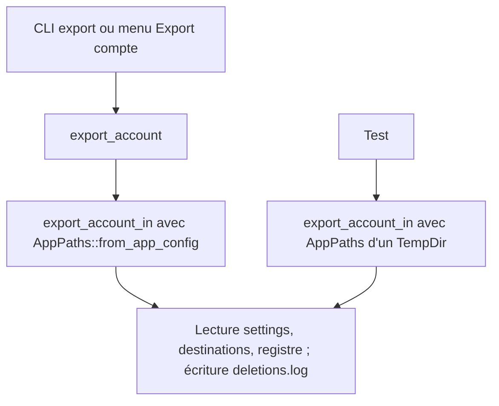
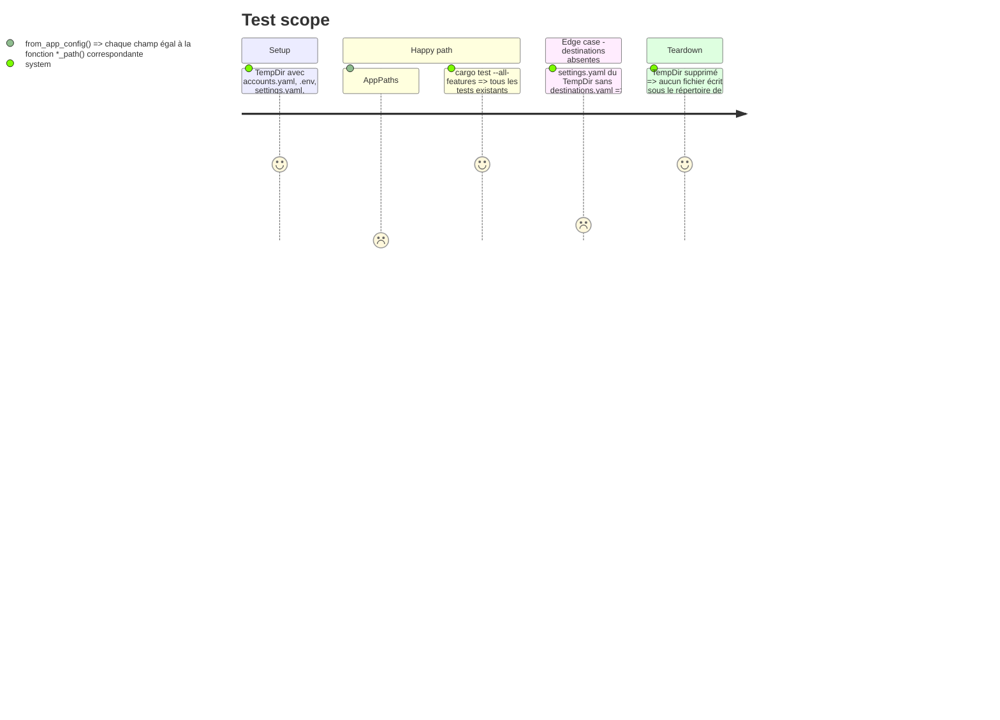

# Instruction: Injecter les chemins de configuration dans l'export

Findings : tests 🔴 `src/email_export.rs:2758` (partie « chemins globaux ») ; tests 🟡 `src/tray_actions.rs:284`.

Refactor sans changement de comportement : le CLI et le tray lisent et écrivent exactement les mêmes fichiers qu'avant.

## Architecture projection

> Tree of the final files. ✅ create · ✏️ modify · ❌ delete

```txt
.
├── src/config.rs           ✏️ `AppPaths { accounts, env, settings, ledger, deletion_log }` et `AppPaths::from_app_config()`, repris de `CleanupPaths`
├── src/server_cleanup.rs   ✏️ `CleanupPaths` remplacé par `config::AppPaths`
├── src/route.rs            ✏️ `load_destinations_from(settings: &Path)` sur `destinations_path_from` ; défaut `destinations.yaml` pris à côté du fichier de settings, plus dans `app_config_dir()`
├── src/email_export.rs     ✏️ `export_account_in(&AppPaths, …)` ; `export_account` devient un wrapper d'une ligne ; `purge_handled` écrit dans `paths.deletion_log` via `record_results_to` / `record_error_to`
├── src/tray_actions.rs     ✏️ `run_contextual_batch_in(&AppPaths, …)` et wrapper ; appel `CleanupPaths` renommé (`:1296`)
├── tests/imap_integration.rs ✏️ `cleanup_dir` construit un `AppPaths`
└── tests/rust_tests.rs     ✏️ test : `AppPaths::from_app_config()` désigne les mêmes fichiers que les fonctions `*_path()`
```

## User Journey



## Test Scope



## Tasks to do

### `1)` Type de chemins partagé

> Un seul type pour tous les fichiers de configuration qu'un flux lit ou écrit.

1. Déplacer `CleanupPaths` dans `config.rs` sous le nom `AppPaths`, avec `from_app_config()`.
2. Remplacer les usages dans `server_cleanup.rs`, `tray_actions.rs:1296` et `tests/imap_integration.rs`. Le `set_var` du mot de passe de `cleanup_dir` reste (voir Decisions du plan).

### `2)` Export piloté par chemins

> `export_account` ne touche plus aucun chemin global.

1. Ajouter `route::load_destinations_from(settings)` sur `destinations_path_from` ; `load_destinations()` l'appelle.
   - `destinations_path_from` (`route.rs:538`) retombe aujourd'hui sur `app_config_dir()` quand `destinations_file` est absent : un test lirait, voire migrerait, le fichier réel. Le défaut devient `settings_file.parent()/destinations.yaml`, identique en production puisque `settings_path()` est dans `app_config_dir()`.
2. `export_account_in(paths, on_progress, on_status, cancel_token)` : destinations, `Settings::load(&paths.settings)`, `handled::load_proofs_from(&paths.ledger, …)`.
3. Faire porter `paths.deletion_log` jusqu'à `purge_handled` (champ de l'exportateur posé par `export_account_in`, ou paramètre) et utiliser `record_results_to` / `record_error_to`.
4. `export_account` appelle `export_account_in(&AppPaths::from_app_config(), …)`.
5. Vérifier par Grep qu'`export_folder` et `purge_handled` n'appellent plus `settings_path`, `ledger_path`, `log_path` ni `load_destinations()`.

### `3)` Lot contextuel piloté par chemins

> Rendre `run_contextual_batch` testable comme `clean_server_in`.

1. `run_contextual_batch_in(paths, target, account_name, selected)` : `.env`, `accounts.yaml`, `settings.yaml` et `deletions.log` pris dans `paths`.
2. `run_contextual_batch` devient un wrapper d'une ligne.

## Test acceptance criteria

| Task | Acceptance criteria |
| ---- | ------------------- |
| 1    | `CleanupPaths` n'existe plus ; `AppPaths::from_app_config()` désigne les mêmes fichiers qu'avant. |
| 2    | `export_account_in` lancé sur un `TempDir` n'écrit rien sous le répertoire de configuration réel ; le CLI et le tray exportent comme avant. |
| 3    | `run_contextual_batch_in` s'appelle avec des chemins de `TempDir` ; le tray garde le même comportement. |
