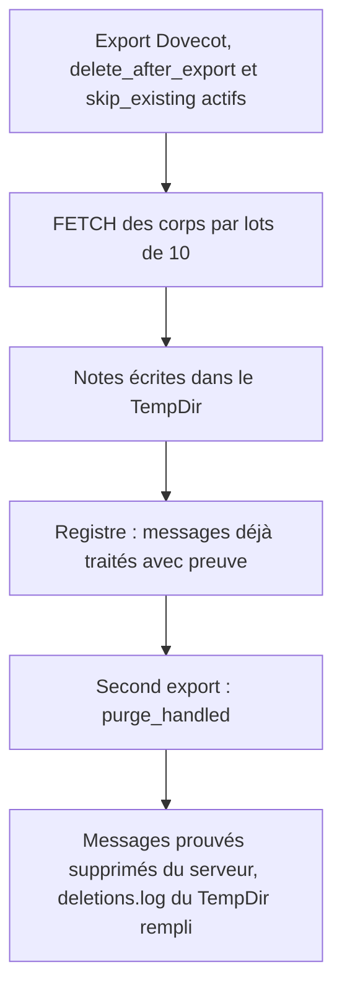
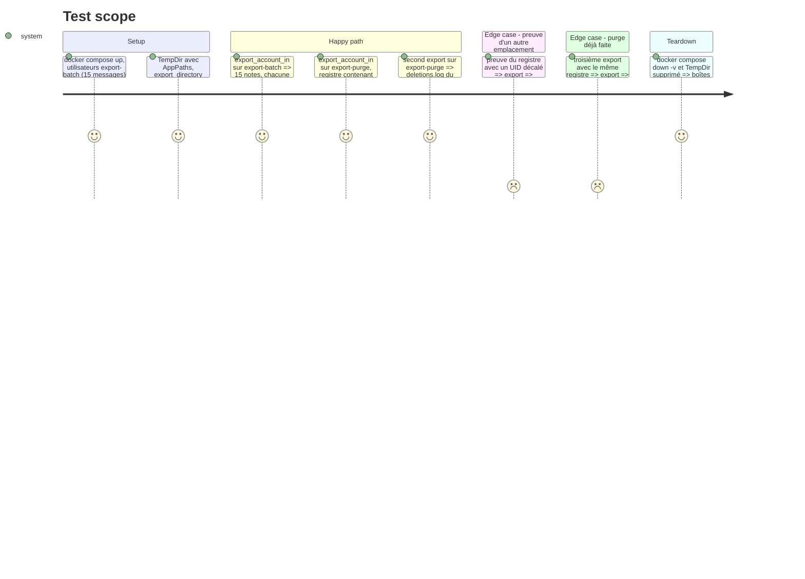

# Instruction: Tester l'export réel avec purge sur Dovecot

Findings : tests 🔴 `src/email_export.rs:2758` ; tests 🟡 `src/email_export.rs:2453-2563` (boucle par lots), `tests/imap_integration.rs:255`, `:18` (`set_var` en parallèle, traité par sérialisation) ; code-quality 🟡 `src/email_export.rs:2474` (branches dupliquées du batching).

À mener après la phase 1.

## Architecture projection

> Tree of the final files. ✅ create · ✏️ modify · ❌ delete

```txt
.
├── tests/fixtures/imap/compose.yaml          ✏️ utilisateurs `export-purge` et `export-batch` ; ce dernier reçoit en plus les messages générés
├── tests/fixtures/imap/seed/batch/           ✅ 12 messages `.eml` distincts (sujet et corps uniques, un `Message-ID` chacun)
├── tests/imap_integration.rs                 ✏️ deux tests d'export réel via `export_account_in`
├── src/email_export.rs                       ✏️ `handle_transport_failure` et `batch_limit_reached` extraits ; bloc `{` vestigial (`:2578`) supprimé
├── .github/workflows/ci.yml                  ✏️ job `dovecot` : `-- --ignored --skip gmail_ --test-threads=1`
└── aidd_docs/tasks/2026_10/2026_10_30_corrections-audit/phase-11.md ✏️ note de la l.81 corrigée
```

## User Journey



## Test Scope



## Tasks to do

### `1)` Fixture d'export

> Assez de messages pour franchir une frontière de lot (`BODY_FETCH_BATCH = 10`).

1. Ajouter 12 `.eml` sous `seed/batch/`, chacun avec un marqueur de corps unique.
2. Dans le service `seed`, créer `export-purge` (seed commun) et `export-batch` (seed commun plus `seed/batch/`).

### `2)` Test de la boucle par lots

> Prouver l'appariement UID → corps à travers plusieurs lots.

1. `export_account_in` sur `export-batch`, `delete_after_export` désactivé.
2. Pour chaque note : assertion inclusive sur son propre marqueur et assertions exclusives sur les marqueurs des autres messages (`.claude/rules/05-testing/05-e2e-exclusive-asserts.md`).

### `3)` Test de la purge d'export

> Exécuter enfin `purge_handled` dans un test.

1. Premier export : prendre les preuves dans le champ `source` des `RouteDecisions` renvoyées, et en écrire deux dans le registre du `TempDir` avec `handled::record_proofs_to(&paths.ledger, …)`. Les notes peuvent rester en place : `skip_reason` teste `Handled` avant `Exported`.
2. Second export avec `skip_existing` et `delete_after_export` : vérifier par une session brute (`inbox_message_ids`) que seuls les messages prouvés ont disparu, et lire `paths.deletion_log`.
3. Cas d'une preuve à UID décalé : message conservé, `stale_proof` compté.
4. Troisième export : aucune suppression supplémentaire, aucune ligne d'erreur.

### `4)` Sérialiser les tests Dovecot en CI

> Supprimer la course entre `set_var` (`require_fixture`) et les lectures concurrentes.

1. Ajouter `--test-threads=1` à `ci.yml:91`.

### `5)` Retirer la duplication du batching

> Une seule branche « connexion perdue », un seul contrôle de limite de lot.

1. Une fois les tâches 2 et 3 vertes, extraire `handle_transport_failure` (`:2474-2487`, `:2552-2561`) et `batch_limit_reached` (`:2462-2467`, `:2531-2537`).
2. Supprimer le bloc nu de `:2578` ; `cargo fmt`.
3. Relancer les tests Dovecot de la tâche 2 et 3.

### `6)` Corriger la note de phase 11

> Ne plus affirmer une couverture qui n'existe pas.

1. Remplacer l'affirmation de `phase-11.md:81` par le nom du nouveau test d'export avec purge.

## Test acceptance criteria

| Task | Acceptance criteria |
| ---- | ------------------- |
| 1    | Le fixture démarre avec les deux nouveaux utilisateurs et 15 messages dans `export-batch`. |
| 2    | Chaque note de l'export porte son propre corps et aucun corps d'un autre message. |
| 3    | Après le second export, seuls les messages prouvés sont absents du serveur, et `deletions.log` du `TempDir` les liste. |
| 4    | Le job `dovecot` lance les tests un par un. |
| 5    | Les tests des tâches 2 et 3 passent après l'extraction ; `export_folder` ne contient plus qu'une branche de perte de connexion. |
| 6    | `phase-11.md` cite le test qui exerce réellement la purge d'export. |
