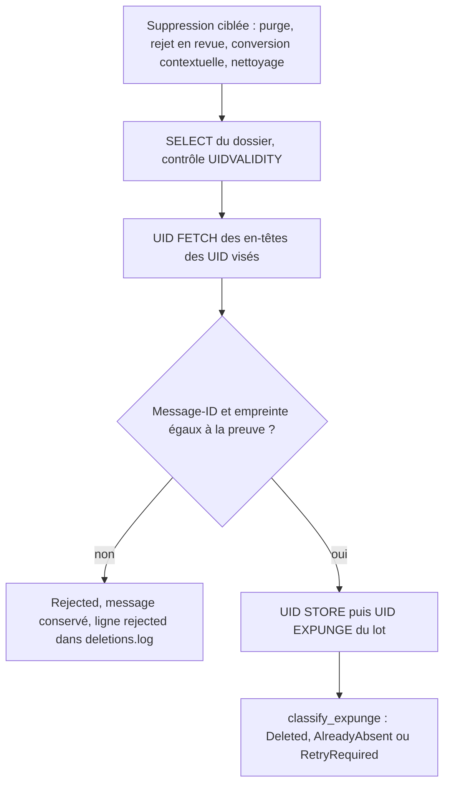
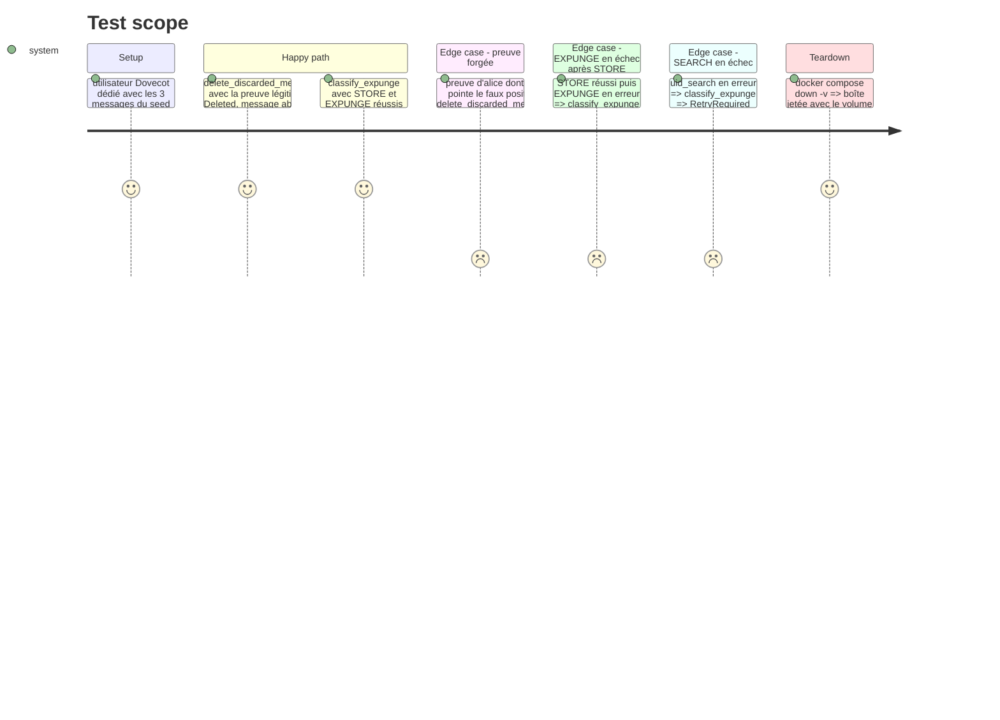

# Instruction: Revérifier l'identité du message avant toute suppression ciblée

Findings : security 🟡 `src/email_export.rs:2249-2300` (suppression pilotée par une preuve de note de staging) ; tests 🟡 `src/email_export.rs:1514-1523` (échec partiel d'`expunge_uids`).

À mener après la phase 2 : le test d'export avec purge doit couvrir `delete_validated` avant qu'on le modifie.

## Architecture projection

> Tree of the final files. ✅ create · ✏️ modify · ❌ delete

```txt
.
├── src/contextual_export.rs  ✏️ `identity_matches(proof, &FetchedMessage) -> bool` via `parse_header_candidate` ; divergence rendue par le variant existant `DeletionOutcome::Rejected`
├── src/email_export.rs       ✏️ `delete_validated` (branche UIDPLUS) : `fetch_headers_by_uid` puis filtrage par `identity_matches` avant `expunge_uids` ; `classify_expunge(present, store_expunge_result) -> Vec<DeletionOutcome>` pure
├── tests/imap_integration.rs ✏️ test : preuve forgée (bon UID, autre `Message-ID`) ne supprime rien
└── tests/rust_tests.rs       ✏️ tests de `identity_matches` et de `classify_expunge`
```

## User Journey



## Test Scope



## Tasks to do

### `1)` Comparaison d'identité pure

> Une seule définition de « c'est bien ce message ».

1. `identity_matches(proof, fetched)` : `parse_header_candidate` sur les en-têtes, comparaison de `message_id` et `header_fingerprint`.
2. Tests unitaires : égalité, `Message-ID` différent, même `Message-ID` et empreinte différente.
3. Vérifier qu'une preuve écrite par l'export (`export_folder`) et une preuve écrite par la conversion contextuelle donnent la même empreinte que `fetch_headers_by_uid` ; si l'export calcule l'empreinte sur d'autres en-têtes, aligner le calcul avant d'activer le contrôle.

### `2)` Contrôle dans `delete_validated`

> Aucune suppression générique sans revérification serveur.

1. Après le contrôle d'UIDVALIDITY, `fetch_headers_by_uid` sur les UID du groupe.
2. UID absent de la réponse : `AlreadyAbsent`. Identité différente : `Rejected("identité serveur différente de la preuve")`, exclu du lot. `tally_deletions` le compte déjà comme refus non réessayé et `deletion_log` l'écrit en `rejected:`.
3. `expunge_uids` sur les seuls UID confirmés.
4. Gmail : dans la boucle par message actuelle, comparer les en-têtes du message trouvé par `X-GM-MSGID` avec `identity_matches` avant le `UID MOVE`. Pas de restructuration : la phase 4 réutilise `identity_matches` dans son regroupement.

### `3)` Classification testable d'`expunge_uids`

> Couvrir l'échec partiel sans mock IMAP (`5-rust-tests.md`).

1. Extraire `classify_expunge(uids, present, result)` de `expunge_uids`.
2. Dans le cas STORE réussi puis EXPUNGE en échec, le message de `RetryRequired` indique que le drapeau `\Deleted` est posé.
3. Tests unitaires des trois cas.

### `4)` Test Dovecot de preuve forgée

> Reproduire le scénario de l'audit.

1. Construire une preuve avec l'identité d'alice et l'UID du faux positif.
2. Vérifier `Rejected` et la présence des trois messages par session brute.

## Test acceptance criteria

| Task | Acceptance criteria |
| ---- | ------------------- |
| 1    | Une preuve correspond à un message si et seulement si `Message-ID` et empreinte sont égaux ; preuves d'export et preuves contextuelles passent le contrôle. |
| 2    | Aucun `UID STORE` n'est envoyé pour un UID dont l'identité serveur diffère de la preuve ; les tests Dovecot existants et celui de la phase 2 restent verts. |
| 3    | Les trois issues d'`expunge_uids` (succès, échec de SEARCH, échec d'EXPUNGE après STORE) sont couvertes par des tests sans réseau. |
| 4    | Une preuve forgée ne supprime aucun message et laisse une ligne `rejected:` dans le journal. |
