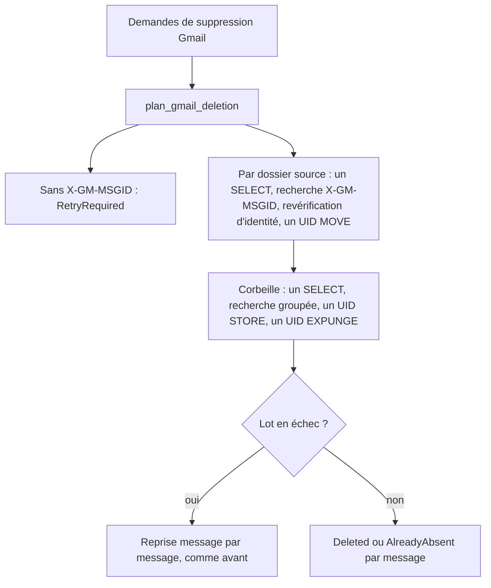
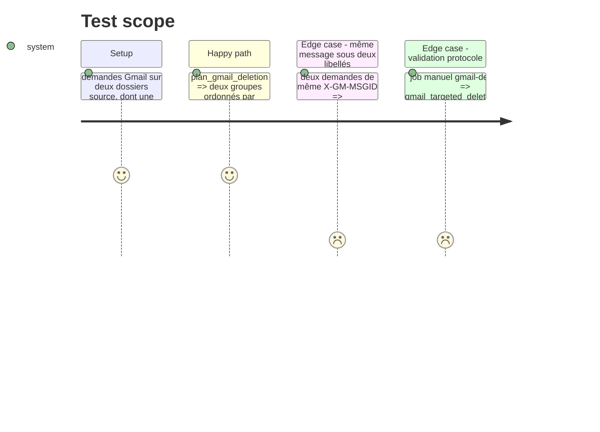

# Instruction: Regrouper et planifier la suppression Gmail

Findings : performance 🟡 `src/email_export.rs:2305` ; tests 🟡 `src/email_export.rs:2302-2340`.

À mener après la phase 3, qui a ajouté la revérification d'identité dans cette branche.

## Architecture projection

> Tree of the final files. ✅ create · ✏️ modify · ❌ delete

```txt
.
├── src/email_export.rs    ✏️ `plan_gmail_deletion(requests) -> GmailDeletionPlan` pure (groupes par dossier source, demandes sans X-GM-MSGID) ; branche Gmail de `delete_validated` exécutée par dossier
└── tests/rust_tests.rs    ✏️ tests de `plan_gmail_deletion`
```

## User Journey



## Test Scope



## Tasks to do

### `1)` Planification pure

> Tester la logique Gmail sans réseau.

1. `plan_gmail_deletion` : regroupement par `folder_raw`, dédoublonnage par `X-GM-MSGID`, liste des demandes non exécutables.
2. Tests unitaires des trois cas du Test Scope.

### `2)` Exécution par dossier

> Passer de sept allers-retours par message à un nombre fixe par dossier.

1. Par groupe : `select`, `uid_search` des `X-GM-MSGID` (petits lots `OR`), revérification d'identité de la phase 3, un `uid_mv` de l'ensemble.
2. Corbeille : un `select`, une recherche groupée, un `uid_store`, un `uid_expunge`.
3. En cas d'erreur sur un lot, reprendre ce lot message par message avec le code actuel.

### `3)` Validation sur Gmail

> Cette branche n'est exécutée que par le job manuel.

1. Lancer le job `gmail-destructive` sur la branche avant fusion et le noter dans la description de la branche.

## Test acceptance criteria

| Task | Acceptance criteria |
| ---- | ------------------- |
| 1    | Le plan regroupe par dossier, dédoublonne par `X-GM-MSGID` et isole les demandes sans identifiant, sans connexion. |
| 2    | Pour N messages d'un même dossier, le nombre de commandes IMAP ne dépend plus de N, hors reprise sur erreur. |
| 3    | Le job manuel Gmail passe sur la branche. |

## Suivi

La tâche 3 reste à faire par un humain : pousser la branche puis lancer le job manuel `gmail-destructive` (`workflow_dispatch`, entrée `run_gmail_destructive`) avant la fusion. Le code Gmail n'est couvert que par les tests sans réseau de `plan_gmail_deletion`.
