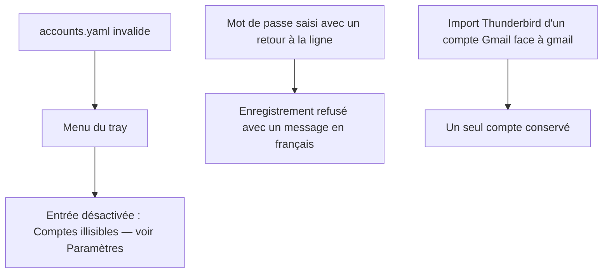
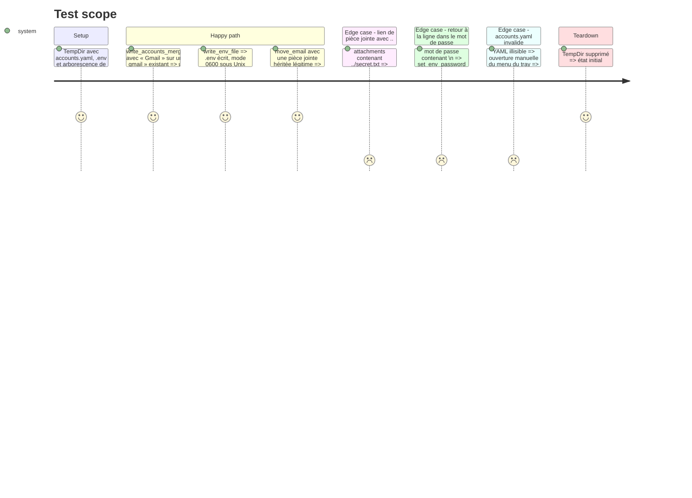

# Instruction: Corriger les défauts isolés

Findings : code-quality 🟡 `src/thunderbird.rs:337`, `src/tray/menu.rs:51` ; ui 🟡 `src/tray/menu.rs:51,78` ; tests 🟡 `src/thunderbird.rs:658`, `:75` ; security 🟢 `src/route.rs:244-275`, `src/tray/ipc.rs:859-873`, `src/tray/ipc.rs:837-847`.

Chaque correction commence par un test de régression qui échoue.

## Architecture projection

> Tree of the final files. ✅ create · ✏️ modify · ❌ delete

```txt
.
├── src/thunderbird.rs     ✏️ fusion par `eq_ignore_ascii_case` (`:337`) ; `write_passwords_to_env` passe par `config::write_env_file` ; `#[cfg(test)] mod tests` pour `parse_profiles_ini`, privée
├── src/route.rs           ✏️ repli des pièces jointes héritées : refus de tout composant `..`, racine ou préfixe dans le lien
├── src/config.rs          ✏️ `env_value_is_valid(&str)` (refus `\r`, `\n`, NUL) et `write_env_file(path, &[String])` (0600 sous Unix)
├── src/tray/ipc.rs        ✏️ `set_env_password` et écriture du `.env` (`:845`) via les helpers de `config.rs`
├── src/tray/menu.rs       ✏️ erreur de lecture des comptes : entrée désactivée « Comptes illisibles — voir Paramètres »
└── tests/rust_tests.rs    ✏️ tests de régression ; `write_passwords_to_env` (fusion, échappement)
```

## User Journey



## Test Scope



## Tasks to do

### `1)` Fusion Thunderbird insensible à la casse

> Aligner la fusion sur `Config::get_account`.

1. Test : import « Gmail » sur un `accounts.yaml` contenant « gmail ».
2. Remplacer `raw.name == account.name` par `eq_ignore_ascii_case`.

### `2)` Traversée dans les pièces jointes héritées

> Refuser avant de joindre, pas après.

1. Test : lien `../x` dans `attachments:` d'une note héritée.
2. Refuser les composants `ParentDir`, `RootDir` et `Prefix` du lien avant `account_root.join` ; garder le contrôle `starts_with` existant.

### `3)` Écriture sûre du `.env`

> Deux écrivains, un seul helper.

1. Tests : valeur avec `\n` refusée ; permissions 0600 sous Unix (`#[cfg(unix)]`).
2. `config::env_value_is_valid` et `config::write_env_file` (création en 0600 via `OpenOptionsExt::mode` sous Unix).
3. `set_env_password`, l'écriture de `ipc.rs:845` et `write_passwords_to_env` passent par ces helpers.
4. Tests de `write_passwords_to_env` (fusion avec un `.env` existant, apostrophe échappée) dans `tests/rust_tests.rs` ; test de `parse_profiles_ini` multi-profils en module inline, la fonction étant privée.

### `4)` Menu sur `accounts.yaml` invalide

> Plus de menu vide sans explication.

1. Dans `create_menu` (`menu.rs:48`), sur `Err` de `get_account_names` ou `get_cleanup_account_names` : journaliser l'erreur et ajouter une entrée désactivée « Comptes illisibles — voir Paramètres ».
2. Vérification manuelle avec un `accounts.yaml` invalide : le code GUI se teste à la main (`.claude/rules/05-testing/5-rust-tests.md`).

## Test acceptance criteria

| Task | Acceptance criteria |
| ---- | ------------------- |
| 1    | Un import ne crée jamais un second compte qui ne diffère que par la casse. |
| 2    | Un lien de pièce jointe contenant `..` ne déplace aucun fichier hors du compte ; les liens légitimes migrent comme avant. |
| 3    | Aucun `.env` ne peut recevoir une ligne injectée ; sous Unix il est créé en 0600. |
| 4    | Avec un `accounts.yaml` invalide, le menu affiche l'entrée désactivée et le reste du menu fonctionne. |
