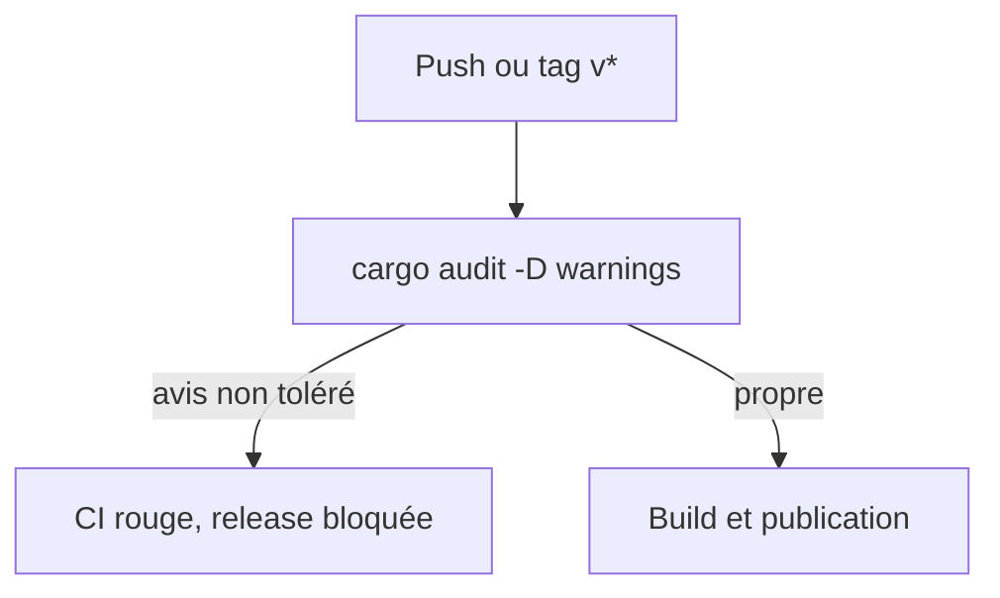
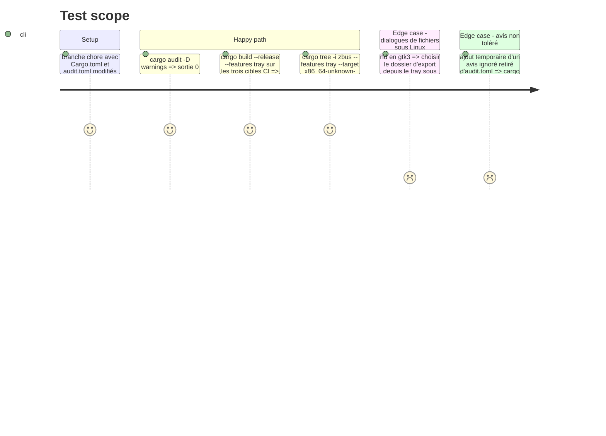

# Instruction: Durcir la politique de dépendances en CI

Findings : dependencies 🟡 `.github/workflows/ci.yml:58-61`, `.github/workflows/release.yml:44` ; dependencies 🟢 `Cargo.toml:99` (`zbus` via `xdg-portal`), `.cargo/audit.toml:7-8`, `:24-26` (justifications inexactes), `.cargo/audit.toml:24-27` (`rand` ignoré par identifiant).

## Architecture projection

> Tree of the final files. ✅ create · ✏️ modify · ❌ delete

```txt
.
├── Cargo.toml                    ✏️ `rfd = { version = "0.15", optional = true, default-features = false, features = ["gtk3"] }`
├── Cargo.lock                    ✏️ `ashpd`, `zbus`, `zvariant*` retirés
├── .cargo/audit.toml             ✏️ trois exceptions `zbus`/`zvariant` retirées ; commentaires `fxhash` et `rand 0.7` corrigés (Android seulement) ; note de contrôle des versions de `rand`
├── .github/workflows/ci.yml      ✏️ `cargo audit -D warnings`
└── .github/workflows/release.yml ✏️ job `audit` dont `build` dépend (`needs: audit`)
```

## User Journey



## Test Scope



## Tasks to do

### `1)` `rfd` sans portail XDG

> Retirer la cause de trois exceptions.

1. Passer `rfd` en `default-features = false, features = ["gtk3"]`.
2. Vérifier par `cargo tree -i zbus` sur la cible Linux que `zbus` a disparu.
3. Tester à la main sous Linux les dialogues de fichiers et les `MessageDialog` (`show_notification`, `confirm_deletion`). Sans machine Linux, s'appuyer sur le build CI et noter le test manuel comme restant dans la description de la branche.
4. Retirer `RUSTSEC-2026-0370`, `-0371` et `-0372` d'`audit.toml`.

### `2)` Justifications exactes

> Un fichier d'exceptions qui dit vrai.

1. `fxhash` et `rand 0.7` : préciser qu'ils ne sont compilés que pour Android (`wry` 0.44, `cfg(target_os = "android")`).
2. Sous l'exception `rand`, noter que `cargo audit` ignore l'avis pour toutes les versions et qu'il faut contrôler `rand` 0.8 et 0.9 à chaque mise à jour du lockfile.

### `3)` Audit bloquant

> Un nouvel avis fait échouer la CI et la release.

1. `ci.yml:61` : `cargo audit -D warnings`.
2. `release.yml` : job `audit` identique, et `needs: audit` sur `build`.

## Test acceptance criteria

| Task | Acceptance criteria |
| ---- | ------------------- |
| 1    | `zbus` n'est plus dans l'arbre Linux, les dialogues fonctionnent, et `audit.toml` ne liste plus ses trois avis. |
| 2    | Chaque commentaire d'`audit.toml` décrit la cible et la portée réelles de son crate. |
| 3    | Un avis non toléré rend la CI rouge et empêche la publication d'une release. |

## Suivi

- Fait : `rfd` en `gtk3` sans portail ; `zbus`, `zvariant*` et `ashpd` ont disparu de `Cargo.lock` (`cargo tree -i zbus` sur la cible Linux ne trouve rien). `cargo audit -D warnings` sort en 0 en local et le build release Windows avec `tray` passe.
- `fxhash` et `rand 0.7` vérifiés par `cargo tree -i kuchikiki` : absents des cibles Windows, Linux et macOS, présents seulement pour Android.
- Reste à faire par un humain : vérifier sous Linux les dialogues `rfd` (choix du dossier d'export, `show_notification`, `confirm_deletion`) et regarder le build Linux de la CI.
