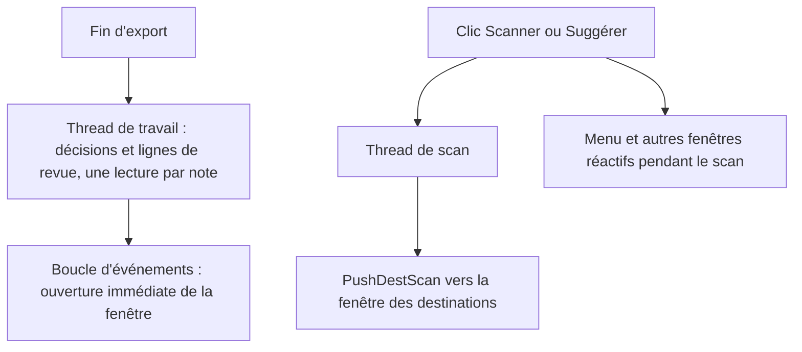
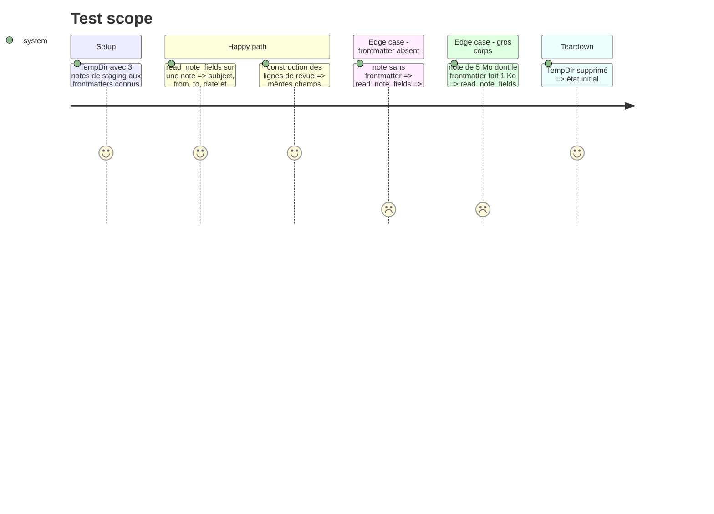

# Instruction: Libérer le thread de la boucle d'événements

Findings : performance 🟡 `src/tray/windows.rs:575`, `src/tray/ipc.rs:324`, `src/email_export.rs:2109`.

## Architecture projection

> Tree of the final files. ✅ create · ✏️ modify · ❌ delete

```txt
.
├── src/tray/ipc.rs          ✏️ `read_note_fields(path, &[&str]) -> NoteFields` : une lecture, frontmatter seul ; `scan_destinations` (actions `scan_suggest`, `scan_folders`) lancé dans un `thread::spawn`
├── src/tray_actions.rs      ✏️ le thread qui produit les décisions appelle aussi `route_rows`
├── src/tray/mod.rs          ✏️ `AppCommand::OpenRouteReview` porte les lignes prêtes ; variante `PushDestScan { window_id, json }`
├── src/tray/event_loop.rs   ✏️ ouverture de la revue sans lecture de fichier ; traitement de `PushDestScan`
├── src/tray/windows.rs      ✏️ `route_rows(&RouteDecisions) -> Vec<serde_json::Value>` extrait de `build_route_window` (`:572-602`), qui reçoit les lignes prêtes ; `load_destinations` lu une fois
└── src/email_export.rs      ✏️ `convert_contextual_selection` télécharge les corps par lots de `BODY_FETCH_BATCH`
```

## User Journey



## Test Scope



## Tasks to do

### `1)` Lignes de revue hors du thread de l'interface

> Ouvrir la revue sans lire de fichier sur la boucle d'événements.

1. `read_note_fields` : `BufReader` jusqu'au `---` fermant, tous les champs demandés en une passe.
2. Extraire `route_rows`, l'appeler dans le thread qui produit les décisions et transmettre les lignes avec elles.
3. `build_route_window` ne fait plus que sérialiser les lignes reçues ; `load_destinations` lu une fois (`:566`, `:629`).
4. Test de `route_rows` : JSON identique à celui d'avant pour un jeu de notes fixe.

### `2)` Scan des destinations en arrière-plan

> Plus de parcours de `notes_dir` sur la boucle d'événements.

1. Pour les actions `scan_suggest` et `scan_folders` (`scan_destinations`, `ipc.rs:311`), cloner la configuration, lâcher le verrou et lancer le scan dans un thread.
2. Renvoyer le résultat par `PushDestScan` ; la fenêtre affiche un état « Analyse en cours… » entre-temps.

### `3)` Corps contextuels par petits lots

> Ne plus garder 500 messages complets en mémoire.

1. `convert_contextual_selection` (`:2109-2122`) : `BODY.PEEK[]` par lots de `BODY_FETCH_BATCH`, conversion lot par lot.
2. Relancer le test Dovecot `contextual_search_uses_uidvalidity_and_keeps_messages_unseen` (corps toujours non lus).

## Test acceptance criteria

| Task | Acceptance criteria |
| ---- | ------------------- |
| 1    | L'ouverture de la revue ne lit aucune note sur la boucle d'événements, et chaque note n'est lue qu'une fois. |
| 2    | Pendant un scan de destinations, le menu du tray et les autres fenêtres répondent. |
| 3    | Au plus `BODY_FETCH_BATCH` corps complets sont en mémoire pendant une conversion contextuelle ; les messages restent non lus. |

## Écarts par rapport au plan

### Lecture des notes : pas d'arrêt au `---` fermant

Le plan prévoyait que `read_note_fields` arrête la lecture au `---` fermant du frontmatter. Ce n'est pas possible : les notes récentes portent leur en-tête (sujet, expéditeur, date) dans le bloc ```email du corps, pas dans le frontmatter. Arrêter la lecture au frontmatter ferait disparaître ces champs de la revue. Le cas de test « note de 5 Mo, lecture arrêtée au --- fermant » a donc été abandonné.

Ce qui a été fait à la place :

- `email_block::note_header_fields` parse le bloc ```email une seule fois pour tous les champs demandés ;
- `ipc::frontmatter_list` travaille sur le texte déjà lu ;
- `windows::route_rows` lit chaque note une seule fois, dans le thread de travail, via `RouteReview::new`.

Le critère d'acceptation de la tâche 1 est tenu : la boucle d'événements ne lit aucune note, et chaque note est lue une seule fois.

### Pas de variante `PushDestScan`

Le résultat du scan passe par `AppCommand::PushDestState`, qui existe déjà et transmet le JSON à la fenêtre. Une variante dédiée aurait dupliqué ce chemin sans rien apporter. Le scan tourne dans un `std::thread::spawn` alimenté par une copie de la configuration, et le verrou est relâché avant le lancement du thread.

### Lots de corps contextuels

La conversion se faisait déjà lot par lot. Le problème venait de la taille des lots : `HEADER_UID_BATCH` (500). Les corps sont désormais demandés par lots de `BODY_FETCH_BATCH` (10). Le test Dovecot `contextual_search_uses_uidvalidity_and_keeps_messages_unseen` passe.

## Vérifications

- `cargo clippy` sans et avec `--all-features` : aucun avertissement.
- `cargo test --all-features` : 647 tests passent.
- Tests Dovecot (`--ignored --skip gmail_`) : 11 passent.
- À vérifier à la main : la réactivité du menu et des fenêtres pendant un scan de destinations.
