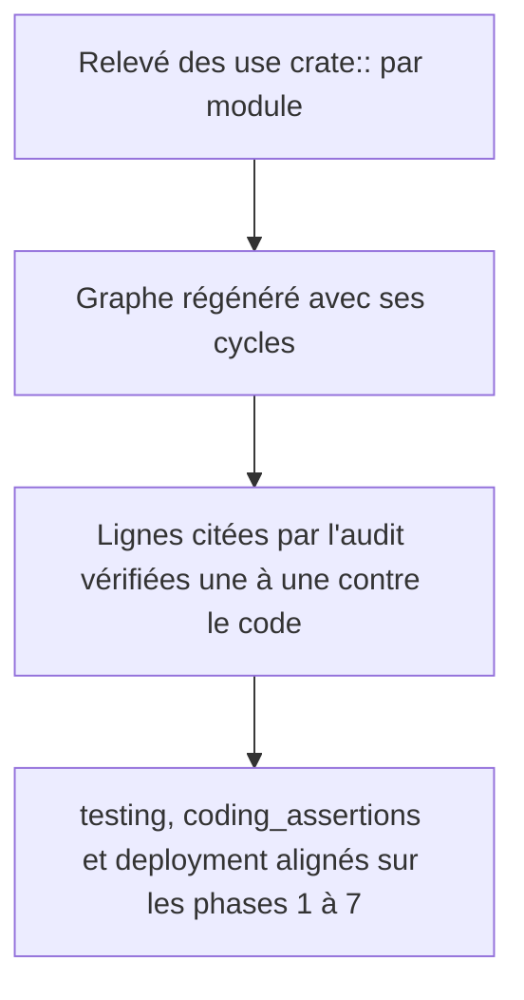
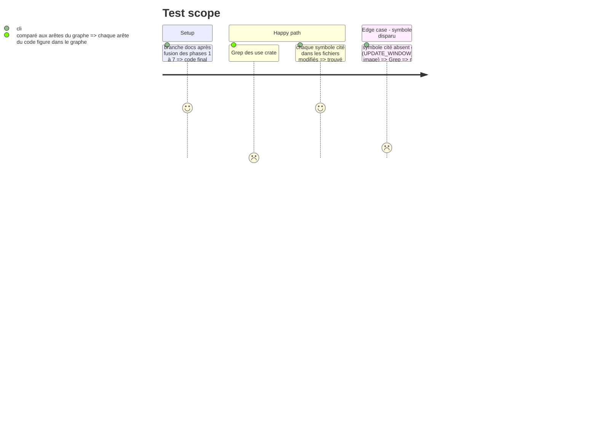

# Instruction: Remettre la mémoire du projet à jour

Findings : architecture 🟡 `aidd_docs/memory/architecture.md:9-40`, `:53`, `:198`, `:221-225`, `:248`, `:272`, `:279`, `:331`, `:354`.

À mener en dernier : la mémoire décrit l'état laissé par les phases 1 à 7.

## Architecture projection

> Tree of the final files. ✅ create · ✏️ modify · ❌ delete

```txt
.
├── aidd_docs/memory/architecture.md  ✏️ graphe régénéré depuis les `use crate::`, cycles marqués comme dette connue ; lignes périmées corrigées ; `AppPaths`, revérification d'identité, suppression Gmail groupée
├── aidd_docs/memory/testing.md       ✏️ l.89 : export et lot contextuel pilotables par `AppPaths` ; nouveaux tests Dovecot ; `--test-threads=1`
├── aidd_docs/memory/coding_assertions.md ✏️ écriture du `.env` par `config::write_env_file` ; toute suppression ciblée passe par `delete_validated`
└── aidd_docs/memory/deployment.md    ✏️ `rfd` en `gtk3` ; audit bloquant avant release
```

## User Journey



## Test Scope



## Tasks to do

### `1)` Graphe d'architecture exact

> Un graphe qui montre les cycles au lieu d'un DAG.

1. Relever les arêtes `use crate::` et `crate::` par module.
2. Régénérer le graphe l.9-40 ; marquer les arêtes de cycle ; relier `app_icon`, `email_block` et `server_audit`.

### `2)` Lignes périmées

> Corriger les six emplacements cités par l'audit.

1. l.53 : retirer `image`, ajouter `sha2` et `windows-sys`.
2. l.198 : `run_tray` est dans `tray/mod.rs`.
3. l.248 : retirer `UPDATE_WINDOW_OPEN` / `CONFIG_WINDOW_OPEN`.
4. l.272, l.354 : ajouter `Correspondent`.
5. l.279, l.331 : signature réelle de `route_email`.

### `3)` Conventions des phases 1 à 7

> Ce qu'un futur agent doit savoir sans relire ce plan.

1. `testing.md` : remplacer l'interdiction de la l.89 par l'usage d'`AppPaths` ; citer les tests d'export avec purge et de preuve forgée.
2. `coding_assertions.md` : `.env` via `write_env_file` ; aucune suppression serveur hors de `delete_validated`.
3. `deployment.md` : `rfd` sans `xdg-portal`, audit bloquant avant release.
4. Vérifier par Grep chaque symbole cité, pas seulement l'existence des fichiers.

## Test acceptance criteria

| Task | Acceptance criteria |
| ---- | ------------------- |
| 1    | Chaque arête `crate::` du code figure dans le graphe, et les cycles y sont visibles. |
| 2    | Aucun symbole cité dans `architecture.md` n'est absent du code. |
| 3    | `testing.md` n'interdit plus de piloter l'export depuis un test, et décrit comment le faire. |

## Réalisation

Le graphe d'architecture a été régénéré à partir des références `crate::` de chaque fichier de `src/`. Les sous-modules de `tray/` y sont regroupés. Les dépendances mutuelles apparaissent en pointillés. La composante fortement connexe (`config`, `handled`, `deletion_log`, `contextual_export`, `email_export`, `html_layout`, `server_audit`, `route`, `destinations`) est signalée comme dette connue.

Un contrôle automatique a ensuite vérifié que chaque identifiant cité entre backticks dans la mémoire existe bien dans le code, la CI ou `Cargo.toml`. Il a fait remonter deux symboles disparus qui ne figuraient pas dans l'audit :

- `CleanupPaths`, remplacé par `AppPaths` à la phase 1 ;
- `local_folder_name` : `_local` est en dur dans le code, ce n'est pas un réglage.

Les autres identifiants signalés sont volontaires : des types listés comme inexistants, des crates retirées, des clés de plugin Obsidian ou des conventions de nommage.
