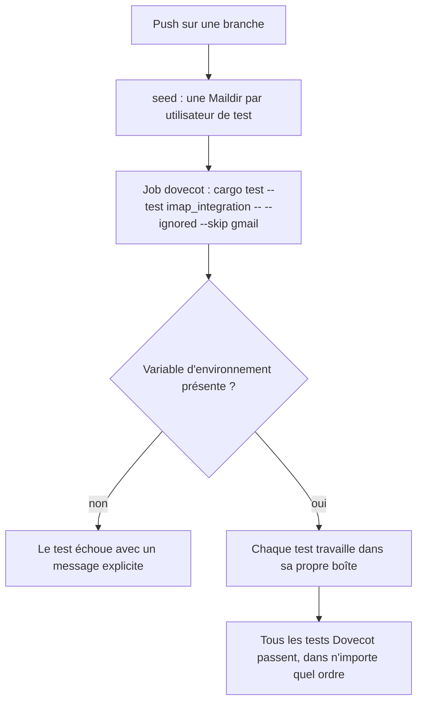
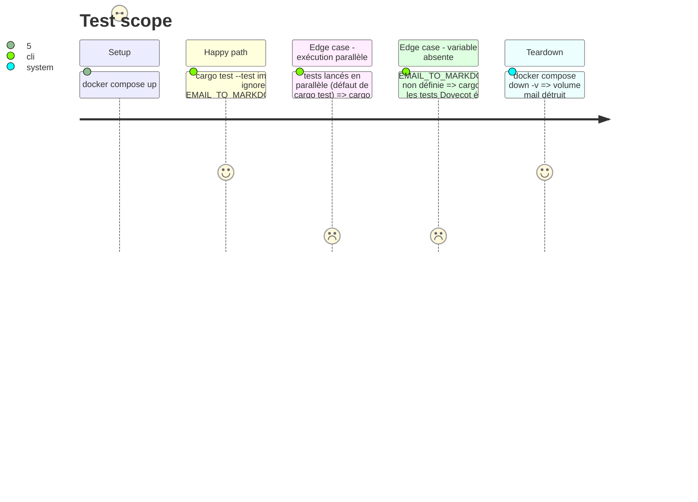

# Instruction: Faire tourner en CI tous les tests IMAP Dovecot

Findings : tests 🔴 `.github/workflows/ci.yml:92` ; tests 🟡 `tests/imap_integration.rs:35`.

## Architecture projection

> Tree of the final files. ✅ create · ✏️ modify · ❌ delete

```txt
.
├── .github/workflows/ci.yml            ✏️ le job dovecot lance tous les tests ignorés sauf le test Gmail
├── tests/fixtures/imap/compose.yaml    ✏️ le service seed crée une boîte par test (un utilisateur IMAP par test)
└── tests/imap_integration.rs           ✏️ chaque test se connecte avec son utilisateur ; garde d'environnement qui échoue
```

## User Journey



## Test Scope



## Tasks to do

### `1)` Une boîte IMAP par test

> Supprimer la dépendance à l'ordre entre les tests Dovecot.

1. Dans `compose.yaml`, faire créer par `seed` une Maildir `/srv/mail/<utilisateur>/Maildir/{cur,new,tmp}` par utilisateur de test et y copier les trois `.eml`. La `passdb` statique accepte n'importe quel nom avec le mot de passe `password`, et `userdb` place la home sous `/srv/mail/%Lu` (`99-contextual-test.conf`).
2. Faire prendre à `account()` le nom d'utilisateur en paramètre ; chaque test utilise le sien (`contextual`, `purge`, puis ceux de la phase 2).
3. Garder `test` pour compatibilité ou le retirer s'il n'est plus utilisé.

La recherche contextuelle parcourt tous les dossiers du compte (`search_contextual`, `email_export.rs:1734`) : isoler par dossier ne suffirait pas, d'où un utilisateur par test.

### `2)` Faire échouer un test ignoré lancé sans sa variable

> Un test lancé par `--ignored` ne doit plus compter « passed » sans rien exécuter.

1. Remplacer `if !enabled() { return; }` par un `assert!` qui nomme la variable manquante, dans chaque test Dovecot.
2. Laisser le test Gmail tel quel : il est exclu du job `dovecot` et lancé par nom dans son job manuel.

### `3)` Lancer tous les tests Dovecot en CI

> Le job `dovecot` exécute aussi `handled_message_with_ledger_proof_is_purged_at_its_current_place`.

1. Remplacer le filtre par nom de `ci.yml:92` par `-- --ignored --skip <nom du test Gmail>`.
2. Renommer l'étape « Run selected ignored IMAP test » en conséquence.

## Test acceptance criteria

| Task | Acceptance criteria |
| ---- | ------------------- |
| 1    | Les tests Dovecot passent en parallèle comme en `--test-threads=1`, dans les deux ordres. |
| 2    | `cargo test --test imap_integration -- --ignored --skip <gmail>` sans la variable affiche un échec par test Dovecot qui nomme `EMAIL_TO_MARKDOWN_IMAP_TEST`. |
| 3    | Le log du job `dovecot` liste tous les tests Dovecot exécutés et passés ; le test Gmail n'y apparaît pas. |
