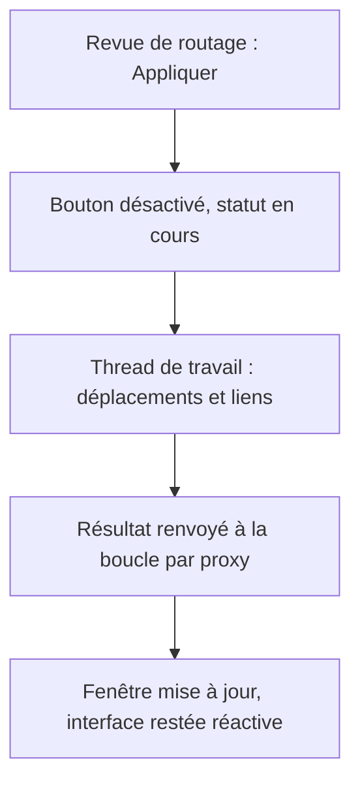
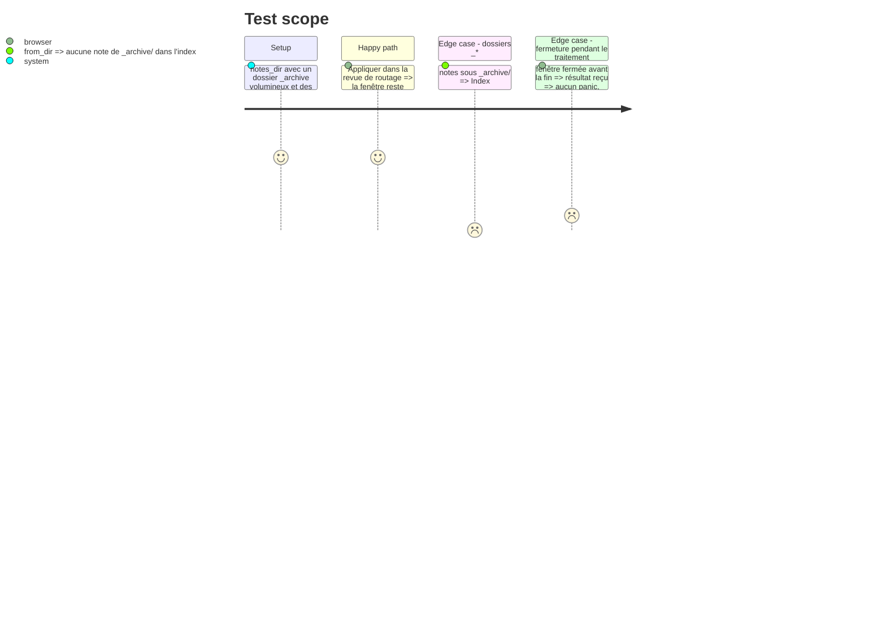

# Instruction: Sortir le routage du thread de la boucle d'événements

Findings : performance 🟡 `src/tray/windows.rs:748`, `src/quote_link.rs:81`.

## Architecture projection

> Tree of the final files. ✅ create · ✏️ modify · ❌ delete

```txt
.
├── src/tray/windows.rs   ✏️ le handler IPC de la revue de routage délègue `apply_route_decisions` à un thread de travail
├── src/tray/ipc.rs       ✏️ `apply_route_decisions` renvoie son résultat par message au lieu de muter l'état de la fenêtre
├── src/tray/mod.rs       ✏️ variante d'`AppCommand` pour le résultat du routage (rapport et `allowed_files` mis à jour)
├── src/tray/event_loop.rs ✏️ traitement de cette variante : état de la fenêtre mis à jour si elle est ouverte
└── src/quote_link.rs     ✏️ `Index::from_dir` écarte les répertoires `_*` comme `handled::complete_from_notes_to`
```

## User Journey



## Test Scope



## Tasks to do

### `1)` Déporter `apply_route_decisions`

> Le scan du coffre ne gèle plus l'interface.

Le handler actuel (`windows.rs:745-760`) emprunte `allowed_files` (`RefCell`), puis enchaîne `apply_route_decisions`, `handled::record_proofs` et `tray_actions::spawn_server_deletions`.

1. Cloner `allowed_files` et les décisions hors du `RefCell`, puis lancer dans un `std::thread` `apply_route_decisions` suivi de `handled::record_proofs` ; `spawn_server_deletions` lance déjà son propre thread et peut être appelé depuis le thread de travail.
2. Renvoyer par `EventLoopProxy` une variante d'`AppCommand` portant le rapport et l'ensemble `allowed_files` mis à jour ; à réception, réécrire le `RefCell` et mettre à jour la fenêtre si elle existe encore, sinon ignorer.
3. Désactiver « Appliquer » pendant le traitement et refuser un second envoi tant que le résultat n'est pas revenu.

### `2)` Écarter les répertoires `_*` de l'index des citations

> Aligner `quote_link` sur `handled`.

1. Filtrer les entrées `_*` dans le `WalkDir` de `Index::from_dir`.
2. Test sur `TempDir`.

## Écarts constatés à l'implémentation

- **Pas de nouvelle variante d'`AppCommand`** : le thread de travail renvoie directement les commandes existantes (`EvalScript` pour `route_review_applied` et `route_review_error`, `CloseWindow` quand tout est routé). L'ensemble `allowed_files` n'est plus un `RefCell` renvoyé à la boucle : il est partagé en `Arc<Mutex<HashSet<String>>>` entre la fenêtre et le thread, et un mutex empoisonné est récupéré (`lock_allowed`). `src/tray/ipc.rs`, `src/tray/mod.rs` et `src/tray/event_loop.rs` restent donc inchangés.
- **Garde contre les envois concurrents** : un `AtomicBool` `applying` refuse un second « Appliquer » et toute suppression pendant le traitement, avec le message « Routage en cours : attendre la fin de l'application. ». Le bouton était déjà désactivé jusqu'à la réponse ; il affiche maintenant « Application en cours… ».
- **Fenêtre fermée pendant le traitement** : les événements envoyés à une fenêtre disparue sont ignorés par la boucle, comme avant ; les déplacements vont à leur terme.
- **Vérification manuelle restante** : la réactivité de la fenêtre sur un coffre de plusieurs milliers de notes n'est pas couverte par un test automatisé.
- **Tâche 2** : tests `quote_link_tests::test_index_from_dir_skips_underscore_dirs` et son témoin `test_index_from_dir_indexes_regular_dirs` (le lien produit porte le nom court de la note, pas son chemin).

## Test acceptance criteria

| Task | Acceptance criteria |
| ---- | ------------------- |
| 1    | Pendant l'application d'une revue sur un coffre de plusieurs milliers de notes, la fenêtre se déplace et se redessine ; le compte rendu est identique à celui d'avant le changement. |
| 2    | Une note sous un répertoire `_*` n'est jamais indexée. |
