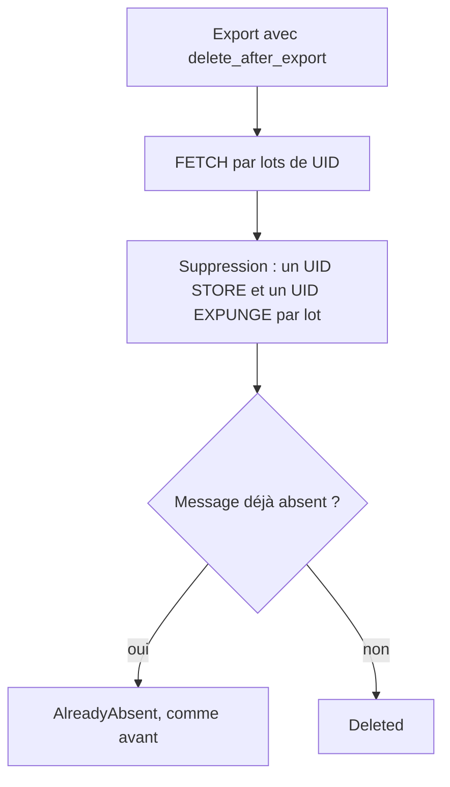
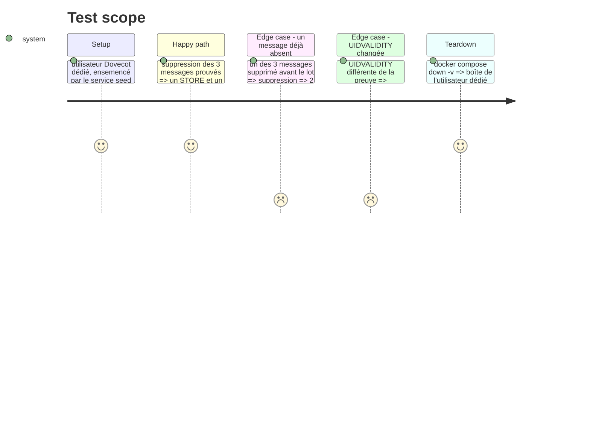

# Instruction: Regrouper les commandes IMAP d'export et de suppression

Findings : performance 🟡 `src/email_export.rs:2164`, `:2395`, `:2306` ; performance 🟢 `src/email_export.rs:2094`, `:2263`.

À mener après les phases 1 et 2 : ce changement touche `delete_validated`.

## Architecture projection

> Tree of the final files. ✅ create · ✏️ modify · ❌ delete

```txt
.
├── src/email_export.rs      ✏️ suppression IMAP générique par lot ; FETCH par lots ; en-têtes ciblés ; registre chargé une fois
└── tests/imap_integration.rs ✏️ test Dovecot de suppression par lot
```

## User Journey



## Test Scope



## Tasks to do

### `1)` Suppression par lot en IMAP générique

> Passer de 3 allers-retours par message à 3 par lot.

1. Construire le jeu d'UID validés, puis un seul `uid_store` et un seul `uid_expunge` (helper `uid_set(&[u32])`).
2. Déduire `AlreadyAbsent` d'un `uid_search` groupé fait avant le `STORE`.
3. Laisser la branche Gmail inchangée (testée seulement par le job manuel).

### `2)` FETCH d'export par lots

> Supprimer le N+1 réseau de la boucle d'export.

1. Récupérer `UID RFC822` par lots de `batch_size` (ou d'une constante si 0) au lieu d'un `FETCH` par message.
2. Conserver `X-GM-MSGID` lu par la pré-vérification au lieu de le redemander (`:1531-1536`, `:2422`). Cette branche n'est exécutée que sur Gmail, donc hors du job `dovecot` : la valider par le job manuel Gmail avant fusion, et le noter dans la description de la branche.
3. Pré-vérification : demander `HEADER_FETCH_FIELDS` au lieu de `RFC822.HEADER` et borner la longueur de commande quand `batch_size == 0`.

### `3)` Une seule lecture du registre par export

> Ne plus relire `handled_messages.txt` deux fois par dossier.

1. Charger `LedgerProofs` une fois avant la boucle des dossiers et le passer à `export_folder`.

## Écarts constatés à l'implémentation

- **Taille du lot de téléchargement** : elle est fixe (`BODY_FETCH_BATCH = 10`) et ne vient pas de `batch_size`. `batch_size` limite le nombre de messages exportés par exécution, pas la mémoire. Un lot de messages avec de grosses pièces jointes doit rester raisonnable. Le lot est de plus réduit pour ne jamais télécharger au-delà de ce que `batch_size` autorise encore.
- **Champs d'en-tête de la pré-vérification** : `PREFILTER_FETCH_FIELDS` ajoute `LIST-ID` et `LIST-UNSUBSCRIBE` aux champs de `HEADER_FETCH_FIELDS`, et ne demande pas `BCC`. La collecte de contacts (`analyze_email_type`) a besoin des en-têtes List-* pour reconnaître les listes de diffusion.
- **Fenêtre de pré-vérification** : elle vaut toujours `HEADER_UID_BATCH` (500), y compris quand `batch_size == 0`. Cela borne la longueur de la commande FETCH.
- **Repli en cas d'échec du lot** : si le serveur rejette un FETCH groupé, chaque message du lot est téléchargé seul, avec l'ancienne gestion d'erreur. Une erreur de transport (`Io`) arrête l'export du dossier, comme avant.
- **Critère « au plus ceil(N/lot) FETCH de corps »** : il est garanti par la construction de la boucle. Aucun test ne compte les commandes, faute de serveur instrumenté (les tests IMAP ne passent par aucun mock). Correction du plan v0.23.0 : le test Dovecot de purge de l'époque (`handled_message_with_ledger_proof_is_purged_at_its_current_place`) n'exportait pas, il appelait directement `delete_discarded_messages`. Le chemin réel est exercé depuis par `export_account_in_pairs_each_uid_with_its_body_across_batches` (15 messages, deux lots) et `export_account_in_purges_only_proved_handled_messages` (`purge_handled`).
- **Branche Gmail** : seules ses jointures d'UID passent par `imap_set`. Elle n'est validable que par le job manuel `gmail_targeted_deletion_fixture`.
- **Registre** : il est chargé dans `export_account` et transmis par `FolderRouting` (champs `ledger` et `handled`), ce qui évite d'ajouter des arguments à `export_folder`. `LedgerProofs::message_ids` remplace `handled::load` et est testé contre lui.

## Test acceptance criteria

| Task | Acceptance criteria |
| ---- | ------------------- |
| 1    | Les tests de la phase 2 passent toujours ; le test Dovecot vérifie les issues mixtes `Deleted` et `AlreadyAbsent`. |
| 2    | L'export d'un dossier de N messages émet au plus `ceil(N / lot)` FETCH de corps ; les notes produites sont identiques à celles d'avant (comparaison sur la boîte Dovecot). Le job manuel Gmail passe. |
| 3    | Le registre n'est lu qu'une fois par commande d'export. |
