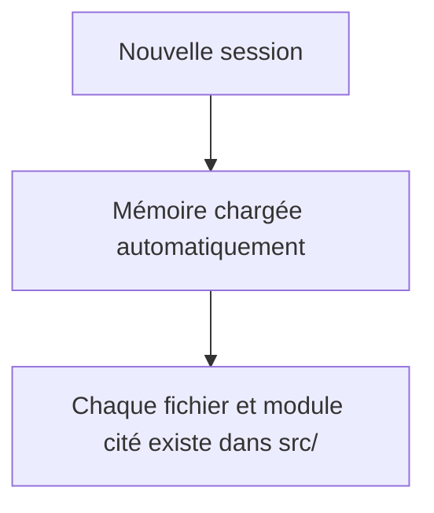
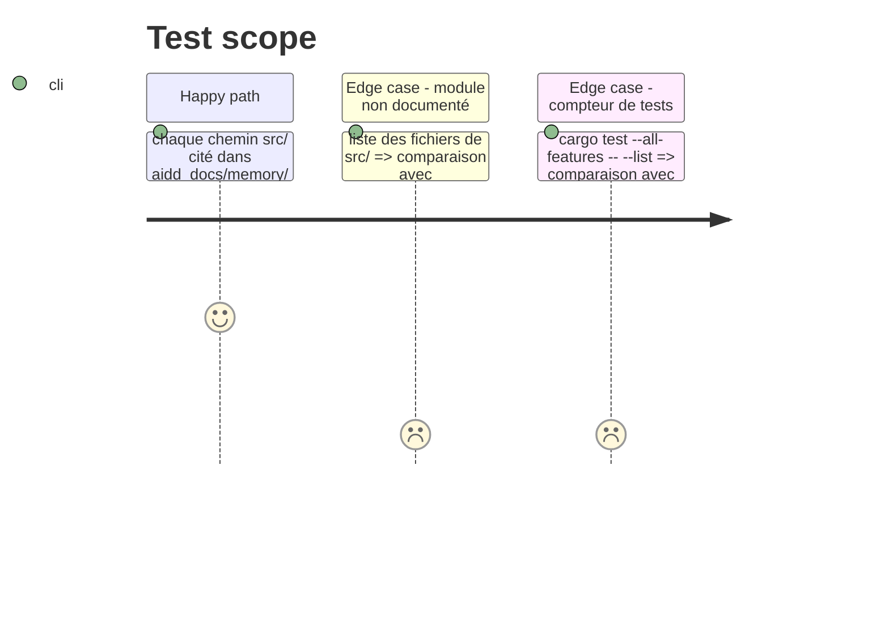

# Instruction: Remettre la mémoire du projet à jour

Findings : architecture 🟡 `aidd_docs/memory/architecture.md:9-31`, `aidd_docs/memory/codebase_map.md:8` ; tests 🟢 `aidd_docs/memory/testing.md:13` ; architecture 🟢 `aidd_docs/ADR.md:7-21`, `docs/memory-bank/module_structure.md:54`.

À mener en dernier. Fichiers lus par un LLM : en anglais, sous forme de puces (`.claude/rules/01-standards/file-language-and-style.md`).

## Architecture projection

> Tree of the final files. ✅ create · ✏️ modify · ❌ delete

```txt
.
├── aidd_docs/memory/architecture.md   ✏️ boucle d'événements unique + celle de run_contextual, modules actuels
├── aidd_docs/memory/codebase_map.md   ✏️ plus de `src/tray.rs`, modules manquants ajoutés, sous-commandes à jour
├── aidd_docs/memory/testing.md        ✏️ nombre de tests, modules de test, job Dovecot
├── aidd_docs/ADR.md                   ✏️ DEC-014 indexée et marquée comme dépassée par le YAML
└── docs/memory-bank/                  ❌ documentation concurrente et périmée
```

## User Journey



## Test Scope



## Tasks to do

### `1)` Mémoire d'architecture et carte du code

> Décrire le code tel qu'il est après les phases 1 à 11.

1. Corriger les lignes citées par l'audit dans `architecture.md` (boucle d'événements, modules, retrait de `dest gui`).
2. Réécrire les entrées périmées de `codebase_map.md` ; ajouter `cleaner`, `contextual_export`, `deletion_log`, `html_layout`, `app_icon`, `tray/*`.

### `2)` Mémoire des tests

> Chiffres et modules exacts.

1. Mettre à jour le nombre de tests, la table des modules et la description du job `dovecot`.

### `3)` Décisions et documentation concurrente

> Une seule source normative.

1. Ajouter DEC-014 à l'index de `ADR.md` avec la mention de son remplacement par `upsert_rule` en YAML.
2. Supprimer `docs/memory-bank/` après avoir vérifié qu'il ne contient rien d'absent de `aidd_docs/memory/`.

## Test acceptance criteria

| Task | Acceptance criteria |
| ---- | ------------------- |
| 1    | Aucun chemin cité dans `architecture.md` ni `codebase_map.md` n'est introuvable ; tous les modules de `src/` figurent dans la carte. |
| 2    | Le nombre de tests de `testing.md` est celui de `cargo test --all-features -- --list`. |
| 3    | DEC-014 est dans l'index ; `docs/memory-bank/` n'existe plus. |

## Écarts

- Les fichiers de `aidd_docs/` sont ignorés par git (`.gitignore`, motif `aidd*`) : seules la suppression de `docs/memory-bank/` et les corrections de commentaires sont commitées.
- Faits encore valables de `docs/memory-bank/` reportés dans `architecture.md` : chemins des profils Thunderbird, retour anticipé de `export_to_markdown` sans effet de bord, IIFE de `export_account`, ordre du pipeline `cleaner`. Le reste décrivait des modules supprimés (`fix_yaml`, `sort_emails`, `tray.rs`).
- Section « Header pre-check » de `architecture.md` réécrite : elle décrivait encore `RFC822.HEADER`.
- Règle `.claude/rules/05-testing/5-rust-tests.md` alignée : IMAP testé contre Dovecot, plus « manual only ».
- Corrigés au passage : commentaire `updater` mal placé dans `src/lib.rs`, doc-comment `PersistRoutingRule` (`destinations.yaml`), lien de `docs/agents/memory-manager.md`.
- Le contrôle du critère 1 tolère les noms de fichiers d'exécution (`accounts.yaml`, `handled_messages.txt`…) qui ne sont pas des chemins du dépôt.
