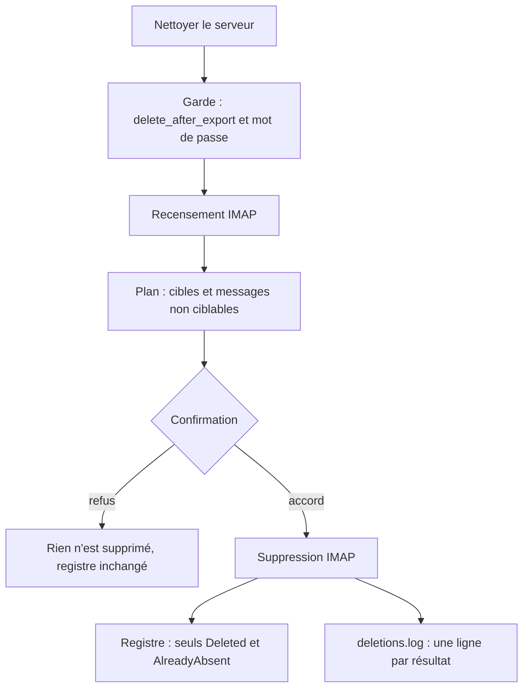

# Instruction: Tester le nettoyage serveur et la purge après export

Findings : tests 🔴 `src/tray_actions.rs:1275` ; tests 🟡 `src/email_export.rs:2153`, `src/tray_actions.rs:284`.

À mener après la phase 1 : les tests de bout en bout utilisent ses boîtes par utilisateur.

`clean_server` enchaîne lecture de la configuration, recensement IMAP (`audit_server`), confirmation, suppression IMAP (`delete_discarded_messages`), puis écriture du registre et de `deletions.log`. Les deux étapes IMAP ne se testent pas sans serveur ; le reste est de la logique pure ou des écritures de fichiers. La phase sépare donc ces parties : tests unitaires sur la logique, tests Dovecot sur l'enchaînement complet.

## Architecture projection

> Tree of the final files. ✅ create · ✏️ modify · ❌ delete

```txt
.
├── src/handled.rs            ✏️ variantes à chemin explicite de `load`, `load_proofs`, `record_proofs` et `complete_from_notes`, là où elles manquent
├── src/deletion_log.rs       ✏️ `record_results` et `record_error` vers un chemin passé en paramètre
├── src/tray_actions.rs       ✏️ `clean_server` découpé : garde du compte, plan de nettoyage, enregistrement des résultats, cœur `clean_server_in`
├── src/email_export.rs       ✏️ décision de suppression par preuve isolée en fonction pure si elle ne l'est pas
└── tests/imap_integration.rs ✏️ tests Dovecot : nettoyage accepté, nettoyage refusé, UIDVALIDITY périmée, message déjà absent
```

## User Journey



## Test Scope

```mermaid
---
title: Test scope
---
journey
  section Setup
    TempDir avec accounts.yaml, settings.yaml, registre et notes routées => chemins injectés, configuration de l'utilisateur intacte: 5: system
  section Happy path
    clean_server_in sur la boîte Dovecot du test avec confirmation acceptée => messages prouvés absents du serveur, registre et deletions.log du TempDir mis à jour: 5: system
  section Edge case - confirmation refusée
    confirmation qui renvoie false => clean_server_in sur Dovecot => les 3 messages sont toujours sur le serveur, registre inchangé: 1: system
  section Edge case - compte sans delete_after_export
    compte dont delete_after_export vaut false => garde du compte => erreur, aucune connexion: 1: system
  section Edge case - message non ciblable
    entrée de recensement HandledLegacy sans preuve => plan de nettoyage => comptée untargetable, absente des cibles: 1: system
  section Edge case - résultats mixtes
    résultats Deleted, AlreadyAbsent et RetryRequired => enregistrement => registre limité aux deux premiers, une ligne de journal par résultat: 1: system
  section Edge case - UIDVALIDITY périmée
    preuve dont l'UIDVALIDITY diffère de la boîte Dovecot => delete_discarded_messages => StaleUidValidity, message toujours présent: 1: system
  section Edge case - dossier introuvable
    preuve qui vise un dossier inexistant => delete_discarded_messages => RetryRequired, rien de supprimé: 1: system
  section Teardown
    TempDir supprimé ; la boîte Dovecot est jetée avec le volume du fixture => état initial: 5: system
```

## Tasks to do

### `1)` Chemins injectables

> Aucun test n'écrit sous `app_config_dir()`.

1. Définir une structure de chemins (comptes, `.env`, réglages, registre, journal) avec un constructeur `from_app_config()`.
2. Ajouter dans `handled` et `deletion_log` les variantes à chemin explicite qui manquent ; les fonctions actuelles les appellent avec le chemin global.

### `2)` Découper `clean_server`

> Isoler ce qui se teste sans serveur.

1. Extraire la garde du compte (`delete_after_export`, mot de passe) en fonction pure.
2. Extraire le plan de nettoyage : entrées de recensement → cibles et nombre de non ciblables.
3. Extraire l'enregistrement : résultats → registre, journal, texte de synthèse, vers les chemins injectés.
4. Écrire `clean_server_in(&paths, account_name, confirm)` qui enchaîne le tout ; `clean_server` l'appelle avec `from_app_config()`.

### `3)` Tests unitaires

> Couvrir la logique sans réseau.

1. Garde : `delete_after_export` faux, mot de passe absent.
2. Plan : comptage `untargetable`, un message Gmail sous plusieurs libellés compte pour une cible.
3. Enregistrement : seules les issues `Deleted` et `AlreadyAbsent` vont au registre ; une ligne de journal par résultat.
4. Si la décision de `delete_proved_messages` (« note absente », « autre preuve ») est séparable des appels IMAP, la rendre pure et tester chaque rejet.

### `4)` Tests Dovecot

> L'enchaînement réel tourne dans le job de la phase 1.

1. Nettoyage accepté et nettoyage refusé, chacun avec son utilisateur IMAP.
2. `StaleUidValidity` (preuve à UIDVALIDITY forgée), `AlreadyAbsent` (message supprimé avant l'appel), `RetryRequired` (dossier inexistant).

## Écarts constatés à l'implémentation

- Le cœur découpé vit dans un nouveau module `src/server_cleanup.rs`, pas dans `src/tray_actions.rs` : `tray_actions` n'est compilé qu'avec la feature `tray`, que le job `dovecot` ne construit pas. `tray_actions::clean_server` ne fait plus qu'appeler `server_cleanup::clean_server_in` avec `CleanupPaths::from_app_config()`.
- La décision de rejet de la purge après export est devenue `contextual_export::deletion_rejection`, appelée par `delete_proved_messages` et testée dans `tests/rust_tests.rs`.

## Test acceptance criteria

| Task | Acceptance criteria |
| ---- | ------------------- |
| 1    | Le menu « Nettoyer le serveur » se comporte comme avant ; aucun test ne crée de fichier sous le dossier de configuration de l'utilisateur. |
| 2    | `clean_server` ne contient plus que l'appel à `clean_server_in`. |
| 3    | Les tests unitaires passent sans réseau, sur Windows et Linux. |
| 4    | Le job `dovecot` exécute et passe les cinq scénarios ; dans chaque cas d'échec, le message visé est encore sur le serveur. |
