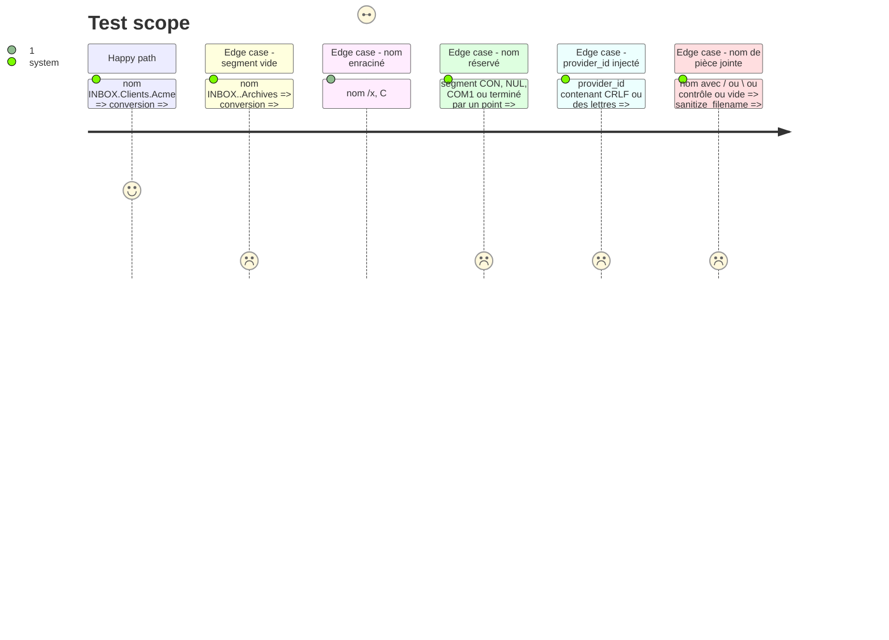

# Instruction: Valider les entrées venues du serveur et des notes

Findings : security 🟡 `src/email_export.rs:2253` (aussi `:1820`) ; security 🟢 `src/email_export.rs:2203`, `src/route.rs:23-41`, `src/utils.rs:512-520` ; tests 🟡 `tests/rust_tests.rs:134`.

À mener après la phase 1.

## Architecture projection

> Tree of the final files. ✅ create · ✏️ modify · ❌ delete

```txt
.
├── src/utils.rs            ✏️ conversion nom de dossier IMAP → chemin relatif sûr ; `sanitize_filename` durci
├── src/route.rs            ✏️ `join_safe_segments` refuse noms réservés Windows et points/espaces finaux
├── src/email_export.rs     ✏️ `export_folder` et `audit_server` passent par la conversion sûre ; `provider_id` numérique exigé
├── src/contextual_export.rs ✏️ `proof_is_complete` rejette un `provider_id` non numérique
└── tests/rust_tests.rs     ✏️ cas de traversée, noms réservés, séparateurs
```

## User Journey


## Test Scope



## Tasks to do

### `1)` Convertir les noms de dossiers IMAP en chemins sûrs

> Le serveur ne choisit plus où l'on écrit.

1. Écrire une fonction qui découpe `folder.display` sur `.` et `/`, ignore les segments vides (`a..b`, `/` final), puis valide chaque segment restant avec les règles de `join_safe_segments`. Un segment `..` reste un refus.
2. L'utiliser à `email_export.rs:2253` et `:1820` ; un dossier refusé est signalé et sauté.
3. Vérifier que le chemin produit pour les noms de dossiers ordinaires (`INBOX`, `INBOX.Sent`, `[Gmail]/Tous les messages`) est identique à celui d'aujourd'hui, pour ne pas déplacer les exports existants.

### `2)` Durcir la validation des segments et des noms de fichiers

> Couvrir les noms réservés Windows et les fins de nom invalides.

1. Étendre `join_safe_segments` : `CON`, `PRN`, `AUX`, `NUL`, `COM1-9`, `LPT1-9`, insensible à la casse et à l'extension ; point ou espace final.
2. Avant de durcir, relever ses appelants (`grep join_safe_segments`) et les destinations des règles de routage existantes : un segment de destination déjà enregistré qui deviendrait refusé doit produire une erreur lisible au routage, pas une perte de note.
3. Étendre `sanitize_filename` : retirer les contrôles, les points/espaces finaux, borner la longueur, remplacer un résultat vide.

### `3)` Exiger un `provider_id` numérique

> Aucune donnée de note n'est interpolée telle quelle dans une commande IMAP.

1. Faire rejeter par `proof_is_complete` un `provider_id` qui n'est pas composé de chiffres.

### `4)` Tests

> Chaque refus est vérifié.

1. Compléter `test_sanitize_filename` avec `/`, `\`, `..`, vide, contrôles, `CON`, nom terminé par un point.
2. Tests de la conversion de dossier et du rejet de `provider_id`.

## Écarts constatés à l'implémentation

- La conversion est `utils::imap_folder_relative_path`. Elle n'appelle pas `join_safe_segments` : les crochets de `[Gmail]` et les espaces internes doivent rester valides, ce que `SAFE_PATH_SEGMENT_RE` refuserait. Elle applique ses propres refus : nom enraciné, `\`, `:`, caractère de contrôle, segment `..`, nom réservé Windows, segment terminé par une espace. Le test de nom réservé est partagé (`utils::is_reserved_windows_name`) avec `join_safe_segments` et `sanitize_filename`.
- Un dossier au nom non sûr est écarté dans la boucle des dossiers de l'export, avant tout appel à `export_folder`, avec un message de statut « {dossier} ignoré : nom de dossier non sûr ». `export_folder` garde un refus `?` par défense. `audit_server` saute le dossier.
- `resolve_contextual_destination` saute une destination enregistrée devenue invalide au lieu d'échouer sur toute la liste : la cible choisie reste résolue par les autres destinations. Le routage d'une décision vers un chemin invalide échouait déjà avec le contexte « invalid routing path », la note restant en staging.
- `sanitize_filename` borne la longueur à 200 octets UTF-8 (et non en caractères), extension de 16 octets au plus conservée. Un plafond en caractères laissait passer plus de 255 octets avec des caractères multioctets, refusés par Linux. `subject_filename_part` n'appelle plus `sanitize_filename` mais le seul remplacement des caractères interdits, pour garder un sujet vide vide.
- Le test `test_export_to_markdown_discards_quarantine_when_export_fails` provoquait l'échec d'écriture par un nom de pièce jointe de 304 octets, désormais tronqué. Il le provoque par un répertoire d'export en lecture seule, ce qui le restreint à `#[cfg(unix)]` (Windows n'applique pas l'attribut lecture seule aux répertoires) ; il se saute s'il tourne en root. Il tourne sur les jobs Linux et macOS de la CI.

## Test acceptance criteria

| Task | Acceptance criteria |
| ---- | ------------------- |
| 1    | Un nom de dossier enraciné ou contenant `..` ne produit aucune écriture hors de `base_export_directory`, et l'export des autres dossiers continue. |
| 2    | `join_safe_segments` et `sanitize_filename` refusent ou neutralisent chaque cas listé. |
| 3    | Une preuve dont le `provider_id` contient autre chose que des chiffres est traitée comme incomplète. |
| 4    | Les nouveaux tests passent sur Windows et Linux. |
