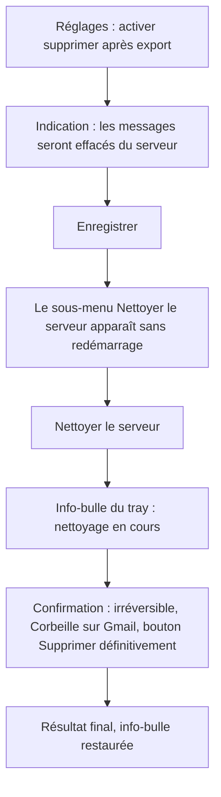
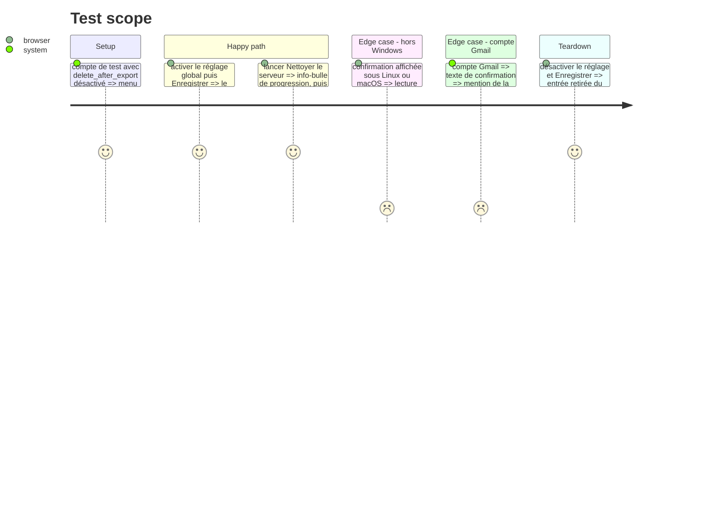

# Instruction: Rendre « Nettoyer le serveur » explicite et suivi

Findings : ui 🟡 `src/tray_actions.rs:1219-1225`, `:1263-1270`, `:1209-1380` ; ui 🟡 `src/tray/windows.rs:242-250` ; ui 🟡 `assets/config_window.html:437-438,540-545`.

À mener après la phase 8, elle-même après la phase 2 : les trois touchent `clean_server`.

## Architecture projection

> Tree of the final files. ✅ create · ✏️ modify · ❌ delete

```txt
.
├── src/tray_actions.rs        ✏️ texte de confirmation, niveau Warning et libellés explicites hors Windows, info-bulle de progression
├── src/tray/mod.rs            ✏️ variante `AppCommand::SetTooltip`
├── src/tray/event_loop.rs     ✏️ traitement de `SetTooltip` sur l'icône du tray
├── src/tray/windows.rs        ✏️ menu reconstruit après l'enregistrement des réglages généraux
└── assets/config_window.html  ✏️ `.field-hint` sur « supprimer après export », global et par compte
```

## User Journey



## Test Scope



## Tasks to do

### `1)` Texte de confirmation

> L'utilisateur sait ce qui est irréversible.

1. Extraire la construction du texte (`tray_actions.rs:1219-1225`) en fonction pure qui prend le nombre de messages et le fournisseur.
2. Ajouter une phrase sur l'irréversibilité, et la variante Gmail (Corbeille).
3. Tester les deux variantes.

### `2)` Confirmation explicite hors Windows

> Le bouton qui supprime le dit.

1. Passer `MessageLevel::Warning` à `rfd` (`:1263-1270`).
2. Remplacer `YesNo` par `OkCancelCustom("Supprimer définitivement", "Annuler")`. `rfd` ne permet pas de choisir le bouton par défaut : le libellé explicite remplace ce garde-fou.

### `3)` Retour pendant le nettoyage

> L'application ne reste plus muette pendant le recensement et la suppression.

1. Ajouter `AppCommand::SetTooltip(Option<String>)`, traité dans la boucle d'événements qui possède l'icône. `action_clean_server` tourne dans le processus du tray, donc `send_command` y fonctionne.
2. Envoyer « Nettoyage en cours… » au début de `action_clean_server`, puis restaurer l'info-bulle par défaut à la fin, en succès comme en erreur.

### `4)` Menu à jour et indication dans les réglages

> L'entrée de menu suit le réglage.

1. Ajouter l'action `save` des réglages généraux à `reply_changed_accounts`, ou envoyer `RefreshMenu` après elle (`windows.rs:242-250`).
2. Ajouter une `.field-hint` sous les cases « supprimer après export » (global et par compte).

## Écarts constatés à l'implémentation

- **Variante Gmail corrigée.** `delete_discarded_messages` déplace le message dans la Corbeille de Gmail, puis l'y marque `\Deleted` et l'expurge : il n'y reste pas. Le texte dit donc que les messages passent par la Corbeille et en sont aussitôt purgés, et que la suppression est irréversible. Écrire « placés dans la Corbeille » aurait laissé croire à une récupération possible.
- **Fournisseur transmis à la confirmation.** `server_cleanup::clean_server_in` passe à `confirm` un troisième argument, `is_gmail` (calculé par `email_export::is_gmail_server`, devenue `pub(crate)`). Les deux tests Dovecot qui l'appellent ont été adaptés.
- **Fonction renommée.** `confirm_yes_no` devient `confirm_deletion`, puisque hors Windows elle ne propose plus Oui/Non. Sur Windows, la boîte native reste Oui/Non, avec « Non » par défaut. Hors Windows, le résultat est comparé à `Custom("Supprimer définitivement")` : chaque backend de `rfd` (GTK, zenity, macOS) renvoie un `Custom` pour les deux boutons, Annuler compris.
- **Info-bulle.** Elle nomme le compte (« Nettoyage du serveur en cours (compte)… »). La valeur par défaut est la constante `menu::DEFAULT_TOOLTIP`.
- **Vérifications manuelles non faites.** Les critères 2 à 4 (dialogue hors Windows, info-bulle, menu rafraîchi, indications visibles) relèvent de l'interface et restent à vérifier à la main. Seul le critère 1 a des tests unitaires.

## Test acceptance criteria

| Task | Acceptance criteria |
| ---- | ------------------- |
| 1    | Le texte mentionne l'irréversibilité ; pour un compte Gmail, il mentionne la Corbeille. Tests unitaires. |
| 2    | Sous Linux ou macOS, le dialogue a une icône d'avertissement et ses boutons s'intitulent « Supprimer définitivement » et « Annuler » (vérification manuelle). |
| 3    | Pendant un nettoyage, l'info-bulle indique l'opération en cours ; elle revient à l'état par défaut après un succès et après une erreur. |
| 4    | Activer ou désactiver le réglage global met à jour le sous-menu sans redémarrage ; l'indication est visible sous les deux cases. |
