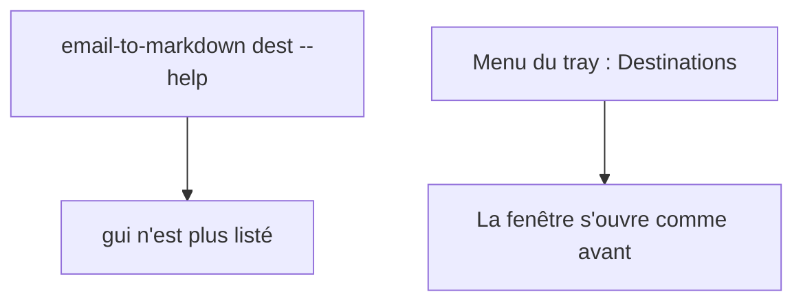
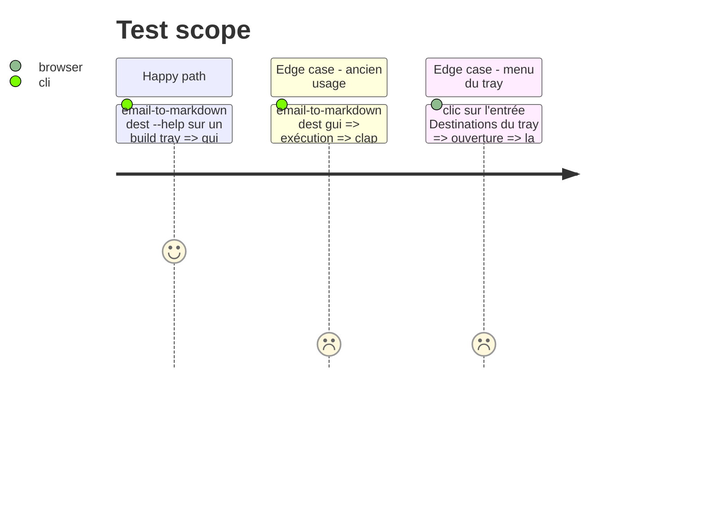

# Instruction: Retirer la sous-commande `dest gui`

Finding : architecture 🔴 `src/dest_cmd.rs:138-149`.

## Architecture projection

> Tree of the final files. ✅ create · ✏️ modify · ❌ delete

```txt
.
├── src/dest_cmd.rs   ✏️ variante `DestCommand::Gui` et son bras de `match` supprimés
└── CHANGELOG.md      ✏️ entrée « Removed » sous « Unreleased »
```

## User Journey



## Test Scope



## Tasks to do

### `1)` Supprimer la variante

> Plus aucun chemin du CLI ne passe par `tray::send_command`.

1. Retirer `DestCommand::Gui` (`dest_cmd.rs:66-69`) et le bras `:138-149`.
2. Vérifier par grep que `send_command(AppCommand::OpenDestGui` n'est plus appelé que depuis `tray/menu.rs`.

### `2)` Documenter le retrait

> L'utilisateur sait où retrouver la fenêtre.

1. Ajouter sous « Unreleased » de `CHANGELOG.md` : retrait de `dest gui`, la fenêtre reste accessible depuis le menu du tray.

## Écarts constatés à l'implémentation

- `mod dest_gui_tests` (`tests/rust_tests.rs`) est conservé : malgré son nom, il teste le module `destinations` (`add_rule`, `remove_entry`…) qu'utilise la fenêtre du tray, pas la sous-commande CLI.
- `tray/mod.rs` appelle `build_dest_gui_window` directement (mode contextuel) : c'est légitime, et seul `tray/menu.rs` passe encore par `send_command(AppCommand::OpenDestGui)`.
- `dest_file` reste utilisé par les autres bras de `run` : pas de variable orpheline.

## Test acceptance criteria

| Task | Acceptance criteria |
| ---- | ------------------- |
| 1    | `cargo build --features tray` passe ; `dest gui` est refusé par clap ; le menu ouvre toujours la fenêtre. |
| 2    | Le CHANGELOG indique le retrait et l'alternative. |
