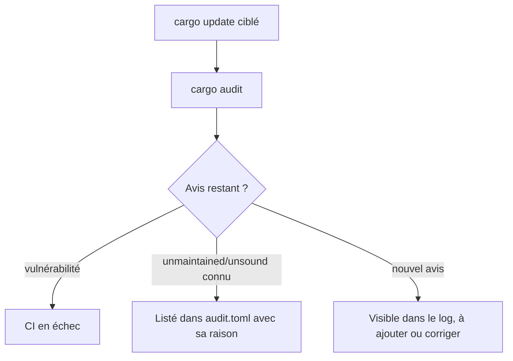
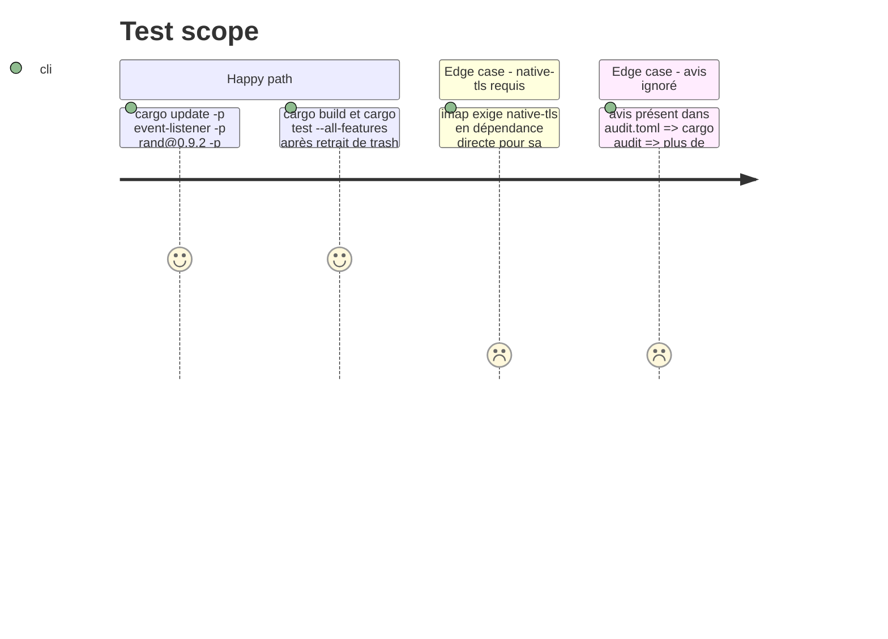

# Instruction: Hygiène des dépendances et politique `cargo audit`

Findings : dependencies 🟡 `Cargo.lock:983`, `.github/workflows/ci.yml:59-62` ; dependencies 🟢 `Cargo.toml:101`, `Cargo.toml:20`, `Cargo.toml:59`, `Cargo.toml:18`, `Cargo.toml:12`, `Cargo.lock:1194`.

## Architecture projection

> Tree of the final files. ✅ create · ✏️ modify · ❌ delete

```txt
.
├── .cargo/audit.toml          ✅ exceptions datées et justifiées, une par avis sans correctif
├── .github/workflows/ci.yml   ✏️ commentaire de l'étape cargo audit mis à jour
├── Cargo.toml                 ✏️ `trash` retiré, `native-tls` retiré si inutile, `htmd = "0.5"`, `imap = "=3.0.0-alpha.15"`
├── Cargo.lock                 ✏️ event-listener 5.4.2, rand 0.9.5 et 0.8.8
└── LICENSE                    ✅ texte MIT, titulaire FX Guillois
```

## User Journey



## Test Scope



## Tasks to do

### `1)` Mises à jour semver-compatibles

> Prendre les correctifs des avis unsound.

1. `rtk cargo update -p event-listener -p rand@0.9.2 -p rand@0.8.5`.
2. Relancer `cargo audit` et noter les avis restants.

### `2)` Dépendances directes

> Ne déclarer que ce qui sert, et épingler ce qui peut casser.

1. Retirer `trash`.
2. Retirer `native-tls` ; s'il est requis pour activer une feature d'`imap`, le garder avec un commentaire.
3. Écrire `htmd = "0.5"` et `imap = "=3.0.0-alpha.15"`.

### `3)` Politique d'audit

> Chaque avis toléré a une raison écrite.

1. Créer `.cargo/audit.toml` avec `ignore = [...]`, un commentaire par identifiant : crate, chemin d'origine, raison, date.
2. Remplacer le commentaire périmé de `ci.yml:59-62` par un renvoi à ce fichier.

### `4)` Licence

> Le `license = "MIT"` de `Cargo.toml` est accompagné de son texte.

1. Ajouter `LICENSE` (MIT, 2026, FX Guillois).

## Écarts constatés à l'implémentation

- RUSTSEC-2026-0097 reste signalé pour `rand 0.7.3`, tiré par `wry 0.44 → kuchikiki → selectors → phf_codegen` (script de build seulement). Aucune version 0.7 corrigée n'existe : l'avis est toléré dans `audit.toml`, avec sa raison. `rand` 0.8 et 0.9 sont bien passés aux versions corrigées.
- `native-tls` est retiré sans commentaire dans le code : `imap` l'active par sa feature par défaut. Un commentaire au-dessus de `imap` le rappelle.
- `audit.toml` tolère aussi `unsafe-libyaml` (via `serde_yaml`, déprécié) et `zbus_names`, `zvariant`, `zvariant_derive` (via `rfd`), apparus depuis le commentaire de la CI.
- Le CHANGELOG mentionne les mises à jour de dépendances et la licence (non demandé par la phase).

## Test acceptance criteria

| Task | Acceptance criteria |
| ---- | ------------------- |
| 1    | `cargo audit` n'affiche plus RUSTSEC-2026-0221 ni RUSTSEC-2026-0097. |
| 2    | `cargo build`, `cargo build --features tray` et `cargo test --all-features` passent ; `trash` est absent de `Cargo.lock`. |
| 3    | `cargo audit` ne remonte que les avis absents d'`audit.toml`, et chaque entrée du fichier a une raison. |
| 4    | `LICENSE` existe à la racine de `app/`. |
