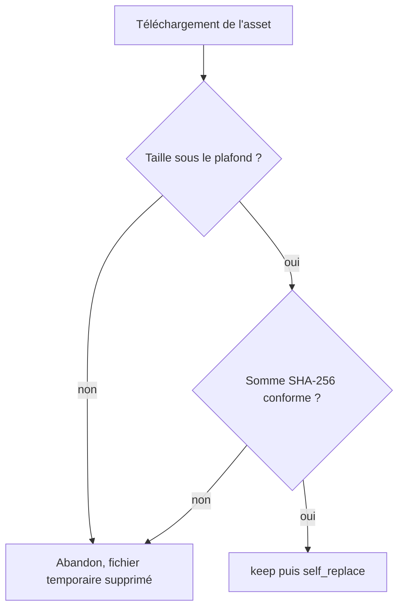
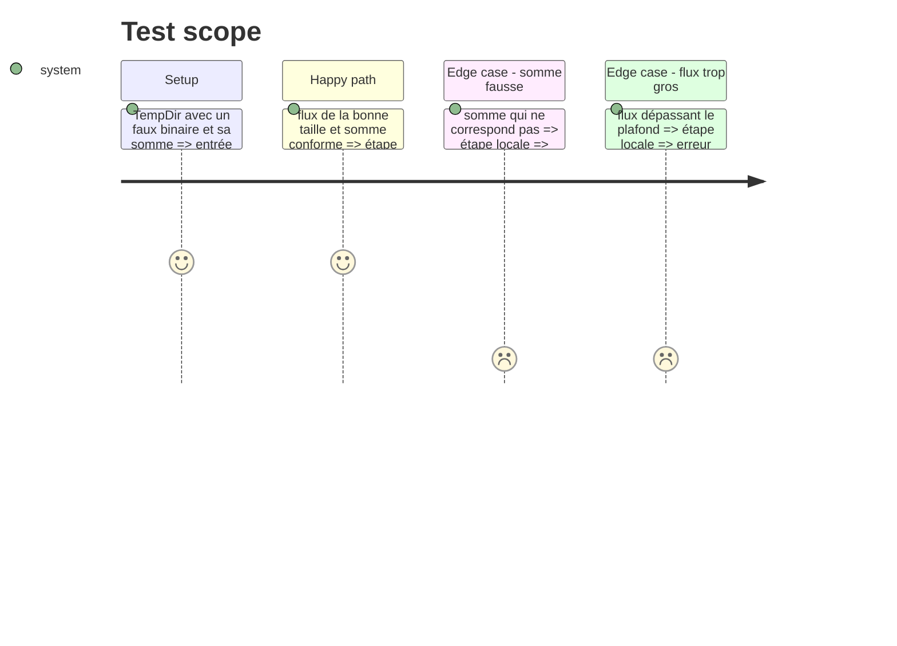

# Instruction: Borner et tester la mise à jour automatique

Findings : security 🟡 `src/updater.rs:150-200` (plafond de taille seulement, la signature est hors plan) ; tests 🟡 `src/updater.rs:170`.

## Architecture projection

> Tree of the final files. ✅ create · ✏️ modify · ❌ delete

```txt
.
└── src/updater.rs   ✏️ plafond de taille au téléchargement ; étape locale « vérifier puis remplacer » extraite et testée
```

## User Journey



## Test Scope



## Tasks to do

### `1)` Plafond de taille

> Une release ne peut pas remplir le disque.

1. Définir une constante de taille maximale de l'asset, avec marge sur la taille actuelle du binaire.
2. Lire via `Read::take(MAX + 1)` et échouer si la limite est atteinte.

### `2)` Extraire l'étape locale

> Tester sans réseau ni remplacement réel.

1. Extraire une fonction qui prend un `Read`, la somme attendue et une fonction de remplacement injectée.
2. Garder l'ordre `verify_checksum` → `keep()` → remplacement (règle `03-tempfile-keep-before-self-replace`).
3. `download_and_apply` l'appelle avec `self_replace::self_replace`.

### `3)` Tests

> Un échec de vérification laisse le binaire intact.

1. Cas nominal, somme fausse, flux trop gros ; le remplacement injecté enregistre s'il a été appelé.

## Écarts constatés à l'implémentation

- `install_download` reçoit aussi le dossier temporaire et le plafond en paramètres. Le test vérifie ainsi qu'aucun fichier ne subsiste dans un `TempDir` qui lui est propre, et éprouve le plafond avec quelques octets au lieu de 100 Mio. La production passe `std::env::temp_dir()` et `MAX_ASSET_BYTES` (100 Mio, pour un binaire d'environ 10 Mo).
- Le refus est détecté une fois lus `max + 1` octets, conformément à `Read::take`, et non au premier octet en trop.
- Critère 2 (mise à jour réelle sous Windows) : vérification manuelle restante.

## Test acceptance criteria

| Task | Acceptance criteria |
| ---- | ------------------- |
| 1    | Un flux plus gros que le plafond est refusé. |
| 2    | La mise à jour réelle se comporte comme avant (vérification manuelle sous Windows). |
| 3    | Dans les deux cas d'échec, le remplacement n'est jamais appelé et aucun fichier temporaire ne subsiste. |
