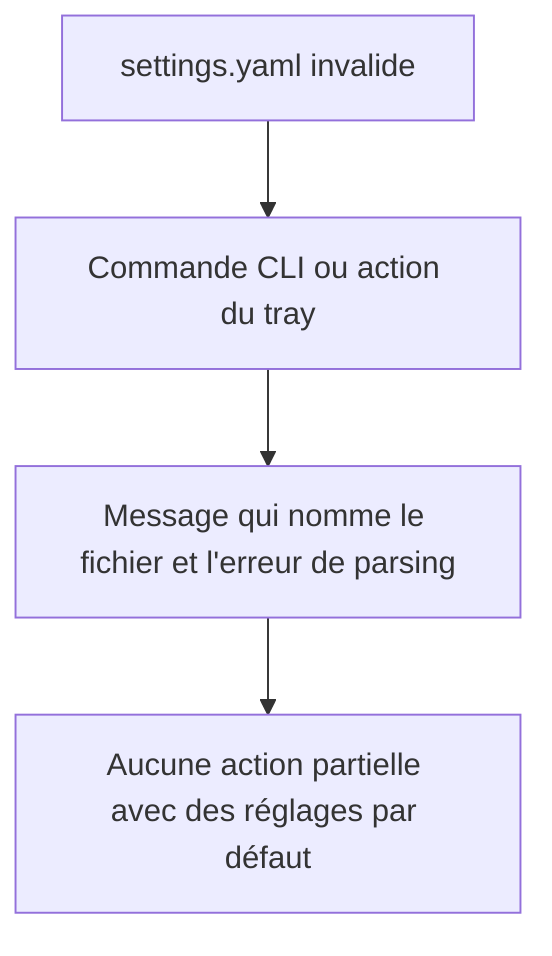
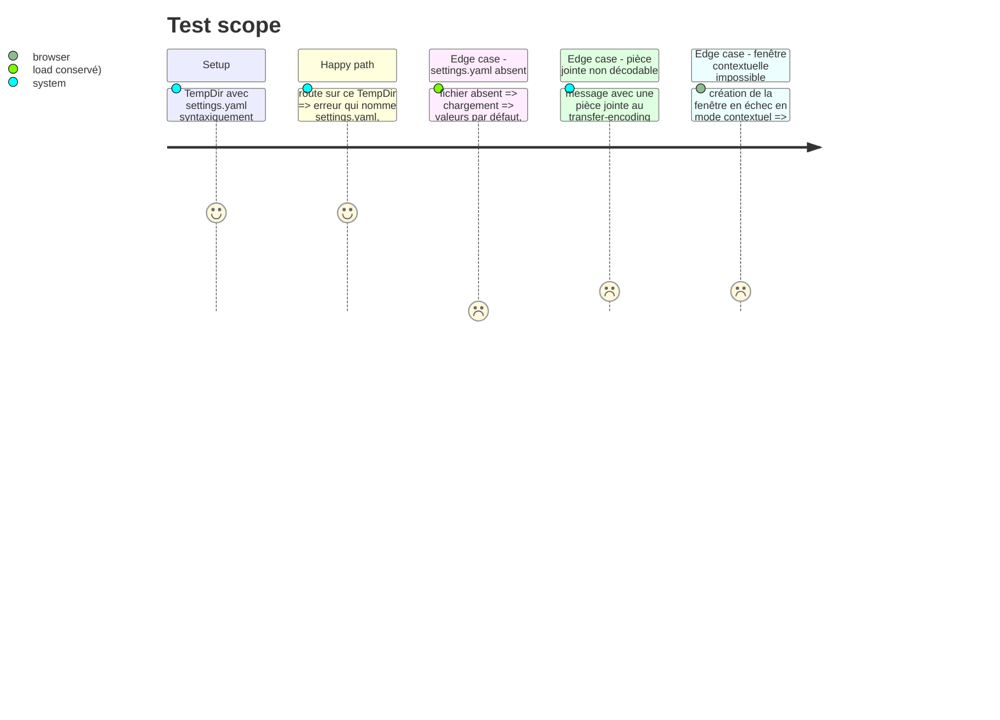

# Instruction: Rendre visibles les erreurs masquées

Findings : code-quality 🟡 `src/main.rs:463`, `src/email_export.rs:1112`, `src/tray/mod.rs:348` ; ui 🟡 `src/tray/ipc.rs:1114-1215`, `src/tray_actions.rs:1300-1311,1351`, `src/tray/menu.rs:217-219` ; ui 🟡 `src/tray/ipc.rs:1043-1052`.

À mener après la phase 2, qui découpe `clean_server` : le site de `tray_actions.rs` se trouve alors dans `clean_server_in`.

## Architecture projection

> Tree of the final files. ✅ create · ✏️ modify · ❌ delete

```txt
.
├── src/main.rs           ✏️ `Settings::load` en erreur → message et arrêt, plus de `unwrap_or_default` (`:463`)
├── src/dest_cmd.rs       ✏️ idem (`:426`)
├── src/route.rs          ✏️ idem (`:518`)
├── src/tray/windows.rs   ✏️ idem (`:555` et `:740-745`, handler de routage) ; plus de double affichage d'erreur des réglages
├── src/tray_actions.rs   ✏️ idem (`:1297`, dans `clean_server_in` après la phase 2) ; messages d'erreur en français
├── src/email_export.rs   ✏️ pièce jointe ou corps non décodés comptés en erreur ; `fs::write` du dump vérifié
├── src/tray/mod.rs       ✏️ échec de fenêtre en mode contextuel → `MessageDialog` avant sortie
├── src/tray/ipc.rs       ✏️ messages d'erreur IPC en français
└── src/tray/menu.rs      ✏️ message d'échec d'ouverture de la documentation en français
```

## User Journey



## Test Scope



## Tasks to do

### `1)` Propager l'erreur de chargement des réglages

> Absent → défauts ; invalide → erreur.

`Settings::load` (`config.rs:143`) renvoie déjà `Settings::default()` quand le fichier est absent, et une erreur seulement quand il est illisible ou invalide. C'est l'appelant qui masque l'erreur.

1. Remplacer `.unwrap_or_default()` par `.context("Lecture de settings.yaml impossible")?` sur les six sites : `main.rs:463`, `dest_cmd.rs:426`, `route.rs:518`, `tray/windows.rs:555`, `tray/windows.rs:740-745`, `tray_actions.rs:1297`.
2. Dans les handlers du tray qui ne renvoient pas de `Result`, afficher l'erreur par le canal existant (réponse IPC ou dialogue) au lieu de poursuivre.

### `2)` Erreurs d'export comptées

> Ne plus écrire de fichier vide en silence.

1. `email_export.rs:1112` : sur échec de `get_body_raw`, ne pas écrire la pièce jointe et l'ajouter aux erreurs du message.
2. `:858` : sur échec de conversion HTML, garder le texte brut et signaler l'erreur.
3. `:2509` : n'afficher « Raw message dumped » que si l'écriture a réussi.

### `3)` Erreurs visibles en mode tray

> L'utilisateur voit ce qui échoue.

1. Afficher un `MessageDialog` d'erreur avant chaque sortie en échec de `run_contextual` (`:348`, `:364`, `:568`).
2. Ne plus renvoyer `ActionResult::Error` quand la webview affiche déjà l'erreur d'enregistrement (`ipc.rs:1043-1052`).

### `4)` Messages en français

> L'interface ne mélange plus les langues.

1. Traduire les messages listés par l'audit (`ipc.rs:1114-1215`, `tray_actions.rs:1300-1311,1351`, `menu.rs:217-219`).

## Écarts constatés à l'implémentation

- **Variante d'erreur dédiée.** `Settings::load` renvoie `ConfigError::SettingsFile { path, reason }` (« Lecture de <fichier> impossible : … ») au lieu d'un simple `.context` : le message nomme ainsi le fichier quel que soit l'appelant.
- **Onze sites au lieu de six.** Le grep a trouvé d'autres `Settings::load(..).unwrap_or_default()` (deux dans `main.rs`, `server_cleanup.rs`, trois dans `tray_actions.rs`, `tray/windows.rs`) : tous propagent désormais l'erreur.
- **Signatures changées.** `route::destinations_path()` et `route::load_destinations()` renvoient un `Result` ; `destinations_path_from(&Path)` porte le test sur `TempDir`. Un fichier de destinations absent ou mal formé donne toujours une liste vide avec un avertissement : seul un `settings.yaml` invalide est une erreur. Les appelants du tray (menu, revue du tri, mode contextuel) convertissent l'erreur en message affiché.
- **Erreurs non fatales.** `ExportContext` reçoit un champ `errors`, que l'export d'un dossier ajoute à `stats.errors` et affiche. Une pièce jointe illisible est omise de la note (aucun fichier vide). Une conversion HTML ratée conserve le texte brut.
- **Exception en mode suppression.** Quand le compte supprime les messages après export, une pièce jointe illisible fait échouer l'export du message : la suppression serveur s'appuie sur la note, et la pièce serait perdue. Le message reste alors sur le serveur.
- **Messages de `tray_actions.rs:1300-1311,1351`.** Ils vivent depuis la phase 2 dans `server_cleanup.rs`, où ils ont été traduits. Les contextes anglais hors de la liste de l'audit (`Failed to load configuration` dans `main.rs` et `tray_actions.rs`, `failed to load settings`) restent en anglais, conformément à la règle des contextes.

## Test acceptance criteria

| Task | Acceptance criteria |
| ---- | ------------------- |
| 1    | Avec un `settings.yaml` invalide, `export` et `route` s'arrêtent avec un message qui nomme le fichier ; sans fichier, ils tournent avec les défauts. Test sur `TempDir` pour `route` ; `grep unwrap_or_default` ne trouve plus aucun appel sur `Settings::load`. |
| 2    | Un message à pièce jointe corrompue produit une note sans fichier vide et une erreur dans le résumé d'export. |
| 3    | Un échec de création de fenêtre en mode contextuel affiche un dialogue ; une erreur d'enregistrement des réglages n'apparaît qu'une fois. |
| 4    | Aucun des messages cités ne reste en anglais. |
