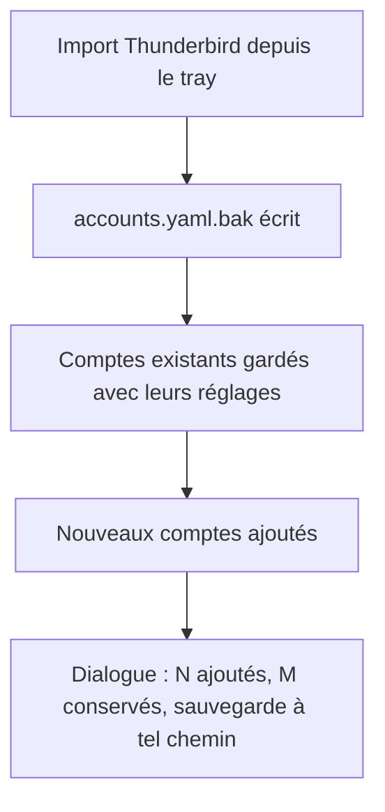
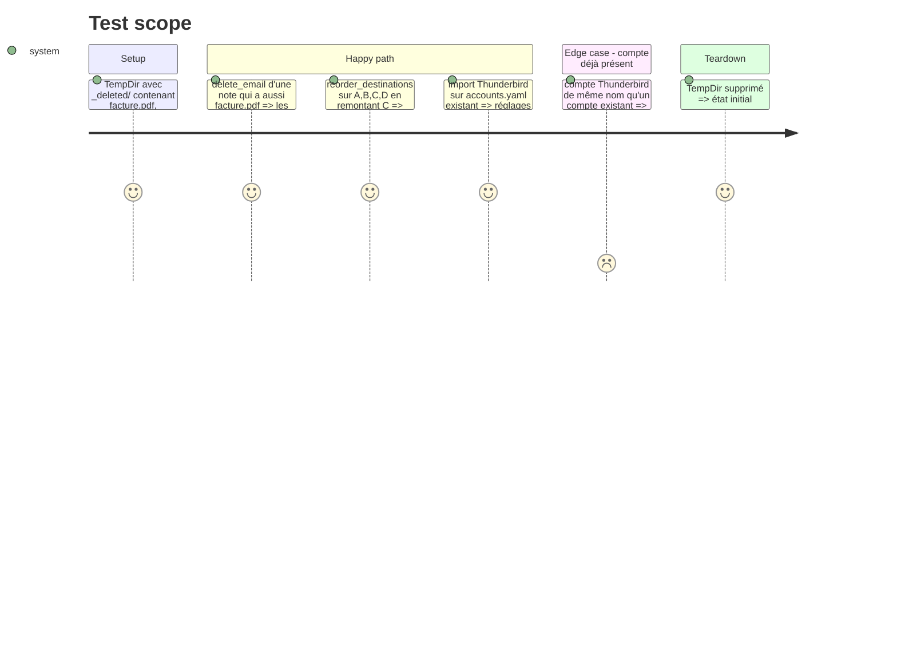

# Instruction: Corriger trois défauts de comportement isolés

Findings : code-quality 🟡 `src/route.rs:480`, `src/destinations.rs:266`, `src/tray_actions.rs:960`.

Chaque correction commence par un test de régression qui échoue.

## Architecture projection

> Tree of the final files. ✅ create · ✏️ modify · ❌ delete

```txt
.
├── src/route.rs           ✏️ `delete_email` applique `unique_name_in` dans `_deleted/`
├── src/destinations.rs    ✏️ `reorder_destinations` conserve l'ordre relatif
├── src/thunderbird.rs     ✏️ `write_accounts_merged(path, &[Account])` : sauvegarde `.bak`, fusion, écriture, rapport ajoutés/conservés
├── src/tray_actions.rs    ✏️ `run_import_thunderbird` (`:960`) appelle la fonction partagée ; message en français
├── src/main.rs            ✏️ sous-commande `import` (`:299`) appelle la même fonction au lieu d'écraser
└── tests/rust_tests.rs    ✏️ trois tests de régression
```

## User Journey



## Test Scope



## Tasks to do

### `1)` Pièce jointe homonyme dans `_deleted/`

> Plus aucun écrasement.

1. Test : deux suppressions de notes à pièce jointe homonyme.
2. Appliquer `unique_name_in` à `route.rs:480`, comme `move_email`.

### `2)` Ordre relatif des destinations

> Tenir la promesse de la doc `destinations.rs:255-257`.

1. Test : réordonner un élément et vérifier l'ordre des autres.
2. Remplacer `swap_remove` par `remove(i)`.

### `3)` Import Thunderbird non destructif

> Les réglages édités dans la fenêtre de config survivent à un import.

Le CLI (`main.rs:299`) et le tray (`tray_actions.rs:960`) écrasent tous deux `accounts.yaml` par `std::fs::write`. La correction passe par une seule fonction de `thunderbird.rs`, appelée des deux côtés.

1. Test sur `TempDir` : `write_accounts_merged` sur un `accounts.yaml` contenant un compte personnalisé.
2. Dans cette fonction : copier le fichier existant en `accounts.yaml.bak`, fusionner (comptes existants conservés tels quels, comptes nouveaux ajoutés), écrire, renvoyer le nombre d'ajoutés et de conservés.
3. Remplacer les deux `std::fs::write` par cet appel.
4. Mentionner la sauvegarde et les comptes conservés dans le dialogue du tray (`:865-875`) et la sortie du CLI, en français (« Imported N account(s) » compris).

## Écarts constatés à l'implémentation

- `thunderbird::generate_accounts_yaml` est supprimée : ses deux appelants passent désormais par `write_accounts_merged`, qui écrit via `config::save_accounts`. Le commentaire d'en-tête « Auto-generated from Thunderbird » disparaît du fichier ; la fenêtre de configuration ne le conservait déjà pas.
- La fusion apparie les comptes par nom exact. Un compte renommé dans la fenêtre de config sera ré-ajouté sous son nom Thunderbird lors d'un nouvel import.
- `ImportSummary::describe` produit le même message pour le CLI et le tray, et remplace « Generated: » comme « Imported N account(s) ».
- Les tests de `write_accounts_merged` sont inline dans `thunderbird.rs`, à côté des autres tests du module.

## Test acceptance criteria

| Task | Acceptance criteria |
| ---- | ------------------- |
| 1    | Après deux suppressions, `_deleted/` contient deux pièces jointes distinctes. |
| 2    | Réordonner un élément ne change pas l'ordre relatif des autres. |
| 3    | Un import, depuis le tray comme depuis le CLI, ne perd aucun réglage d'un compte existant, et `accounts.yaml.bak` contient l'état précédent. |
