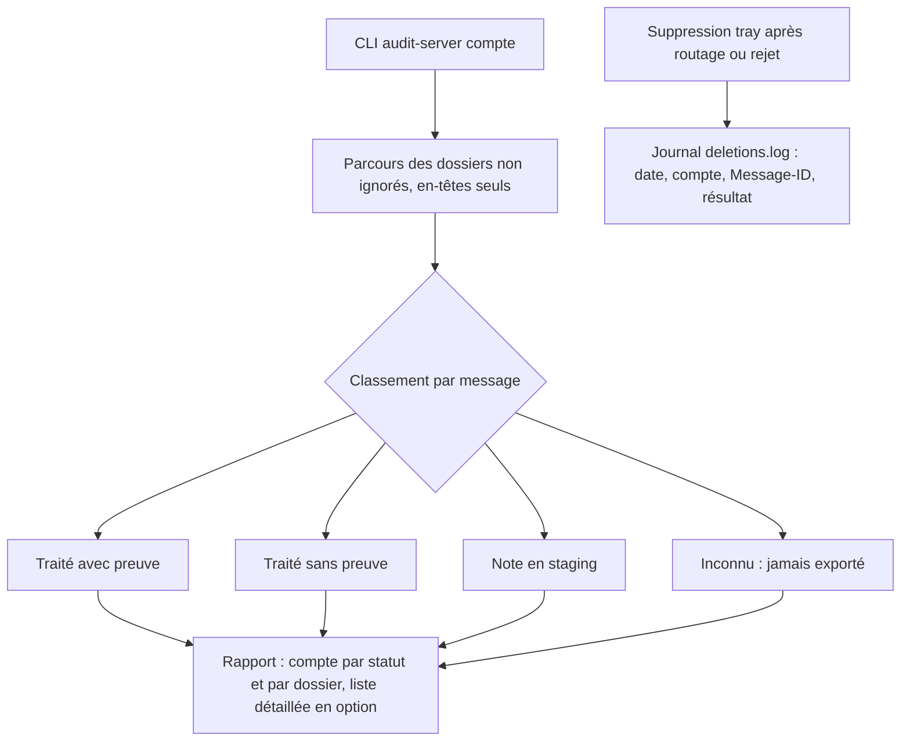
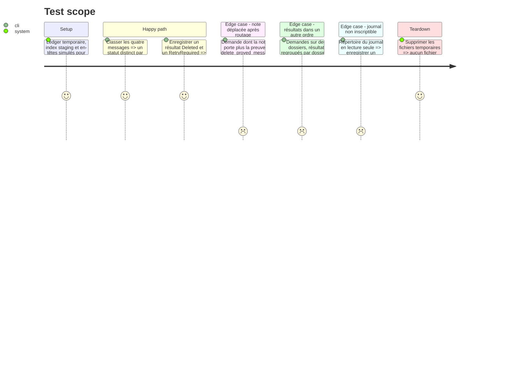

# Instruction: État des lieux serveur et journal des suppressions

## Architecture projection

> Tree of the final files. ✅ create · ✏️ modify · ❌ delete

```txt
.
├── src/
│   ├── ✅ server_audit.rs     # recensement en lecture seule : statut de chaque message serveur
│   ├── ✅ deletion_log.rs     # journal fichier des résultats de suppression
│   ├── ✏️ lib.rs              # déclaration des deux modules
│   ├── ✏️ main.rs             # sous-commande CLI `audit-server <compte>`
│   ├── ✏️ email_export.rs     # delete_proved_messages : demande écartée comptée et journalisée, plus de `continue` muet
│   └── ✏️ tray_actions.rs     # journal des résultats ; retry_contextual_deletions apparie par preuve
├── tests/
│   └── ✏️ rust_tests.rs       # classement des statuts, format du journal
└── ✏️ CHANGELOG.md
```

## User Journey



## Test Scope



## Tasks to do

### `1)` Recenser sans rien modifier

> Connaître l'état réel du serveur avant d'écrire du code destructif.

1. `server_audit::classify(headers, handled, exported)` : statut `HandledWithProof`, `HandledLegacy`, `Staged`, `Unknown` ; le registre est testé avant l'index staging.
2. `server_audit::audit_account(account, folder)` : `UID FETCH` par fenêtres de `HEADER_UID_BATCH` des champs `HEADER_FETCH_FIELDS` (plus `X-GM-MSGID` sur Gmail), aucun corps, aucun `STORE` ; sur Gmail, un message vu dans plusieurs dossiers est compté une fois par X-GM-MSGID.
3. Sous-commande `audit-server <compte> [--folder <nom>] [--details]` : totaux par statut et par dossier ; `--details` liste date, expéditeur, sujet et statut.

### `2)` Journaliser chaque suppression

> Un échec de suppression ne reste plus muet.

1. `deletion_log::append(account, proof, outcome)` écrit une ligne horodatée dans `app_config_dir()/deletions.log` ; une erreur d'écriture est seulement avertie.
2. `spawn_immediate_server_deletions` journalise chaque `MessageDeletionResult` et chaque erreur de connexion ou de préflight.
3. `delete_proved_messages` renvoie, pour chaque demande dont la note est absente ou porte une autre preuve, un résultat `RetryRequired("note absente ou preuve différente")` au lieu de l'ignorer.
4. `retry_contextual_deletions` apparie chaque résultat à sa demande par la preuve, plus par position (`zip`) : `delete_validated` regroupe par dossier et change l'ordre. Une demande rejetée faute de note est journalisée et comptée, mais pas remise dans `retry_deletion`.

### `3)` Vérifier la cause du symptôme

> Confirmer que les messages restants sont bien des messages traités.

1. Lancer `audit-server gutsandgrit@gmail.com --details` et consigner le résultat dans ce dossier de tâche (`audit-2026-10-30.md`).
2. Si aucun message n'est `HandledWithProof` ou `HandledLegacy`, s'arrêter et revoir le plan avant la phase 2.

## Test acceptance criteria

| Task | Acceptance criteria |
| ---- | ------------------- |
| 1 | `audit-server` affiche un total par statut, ne modifie ni le serveur ni le registre, et classe en `Staged` un message dont seule la note en staging existe. |
| 2 | Après un routage dans le tray, `deletions.log` contient une ligne par message avec son résultat ; une demande dont la note ne correspond plus apparaît comme échec ; avec des demandes sur deux dossiers, chaque résultat de `retry_contextual_deletions` correspond à sa propre demande. |
| 3 | Le rapport d'état des lieux de `gutsandgrit@gmail.com` est consigné et indique combien des messages restants sont traités, en staging ou inconnus. |
