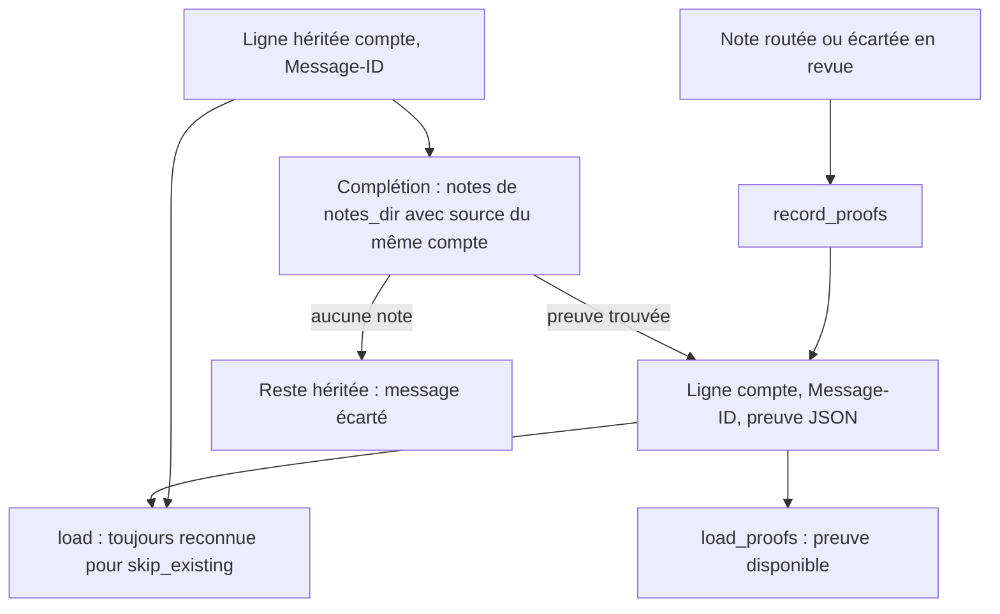
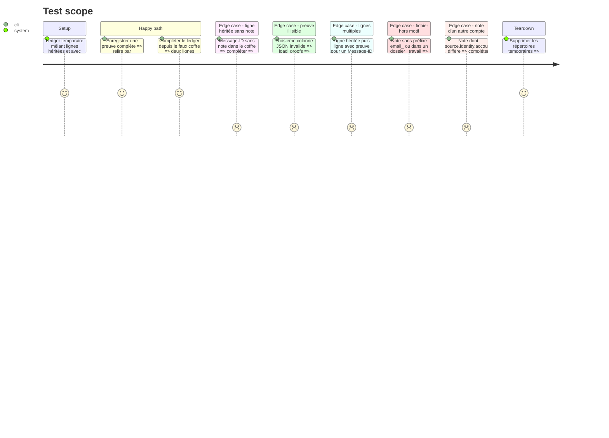

# Instruction: Registre avec preuve et complétion depuis les notes

## Architecture projection

> Tree of the final files. ✅ create · ✏️ modify · ❌ delete

```txt
.
├── src/
│   ├── ✏️ handled.rs          # format à 3 colonnes, lecture rétrocompatible, preuve prioritaire, complétion
│   └── ✏️ server_audit.rs     # statut HandledWithProof fondé sur load_proofs
└── tests/
    └── ✏️ rust_tests.rs       # complétion depuis un faux coffre de notes
```

## User Journey



## Test Scope



## Tasks to do

### `1)` Écrire la preuve dans le registre

> Chaque nouvelle entrée porte de quoi cibler exactement le message serveur.

1. `record_to` accepte une preuve optionnelle par entrée et l'écrit en troisième colonne (JSON sur une ligne, `serde_json`).
2. `record_proofs` passe la preuve ; une preuve incomplète (`proof_is_complete` faux) s'écrit sans troisième colonne.
3. Conserver le filtre `clean` sur compte et Message-ID.

### `2)` Relire les deux formats

> Le `skip_existing` ne régresse pas, la purge dispose des preuves.

1. `load_from` ne prend que la deuxième colonne comme Message-ID, quel que soit le nombre de colonnes.
2. `load_proofs_from(path, account)` renvoie les preuves par Message-ID et l'ensemble des Message-ID sans aucune preuve ; JSON invalide ⇒ ligne héritée ; une preuve pour un Message-ID retire celui-ci des hérités.
3. `load_proofs(account)` sur le registre par défaut ; `server_audit` s'appuie dessus.

### `3)` Compléter les entrées héritées depuis les notes routées

> Remplacer le Message-ID seul par la preuve déjà écrite dans les notes.

1. `complete_from_notes(notes_dir, account)` : parcours unique de `notes_dir` sans suivre les symlinks, en ignorant les dossiers `.*` et `_*`, limité aux fichiers `email_*.md` ; lecture par `read_source_proof`, filtre sur le compte et sur `proof_is_complete`.
2. Ajouter au registre une ligne avec preuve pour chaque Message-ID hérité retrouvé ; ne rien réécrire ni supprimer des lignes existantes.
3. Déclenchée seulement par l'action tray de la phase 4, jamais à l'export : `notes_dir` peut couvrir tout `Documents`, et les entrées des messages écartés restent héritées, donc un déclenchement à l'export relirait l'arbre à chaque fois.

## Test acceptance criteria

| Task | Acceptance criteria |
| ---- | ------------------- |
| 1 | Après un routage, la ligne du registre contient compte, Message-ID et une preuve JSON qui se relit à l'identique. |
| 2 | Un registre uniquement hérité donne le même ensemble de Message-ID qu'avant ; une ligne corrompue ne fait pas échouer la lecture ; un Message-ID ayant une ligne avec preuve n'est plus compté comme hérité. |
| 3 | Après complétion, `audit-server` classe en `HandledWithProof` les messages dont la note routée existe, et ne laisse en `HandledLegacy` que les messages sans note. |
