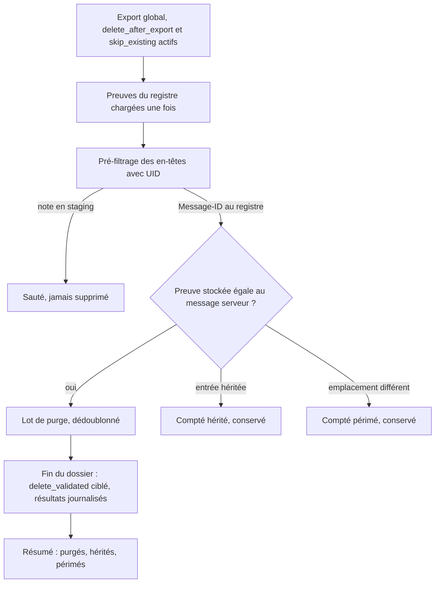
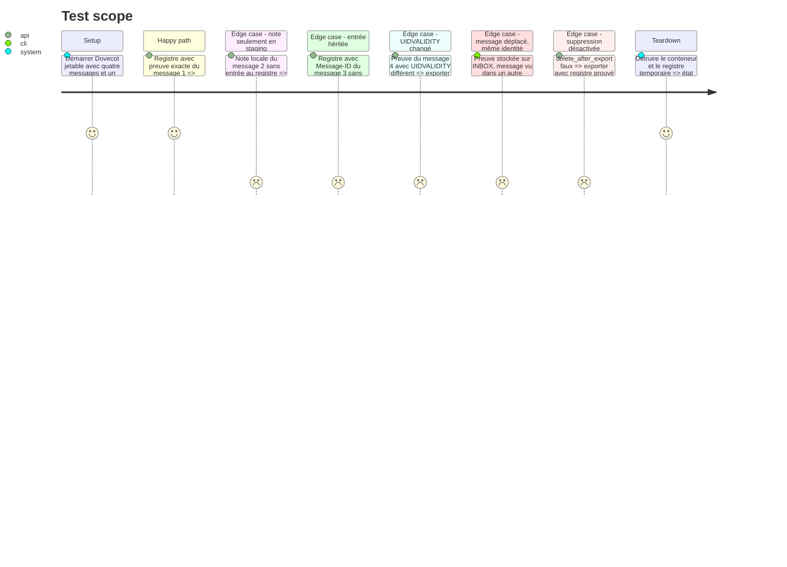

# Instruction: Purge prouvée pendant l'export global

## Architecture projection

> Tree of the final files. ✅ create · ✏️ modify · ❌ delete

```txt
.
├── src/
│   ├── ✏️ email_export.rs   # motif de saut distingué, UID au pré-filtrage, purge en fin de dossier, ExportStats
│   ├── ✏️ tray_actions.rs   # résumé d'export : purgés, hérités restants, emplacements périmés
│   └── ✏️ main.rs           # résumé CLI : mêmes totaux
├── tests/
│   ├── ✏️ rust_tests.rs        # appariement preuve stockée / message serveur
│   └── ✏️ imap_integration.rs  # purge Dovecot : seuls les UID prouvés disparaissent
└── ✏️ CHANGELOG.md
```

## User Journey



## Test Scope



## Tasks to do

### `1)` Distinguer le motif du saut

> Seul un saut dû au registre peut mener à une suppression.

1. `should_skip_from_headers` renvoie le motif (`Handled(message_id)`, `Exported`, aucun) ; partager ce classement avec `server_audit::classify`.
2. `prefilter_window` récupère `(UID RFC822.HEADER)`, ou `(UID X-GM-MSGID RFC822.HEADER)` sur Gmail, dans le même fetch par numéros de séquence, et renvoie, en plus des numéros conservés, les identités serveur `(uid, provider_id, message_id)` sautées pour motif `Handled`.
3. Le saut `already_handled` après téléchargement (`export_folder`) alimente la même liste.

### `2)` Apparier avec la preuve stockée

> Ne supprimer qu'un message dont l'identité serveur égale la preuve du registre.

1. Charger `handled::load_proofs` une fois par export, à côté de `handled::load`, seulement si `delete_after_export` et `skip_existing`.
2. Serveur générique : retenir la preuve dont `folder_raw`, `uid_validity` et `uid` égalent le dossier courant et l'UID vu.
3. Gmail : retenir la preuve dont `provider_id` égale le `X-GM-MSGID` lu au pré-filtrage.
4. Dédoublonner le lot par `provider_id` (Gmail) ou par emplacement (générique) : un message vu dans INBOX et dans « Tous les messages » n'est supprimé qu'une fois.
5. La preuve passée à la suppression garde l'identité stockée mais porte l'emplacement courant (dossier exporté, UIDVALIDITY, UID) : sur Gmail, un message sorti d'INBOX mais visible sous un libellé serait sinon cherché dans le seul dossier d'origine et compté `AlreadyAbsent` sans être supprimé.
6. Entrée sans preuve : compter `legacy_handled`. Preuve sans correspondance : compter `stale_proof`. Rien n'est supprimé dans ces deux cas.

### `3)` Supprimer en fin de dossier

> Réutiliser le chemin destructif existant, sans EXPUNGE global.

1. Après la boucle du dossier, une fois toutes les lectures par numéro de séquence terminées (un EXPUNGE les décale), passer les preuves retenues à `delete_discarded_messages` (préflight UIDPLUS / Gmail inclus).
2. Compter `Deleted` et `AlreadyAbsent` dans `ExportStats.purged` ; journaliser chaque résultat via `deletion_log` ; un échec n'interrompt pas l'export.
3. Préflight non supporté : avertissement unique journalisé, aucun message supprimé.

### `4)` Rendre la purge visible

> L'utilisateur voit ce qui a été supprimé et ce qui reste.

1. Résumé tray et CLI : « N supprimé(s) du serveur (déjà traités) » ; si M hérités > 0, « M message(s) traité(s) sans preuve : utiliser Nettoyer le serveur » (la complétion depuis les notes y est faite) ; si P périmés > 0, leur nombre.
2. Entrée `CHANGELOG.md` sous la version en cours.

## Test acceptance criteria

| Task | Acceptance criteria |
| ---- | ------------------- |
| 1 | Un message dont la note est en staging mais absent du registre n'entre jamais dans le lot de purge. |
| 2 | Seuls les messages dont l'UID (ou le X-GM-MSGID) égale la preuve stockée sont retenus, une seule fois chacun ; une entrée héritée ou un UIDVALIDITY différent n'est jamais retenu ; la preuve de suppression porte toujours l'emplacement où le message vient d'être vu. |
| 3 | Sur Dovecot, après export, seuls les messages prouvés ont disparu ; aucun EXPUNGE non ciblé n'est émis ; avec `delete_after_export: false`, rien n'est supprimé ; chaque suppression figure dans `deletions.log`. |
| 4 | Le résumé de fin d'export affiche le nombre de messages purgés et, s'il y en a, les nombres d'hérités et de périmés. |

## Écarts constatés à l'implémentation

Le scénario Dovecot « export complet avec registre temporaire » n'a pas été écrit tel quel. Le registre est lu à un chemin fixe, tiré de `dirs::config_dir()`, qu'aucune variable ne permet de rediriger. Un test passant par `export_account` écrirait donc dans le registre réel de l'utilisateur. Le test Dovecot ajouté (`handled_message_with_ledger_proof_is_purged_at_its_current_place`, ignoré par défaut) vérifie à la place la chaîne appariement puis suppression ciblée, avec un registre construit en mémoire : seul le message prouvé disparaît, et une preuve déplacée de mille UID est jugée périmée. Les cas « héritée », « UIDVALIDITY changé » et « message Gmail déplacé » sont couverts par les tests de `handled.rs` et le module `handled_purge_tests` de `rust_tests.rs`. Ni ce test Dovecot ni les tests Gmail n'ont été exécutés dans cette session.

Le pré-filtrage lit désormais les en-têtes par une commande `FETCH` brute, analysée par `contextual_export::parse_fetch_response`, qui renvoie aussi le numéro de séquence. Le client `imap` n'expose en effet pas `X-GM-MSGID`. `parse_uid_fetch_response` s'appuie maintenant sur cette fonction.
