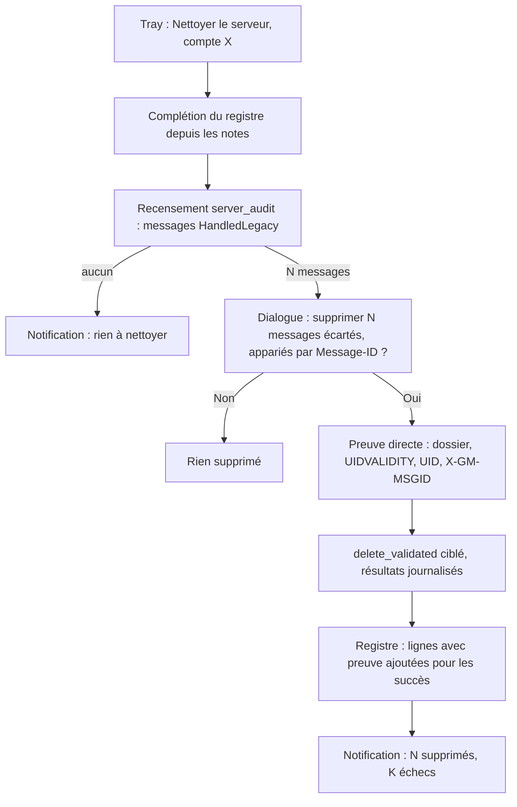
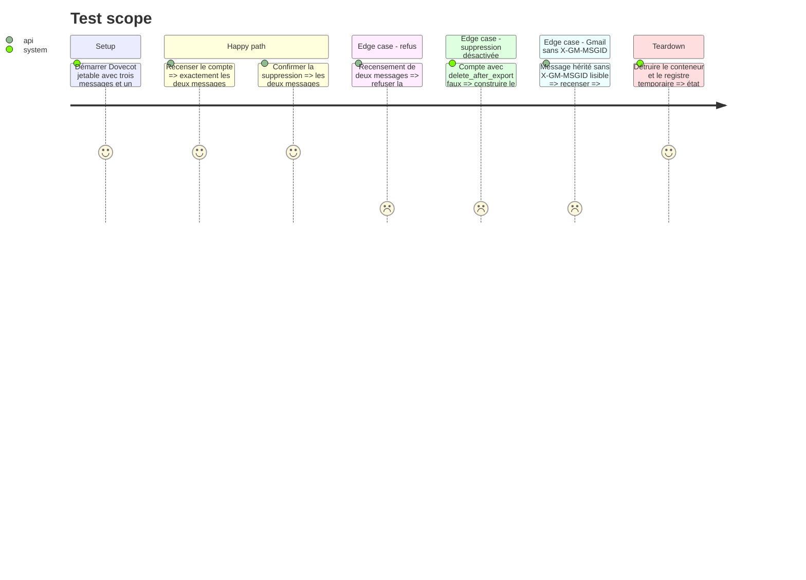

# Instruction: Nettoyage confirmé des entrées sans preuve (tray)

## Architecture projection

> Tree of the final files. ✅ create · ✏️ modify · ❌ delete

```txt
.
├── src/
│   ├── ✏️ server_audit.rs     # preuve directe pour les messages HandledLegacy
│   ├── ✏️ tray_actions.rs     # action « Nettoyer le serveur » : complétion, recensement, confirmation, suppression
│   └── ✏️ tray/menu.rs        # sous-menu par compte, visible si delete_after_export
├── tests/
│   ├── ✏️ rust_tests.rs        # preuve directe et mise à jour du registre
│   └── ✏️ imap_integration.rs  # recensement puis suppression sur Dovecot
└── ✏️ CHANGELOG.md
```

## User Journey



## Test Scope



## Tasks to do

### `1)` Recenser les messages sans preuve

> Savoir combien de messages seraient supprimés avant toute action destructive.

1. Lancer `handled::complete_from_notes` puis `server_audit::audit_account` sur le compte.
2. Pour chaque message `HandledLegacy`, construire une preuve directe (dossier, UIDVALIDITY, UID, Message-ID, X-GM-MSGID lu par lot sur Gmail) ; exclure toute preuve incomplète ; dédoublonner par `provider_id`.
3. Ne rien supprimer pendant le recensement.

### `2)` Confirmer puis supprimer

> L'utilisateur autorise une seule fois la suppression par Message-ID seul.

1. Aucun message : notification « rien à nettoyer ».
2. Sinon, `rfd::MessageDialog` Oui/Non indiquant le compte, le nombre N et que l'appariement repose sur le Message-ID.
3. Oui : `delete_discarded_messages` sur les preuves directes, chaque résultat journalisé ; Non : sortie sans effet.
4. Notification : supprimés, déjà absents, échecs.

### `3)` Mettre le registre à jour

> Une entrée nettoyée ne redevient pas héritée.

1. Pour chaque `Deleted` ou `AlreadyAbsent`, ajouter au registre une ligne avec la preuve directe.
2. Un échec laisse l'entrée héritée pour un nouvel essai.

### `4)` Exposer l'action

> Action par compte, à côté de « Reprendre le tri ».

1. Sous-menu « Nettoyer le serveur » dans `tray/menu.rs`, une entrée par compte dont `delete_after_export` est vrai, selon le motif `RESUME_SORT_PREFIX`.
2. Action dans un thread, résultat via `ActionResult` ; erreurs en `ActionResult::Error`.
3. Entrée `CHANGELOG.md`.

## Test acceptance criteria

| Task | Acceptance criteria |
| ---- | ------------------- |
| 1 | Le recensement renvoie exactement les messages serveur dont le Message-ID est au registre sans preuve et sans note routée, sans modifier le serveur. |
| 2 | Sans confirmation, aucun message n'est supprimé ; avec confirmation, seuls les messages recensés disparaissent, par suppression ciblée. |
| 3 | Après un nettoyage réussi, un nouveau recensement renvoie zéro message ; un message en échec est recensé de nouveau. |
| 4 | L'action n'apparaît que pour les comptes avec `delete_after_export` et signale son résultat par notification. |

## Écarts

- Le recensement réutilise `ImapExporter::audit_server` plutôt qu'une fonction `server_audit::audit_account` : la preuve de chaque message est construite pendant le recensement, à partir de l'UIDVALIDITY lue à l'ouverture du dossier.
- Les messages hérités dont la preuve ne peut pas être construite sont exclus de la suppression et signalés dans la notification finale.
- La clé de dédoublonnage des cibles est factorisée dans `contextual_export::proof_target_key`, partagée avec la purge pendant l'export.
- Le critère 3 est couvert par un test unitaire du registre (une ligne héritée devient prouvée après inscription de la preuve). Le parcours complet, avec confirmation et suppression sur un serveur, n'a été exécuté ni contre Dovecot ni contre Gmail : le registre réel est à un chemin fixe et la boîte de dialogue `rfd` n'est pas pilotable en test.
- Essai réel sur gutsandgrit (30/10, 15 h 19) : les 9 messages hérités ont été supprimés et le nouveau recensement en trouve zéro. L'essai a révélé deux défauts, corrigés depuis :
  - la confirmation `rfd`, ouverte après le recensement, restait derrière les autres fenêtres. Sous Windows, elle passe maintenant par `MessageBoxW`, au premier plan, avec « Non » par défaut ;
  - deux nettoyages simultanés écrivaient deux fois les mêmes preuves. Un verrou n'en autorise plus qu'un à la fois.
