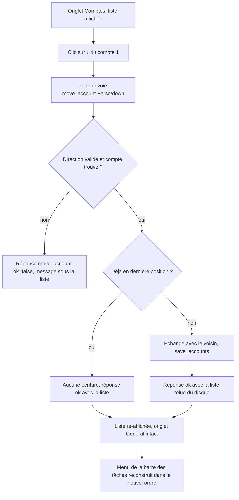
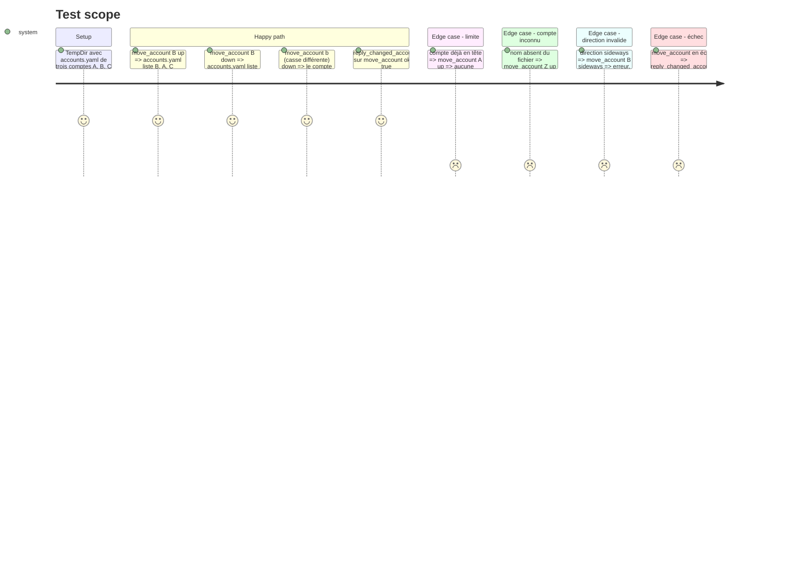

# Instruction: Réordonner les comptes par flèches haut/bas

## Architecture projection

> Tree of the final files. ✅ create · ✏️ modify · ❌ delete

```txt
.
├── assets/
│   └── config_window.html        ✏️ flèches ↑/↓ par ligne, envoi de move_account, traitement de sa réponse, styles
├── src/tray/
│   ├── ipc.rs                    ✏️ fn move_account(name, direction, accounts_path) + branche "move_account" + tests
│   └── windows.rs                ✏️ "move_account" dans reply_changed_accounts + tests
└── aidd_docs/memory/
    └── testing.md                ✏️ nouveaux tests et décompte
```

## User Journey



## Test Scope



## Wireframe

```txt
┌──────────────────────────────────────────────────────────┐
│ (1)                                  [Ajouter un compte] │
├──────────────────────────────────────────────────────────┤
│ (2) ┌──────────────────────────────────────────────────┐ │
│     │ (3) [↑][↓]  Perso                     [Modifier] │ │
│     │             Supprimer la configuration           │ │
│     └──────────────────────────────────────────────────┘ │
│     ┌──────────────────────────────────────────────────┐ │
│     │     [↑][↓]  Pro                       [Modifier] │ │
│     │             Supprimer la configuration           │ │
│     └──────────────────────────────────────────────────┘ │
│ (4) message de succès / erreur                           │
└──────────────────────────────────────────────────────────┘
```

1. En-tête de liste existant (`.acct-list-head`).
2. Liste des comptes (`#account-list-view`), dans l'ordre de `accounts.yaml`.
3. Ligne de compte : flèches à gauche ; ↑ inactif sur la première ligne, ↓ inactif sur la dernière.
4. Zone `#reload-msg` existante : cause d'échec.

## Tasks to do

### `1)` Déplacement dans `accounts.yaml`

> Fonction testable qui déplace un compte d'un cran, chemins en paramètres.

1. Dans `src/tray/ipc.rs`, ajouter `fn move_account(account_name: &str, direction: &str, accounts_path: &Path) -> anyhow::Result<()>` à côté de `delete_account`.
2. Valider `direction` d'abord (`"up"` / `"down"`, sinon `bail!`), avant toute lecture du disque.
3. Charger via `config::load_raw_accounts`, trouver l'index par `eq_ignore_ascii_case`, sinon `bail!("Compte introuvable : …")`.
4. En limite (index 0 vers le haut, dernier vers le bas) : `Ok(())` sans écrire.
5. Sinon `accounts.swap(i, voisin)` puis `config::save_accounts`.

### `2)` Branche IPC `move_account` avec sa propre réponse

> Ne pas passer par `reload`, qui réécrit l'onglet Général depuis le disque et effacerait des saisies non enregistrées.

1. Dans `handle_config_ipc`, ajouter `"move_account"` : lire `data.account_name` et `data.direction`, appeler `move_account` avec `config::accounts_yaml_path()`.
2. Succès → relire `load_raw_accounts` et répondre `{"action":"move_account","ok":true,"accounts":[...]}`.
3. Échec (y compris à la relecture) → `{"action":"move_account","ok":false,"message":"Déplacement impossible : …"}`.
4. Dans `src/tray/windows.rs`, ajouter `"move_account"` au `matches!` de `reply_changed_accounts` pour déclencher `RefreshMenu`.
5. Tests inline de `reply_changed_accounts` : `move_account` ok → `true`, ok=false → `false`.

### `3)` Flèches dans la liste

> Afficher, brancher et traiter la réponse.

1. Dans `renderAccountList`, ajouter deux boutons `.acct-move-btn` (`data-idx`, `data-dir`) avant le nom, `title` « Monter » / « Descendre ».
2. `disabled` sur ↑ de la première ligne et ↓ de la dernière.
3. Au clic : masquer `#reload-msg`, puis `postIpc({ action: 'move_account', data: { account_name, direction } })`.
4. Dans `window.config_result`, branche `result.action === 'move_account'` : en succès, `accounts = result.accounts` puis `renderAccountList()`, sans `populateGeneral()` ; en échec, `showReloadMsg(message, false)`.
5. Styles `.acct-move-btn` sobres, cohérents avec `.btn-secondary`, sans casser `.acct-row` en flex.

### `4)` Mémoire projet

> Tenir le décompte des tests à jour.

1. `aidd_docs/memory/testing.md` : ajouter les tests `move_account` et `reply_changed_accounts`, mettre à jour le décompte.

## Test acceptance criteria

| Task | Acceptance criteria |
| ---- | ------------------- |
| 1 | Partant de A, B, C, après `move_account("B", "up")` `load_raw_accounts` rend B, A, C. Un compte déjà en limite laisse le fichier identique. Un nom inconnu ou une direction invalide renvoie une erreur sans écrire. |
| 2 | Une réponse `move_account` réussie porte la liste dans le nouvel ordre et provoque la reconstruction du menu. Une réponse en échec ne la provoque pas. |
| 3 | Dans la fenêtre, ↓ sur le premier compte le place en deuxième position et le menu de la barre des tâches suit. Une valeur modifiée et non enregistrée dans l'onglet Général est toujours là après le clic. Les flèches en limite sont grisées. |
| 4 | `testing.md` liste les nouveaux tests et le décompte correspond à `cargo test --all-features -- --list`. |
