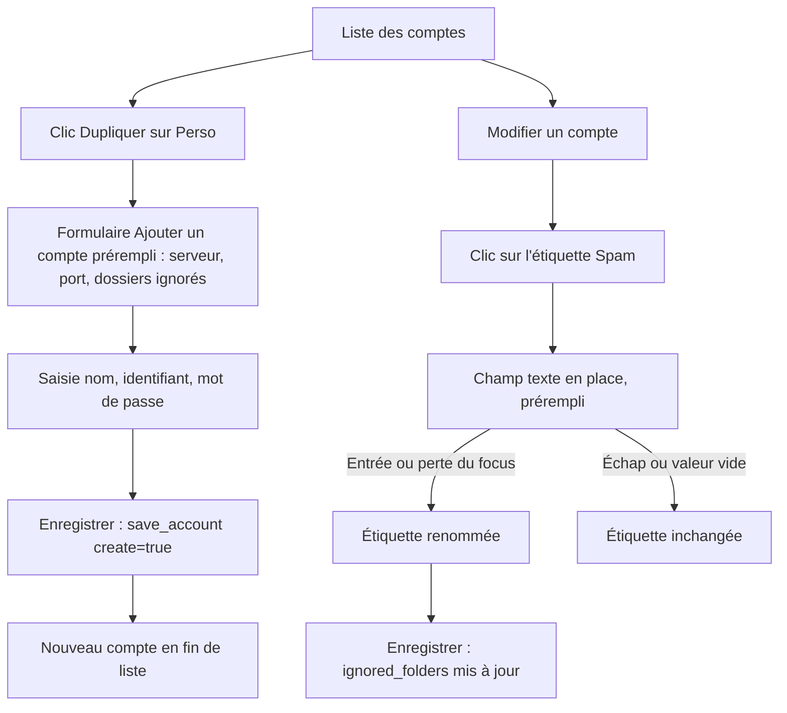
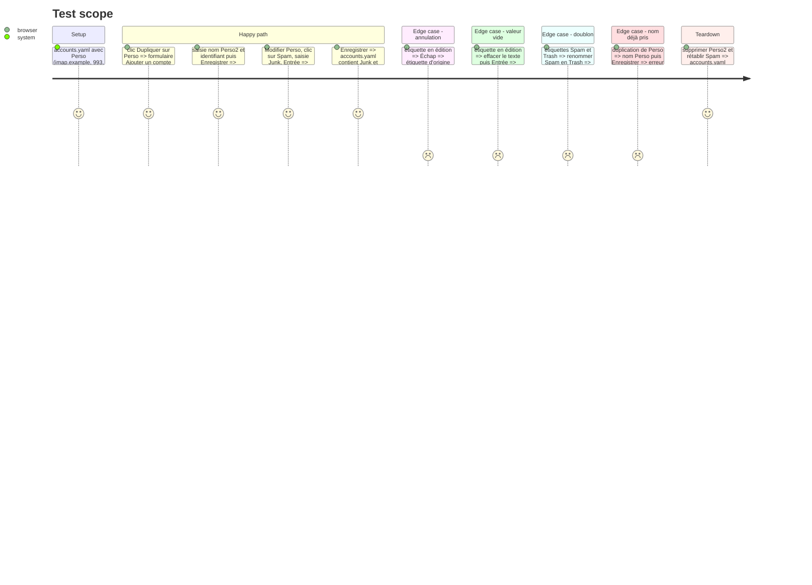

# Instruction: Dupliquer un compte et renommer un dossier ignoré

## Architecture projection

> Tree of the final files. ✅ create · ✏️ modify · ❌ delete

```txt
.
├── assets/
    └── config_window.html        ✏️ bouton Dupliquer, showNewAccount(source), étiquette éditable sur place, styles
```

## User Journey



## Test Scope



## Wireframe

```txt
┌──────────────────────────────────────────────────────────┐
│ (1) ┌──────────────────────────────────────────────────┐ │
│     │ [↑][↓]  Perso            [Dupliquer] [Modifier]  │ │
│     │         Supprimer la configuration               │ │
│     └──────────────────────────────────────────────────┘ │
├──────────────────────────────────────────────────────────┤
│ (2) Modifier le compte                                   │
│     Dossiers ignorés                                     │
│ (3) ( Spam × ) ( [Trash______] ) ( Archives × )          │
│     [Ajouter un dossier...] [+]                          │
└──────────────────────────────────────────────────────────┘
```

1. Ligne de compte : bouton Dupliquer à côté de Modifier.
2. Formulaire de détail existant (`#account-detail-view`), en mode création lors d'une duplication.
3. Zone d'étiquettes (`#acct-chips`) : une étiquette cliquée devient un champ texte à sa place.

## Tasks to do

### `1)` Dupliquer un compte

> Ouvrir le formulaire de création prérempli depuis un compte existant.

1. Dans `renderAccountList`, ajouter `.acct-dup-btn` (`data-idx`) « Dupliquer » à côté de « Modifier ».
2. Faire accepter à `showNewAccount` un compte source optionnel. Avec une source, préremplir `acct-server`, `acct-port` et `currentFolders` (copie par `slice()`).
3. Garder vides `acct-newname`, `acct-username` et `acct-password`, et le comportement sur Défaut, avec ou sans source.
4. Aucune modification Rust : `save_account` avec `create: true` valide déjà le nom.

### `2)` Renommer une étiquette sur place

> Corriger un dossier ignoré sans le supprimer puis le ressaisir.

1. Dans `renderChips`, rendre le libellé cliquable (`.chip-label`, `data-folder-idx`), distinct de `.chip-remove`.
2. Au clic, remplacer le libellé par un `<input>` prérempli, sélectionné et focalisé.
3. Une fonction de fin d'édition unique, protégée par un drapeau `done` propre au champ : seul le premier appel agit. Un `blur` déclenché par le retrait du champ du DOM après Entrée ou Échap est ainsi ignoré.
4. Entrée ou perte du focus : valeur nettoyée (trim). Si elle est vide ou inchangée, rien ne change. Si elle est égale à une autre étiquette, supprimer celle en édition. Sinon remplacer `currentFolders[idx]`. Puis appeler `renderChips()`.
5. Échap : fin d'édition sans modification. Entrée : `preventDefault()`, pour ne déclencher ni `addFolder` ni aucune autre action.
6. Ajouter un `title` « Cliquer pour modifier » et un curseur texte sur `.chip-label`.

## Test acceptance criteria

| Task | Acceptance criteria |
| ---- | ------------------- |
| 1 | « Dupliquer » ouvre « Ajouter un compte » avec serveur, port et dossiers ignorés du compte source. Le nom, l'identifiant, le mot de passe et le comportement sont vides. Modifier les étiquettes du nouveau compte ne touche pas celles du compte source en mémoire. |
| 2 | Cliquer sur une étiquette permet de la renommer. Entrée ou perte du focus applique le nom. Échap ou une valeur vide le laisse intact. Un renommage en doublon ne laisse qu'une étiquette. Après Enregistrer, `accounts.yaml` contient le nouveau nom. |