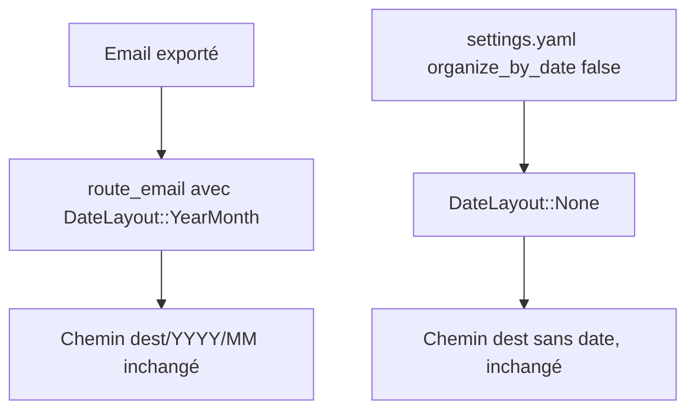
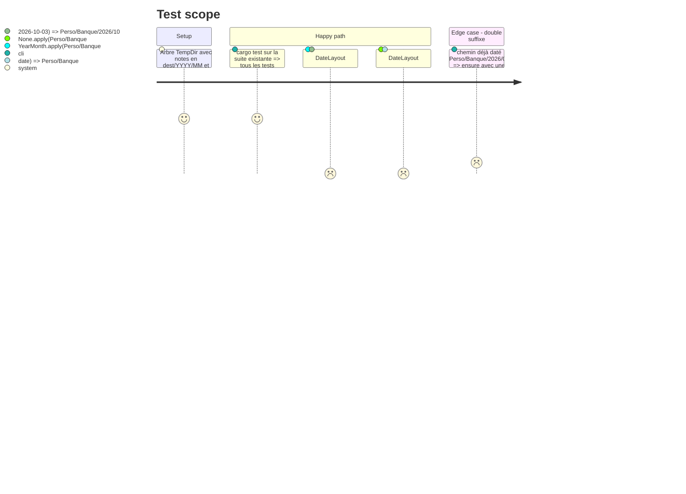

<!-- Fill or omit these sections; never add, rename, or reorder one. -->

# Instruction: Centraliser le motif de date (refactor sans effet)

## Architecture projection

> Tree of the final files. ✅ create · ✏️ modify · ❌ delete

```txt
.
├── src/
│   ├── date_layout.rs          ✅ enum DateLayout + construction et reconnaissance du suffixe date
│   ├── lib.rs                  ✏️ déclare le module date_layout
│   ├── config.rs               ✏️ Settings::date_layout() dérivé de organize_by_date
│   ├── route.rs                ✏️ route_email prend DateLayout ; ends_with_year_month / ensure_year_month délèguent puis disparaissent
│   ├── contextual_export.rs    ✏️ candidate_target prend DateLayout
│   ├── email_export.rs         ✏️ contexte de routage porte DateLayout au lieu de organize_by_date
│   ├── tray_actions.rs         ✏️ lit Settings::date_layout()
│   ├── dest_cmd.rs             ✏️ destination_of / strip_trailing_year_month / email_stats via date_layout
│   └── tray/
│       ├── ipc.rs              ✏️ dated_dest_path / apply_route_decisions prennent DateLayout
│       └── windows.rs          ✏️ lit Settings::date_layout()
└── tests/rust_tests.rs         ✏️ appels adaptés à la nouvelle signature
```

## User Journey



## Test Scope



## Tasks to do

### `1)` Créer `src/date_layout.rs`

> Un seul endroit sait construire et reconnaître le suffixe date d'un chemin.

1. Enum `DateLayout { None, Year, YearMonth, YearMonthDay }`, `#[derive(Debug, Clone, Copy, PartialEq, Eq, Serialize, Deserialize)]`, `rename_all = "snake_case"`.
2. `segments(self, date) -> Vec<String>` : `%Y`, `%m`, `%d` selon le variant.
3. `apply(self, base: &str, date) -> String` : base suivie des segments, sans double `/`.
4. `ensure(self, rel: &str, date) -> String` : n'ajoute rien si `rel` porte déjà un suffixe date (remplace `route::ensure_year_month`).
5. `date_suffix_len(rel: &str) -> usize` (fonction libre) : nombre de segments date en fin de chemin. Dans cette phase, seul `YYYY/MM` est reconnu (même contrôle que `ends_with_year_month` : `19xx`/`20xx`, mois `01`–`12`).
6. `strip_date_suffix(rel: &str) -> String` : retire le suffixe reconnu (remplace `dest_cmd::strip_trailing_year_month`).
7. `destination_of(rel_dir: &str) -> String` : retire `<date>` ou `<date>/<bucket>` (déplacé depuis `dest_cmd`).
8. Pas de `Regex` : un contrôle par segment suffit (règle `02-regex-static-lazylock`).

### `2)` Brancher `Settings`

> L'exécution lit un `DateLayout` résolu, jamais le booléen.

1. `Settings::date_layout(&self) -> DateLayout` : `organize_by_date` à `true` donne `YearMonth`, à `false` donne `None`.
2. `organize_by_date` reste la seule clé YAML dans cette phase.

### `3)` Remplacer `organize_by_date: bool` par `DateLayout`

> Chaque site de construction appelle `DateLayout::apply` / `ensure`.

1. `route::route_email(meta, dests, layout)` : la closure `dated` délègue à `layout.apply`.
2. `contextual_export::candidate_target(target, candidate, layout)` : joint `layout.segments(date)`.
3. `tray/ipc.rs::dated_dest_path(row, layout)` puis `apply_route_decisions(…, layout)`.
4. `email_export.rs` : champs `organize_by_date` des contextes renommés `date_layout: DateLayout`.
5. `tray_actions.rs`, `tray/windows.rs`, `email_export.rs:3160` : `Settings::load(..).date_layout()`.
6. `dest_cmd.rs` : supprimer `destination_of` et `strip_trailing_year_month`. `email_stats`, `scan_folders` et `dest suggest` appellent `date_layout::destination_of` et `date_layout::strip_date_suffix`.
7. Supprimer `route::ends_with_year_month` et `route::ensure_year_month` une fois sans appelant.

### `4)` Tests unitaires du module

> Couvrir le module avant d'élargir son comportement en phase 2.

1. `#[cfg(test)] mod tests` dans `date_layout.rs` : `apply`, `ensure` (double suffixe), `strip_date_suffix`, `destination_of` avec et sans bucket.
2. Reprendre à l'identique les cas existants de `ends_with_year_month` (année `1899` refusée, mois `13` refusé).

## Test acceptance criteria

| Task | Acceptance criteria |
| ---- | ------------------- |
| 1 | `DateLayout::YearMonth.apply("Perso/Banque", 2026-10-03)` renvoie `Perso/Banque/2026/10`, et `DateLayout::None` renvoie `Perso/Banque`. |
| 2 | Un `settings.yaml` avec `organize_by_date: false` donne `DateLayout::None` ; un fichier absent donne `YearMonth`. |
| 3 | La suite `cargo test` existante passe sans qu'aucune assertion ne change. `grep organize_by_date src/` ne trouve plus que `config.rs`, `tray/ipc.rs` (formulaire) et les données de test. |
| 4 | Les tests de `date_layout` refusent `Perso/Banque/1899/06` et `Perso/Banque/2026/13` comme suffixes date. |
