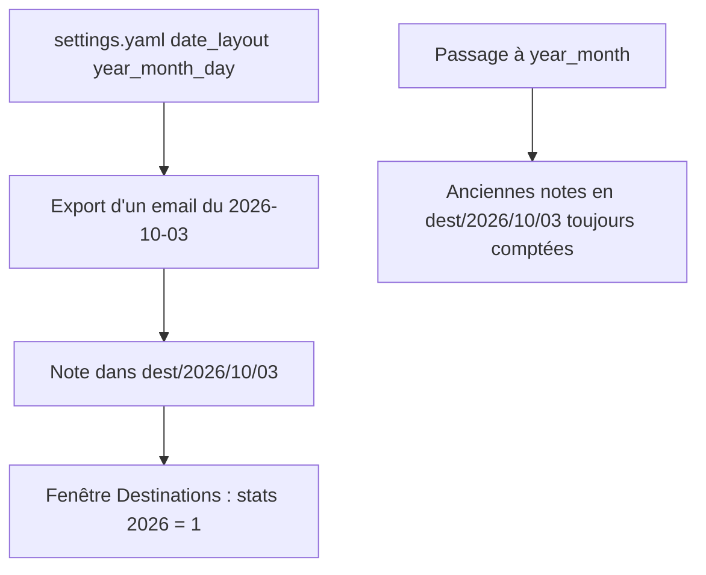
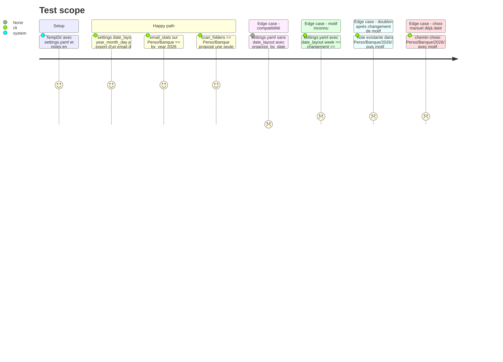

<!-- Fill or omit these sections; never add, rename, or reorder one. -->

# Instruction: Motif de date configurable

## Architecture projection

> Tree of the final files. ✅ create · ✏️ modify · ❌ delete

```txt
.
├── src/
│   ├── date_layout.rs      ✏️ reconnaissance de YYYY, YYYY/MM, YYYY/MM/DD
│   ├── config.rs           ✏️ clé date_layout, résolution avec repli sur organize_by_date
│   ├── contextual_export.rs ✏️ find_existing_proof cherche dans tous les dossiers datés candidats
│   ├── email_export.rs     ✏️ appel de find_existing_proof avec la cible non datée
│   ├── tray_actions.rs     ✏️ appel de find_existing_proof avec la cible non datée
│   ├── tray/ipc.rs         ✏️ save_settings écrit le motif via set_date_layout
│   └── dest_cmd.rs         ✏️ profondeurs de parcours tenant compte de 3 segments date
└── tests/rust_tests.rs     ✏️ tests settings, scan et export E2E par motif
```

## User Journey



## Test Scope



## Tasks to do

### `1)` Clé `date_layout` dans `Settings`

> Le motif se règle dans `settings.yaml` sans casser `organize_by_date`.

1. Champ `date_layout: Option<DateLayout>`, `skip_serializing_if = "Option::is_none"`.
2. `Settings::date_layout()` : la clé si présente, sinon le repli de la phase 1.
3. `Settings::set_date_layout(layout)` : écrit `date_layout` et met `organize_by_date = layout != None`.
4. Mettre à jour `impl Default for Settings`.
5. `tray/ipc.rs::save_settings` (case actuelle, jusqu'à la phase 4) passe par `set_date_layout` : case décochée → `None` ; case cochée → motif courant s'il n'est pas `None`, sinon `YearMonth`. Les deux clés restent cohérentes entre deux phases livrées séparément.

### `2)` Élargir la reconnaissance

> Toute note déjà rangée reste reconnue après un changement de motif.

1. `date_suffix_len` : reconnaît le plus long suffixe parmi `YYYY/MM/DD`, `YYYY/MM`, `YYYY`, testé dans cet ordre.
2. Jour : 2 chiffres, de `01` à `31`.
3. `destination_of` : retire `<date>` ou `<date>/<bucket>`, quel que soit le nombre de segments de date.
4. `ensure` : un chemin qui porte déjà un suffixe reconnu reste tel quel, même s'il est plus court que le motif.
5. Documenter le faux positif accepté (un dossier de niveau nommé `2026`) dans la doc-comment.

### `3)` Profondeurs de parcours

> Le scan et les statistiques atteignent les notes rangées en `YYYY/MM/DD/bucket`.

1. Constante `MAX_DATE_SEGMENTS = 3` dans `date_layout.rs`.
2. `email_stats` : `max_depth = MAX_DATE_SEGMENTS + 1` (bucket).
3. `NOTES_SCAN_DEPTH` : `1 + 2 + MAX_DATE_SEGMENTS + 1`. La phase 3 rendra le `2` configurable.

### `4)` Détection des doublons indépendante du motif

> Un email déjà exporté sous un ancien motif n'est jamais réexporté.

1. `DateLayout::lookup_dirs(base: &Path, date: Option<date>) -> Vec<PathBuf>` : `base`, `base/Y`, `base/Y/M`, `base/Y/M/D` (seulement `base` sans date).
2. `find_existing_proof(target, candidate)` : `target` est la cible **non datée**, et la fonction parcourt chaque `lookup_dirs`.
3. Appelants (`contextual_export.rs:811`, `email_export.rs:2302`, `tray_actions.rs:282`) : passer `target` au lieu de `effective_target`.

### `5)` Tests

> Prouver le motif de bout en bout, du réglage au fichier écrit.

1. Tests `config_tests` : clé présente, clé absente avec `organize_by_date` à `true` ou `false`, valeur inconnue.
2. Tests `date_layout` : les 4 variants dans `apply`, et les préfixes dans `date_suffix_len`.
3. Test E2E : export par le routeur avec `year_month_day`, assertion inclusive sur `2026/10/03` et exclusive sur l'absence de `2026/10/2026` (règle `05-e2e-exclusive-asserts`).

## Test acceptance criteria

| Task | Acceptance criteria |
| ---- | ------------------- |
| 1 | Un `settings.yaml` avec `date_layout: year` range un email du 2026-10-03 dans `<dest>/2026`. |
| 1 | Après `set_date_layout(None)` puis enregistrement, le fichier contient `organize_by_date: false` et `date_layout: none`. |
| 1 | Avec `date_layout: year_month_day`, un `save_settings` case cochée conserve `year_month_day` ; case décochée, il écrit `none` et `organize_by_date: false`. |
| 2 | Avec le motif `year_month`, les notes présentes dans `<dest>/2026/10/03` sont comptées dans les statistiques 2026. |
| 2 | Un chemin choisi à la main, déjà daté en `YYYY/MM`, n'est jamais redaté avec le motif `YYYY/MM/DD`. |
| 3 | Une note dans `Perso/Banque/2026/10/03/bucket` fait apparaître `Perso/Banque` dans le scan des dossiers. |
| 4 | Une note déjà présente en `<dest>/2026/10` est signalée « déjà présente » par l'export clic droit, même avec le motif `year_month_day` ou `none`. |
| 5 | Une valeur `date_layout` inconnue fait échouer le chargement avec un message qui liste `none`, `year`, `year_month`, `year_month_day`. |
