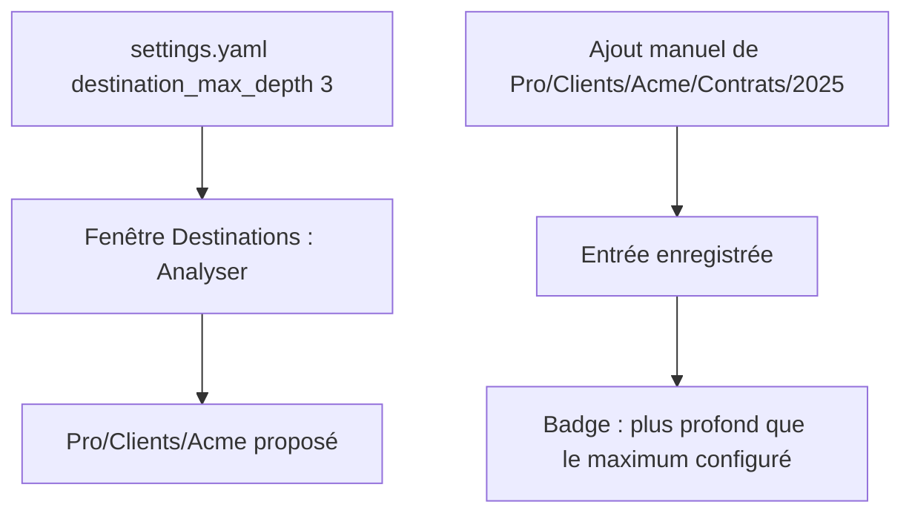
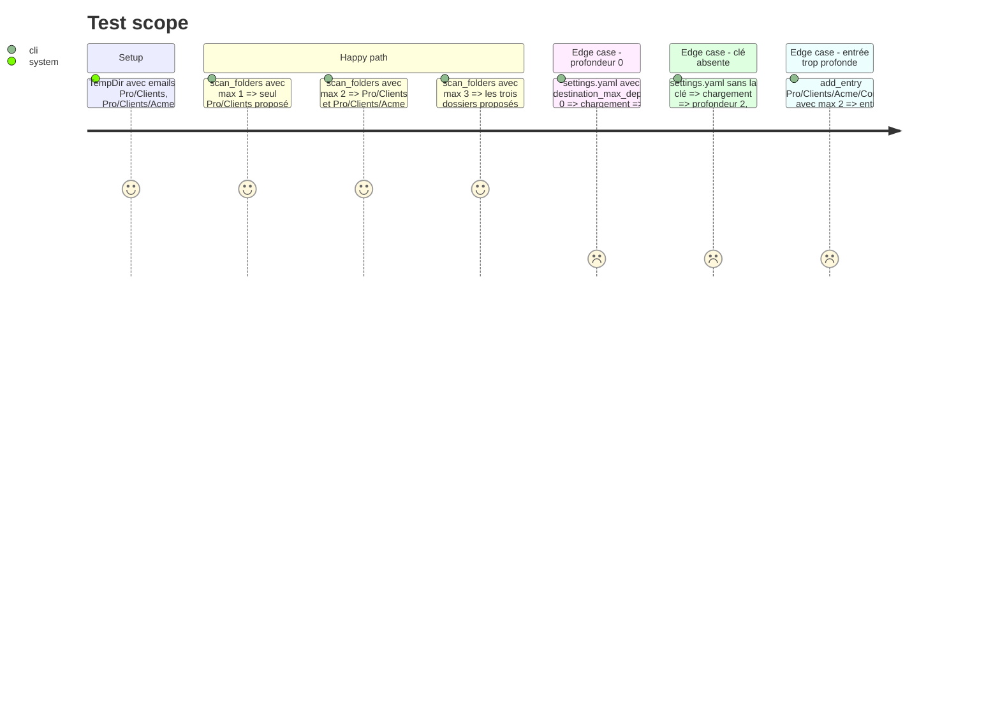

<!-- Fill or omit these sections; never add, rename, or reorder one. -->

# Instruction: Profondeur maximale des destinations

## Architecture projection

> Tree of the final files. ✅ create · ✏️ modify · ❌ delete

```txt
.
├── src/
│   ├── config.rs                 ✏️ clé destination_max_depth, défaut 2, 0 refusé
│   ├── dest_cmd.rs               ✏️ scan_folders / scan_domains / add_entry paramétrés par la profondeur
│   └── tray/
│       └── ipc.rs                ✏️ scan_destinations lit max_depth ; state_json ajoute la liste too_deep
├── assets/
│   └── destinations_window.html  ✏️ avertissement sur les entrées plus profondes que le maximum
└── tests/rust_tests.rs           ✏️ scan à profondeurs 1, 2 et 3, validation de 0
```

## User Journey



## Test Scope



## Tasks to do

### `1)` Clé `destination_max_depth`

> La profondeur sous la branche se règle globalement, avec 1 au minimum.

1. `Settings.destination_max_depth: Option<usize>`, `skip_serializing_if = "Option::is_none"`.
2. `Settings::destination_max_depth(&self) -> usize` : la clé, ou 2 si elle est absente.
3. Validation unique, dans `Settings::load` et `Settings::save` : la valeur 0 renvoie `Err` avec un message qui nomme `destination_max_depth`, et `save` n'écrit rien.

### `2)` Scan paramétré

> Le scan propose tout dossier de 1 à N niveaux sous une branche.

1. `scan_folders(root, branches, max_depth)` : garde une destination de `2..=1 + max_depth` segments.
2. Parcours : `1 + max_depth + MAX_DATE_SEGMENTS + 1`, à calculer dans une fonction `notes_scan_depth(max_depth)`.
3. `scan_domains(root, max_depth)` : même profondeur de parcours.
4. Supprimer `DESTINATION_SEGMENTS` et `NOTES_SCAN_DEPTH`.
5. Appelants (`tray/ipc.rs::scan_destinations`, CLI `dest suggest`) : lisent `Settings::destination_max_depth()`.

### `3)` Avertissement au-delà du maximum

> Un chemin plus profond est accepté, mais signalé.

1. Fonction `exceeds_max_depth(path, max_depth) -> bool` dans `dest_cmd.rs`, après `date_layout::strip_date_suffix`.
2. Gestionnaire CLI `dest add` (`dest_cmd.rs:123`, autour de l'appel à `add_entry`) : `eprintln!` d'un avertissement si le chemin dépasse le maximum. `add_entry` reste inchangée et enregistre l'entrée.
3. `tray/ipc.rs::state_json` : ajoute `"too_deep": Vec<String>` (chemins pour lesquels `exceeds_max_depth` est vrai) et `"max_depth"`, sur le modèle de la liste `missing` existante.
4. `destinations_window.html` : badge d'avertissement sur chaque entrée présente dans `too_deep`, avec une infobulle qui cite `max_depth`. Aucun calcul de segments côté JS.

### `4)` Tests

> Prouver les bornes du scan et la validation.

1. `scan_folders` à `max_depth` 1, 2 et 3 sur le même arbre.
2. `config_tests` : clé absente (2), clé à 3, clé à 0 (erreur).
3. Adapter les tests `test_scan_folders_*` existants à la nouvelle signature (`max_depth = 2`), sans changer leurs assertions.
4. `exceeds_max_depth` : un chemin daté en `YYYY/MM` ne compte pas ses segments de date.

## Test acceptance criteria

| Task | Acceptance criteria |
| ---- | ------------------- |
| 1 | Un `settings.yaml` avec `destination_max_depth: 0` est refusé avec un message qui nomme la clé. Sans la clé, la profondeur vaut 2. |
| 2 | Avec `max_depth = 3`, `Pro/Clients/Acme/Contrats` est proposé. Avec `max_depth = 2`, il ne l'est pas, alors que `Pro/Clients/Acme` l'est. |
| 2 | Avec la configuration par défaut, la fenêtre Destinations propose exactement les mêmes dossiers qu'avant la modification. |
| 3 | `add_entry` de `Pro/A/B/C` avec un maximum de 2 enregistre l'entrée, et `exceeds_max_depth` renvoie `true` (le message stderr du gestionnaire CLI se vérifie à la main : aucun test ne lance le binaire). |
| 3 | `state_json` avec un maximum de 2 liste `Pro/A/B/C` dans `too_deep` et pas `Pro/A/B` ; la fenêtre affiche le badge sur la première seule. |
| 4 | `exceeds_max_depth("Pro/A/B/2026/10", 2)` renvoie `false`. |
