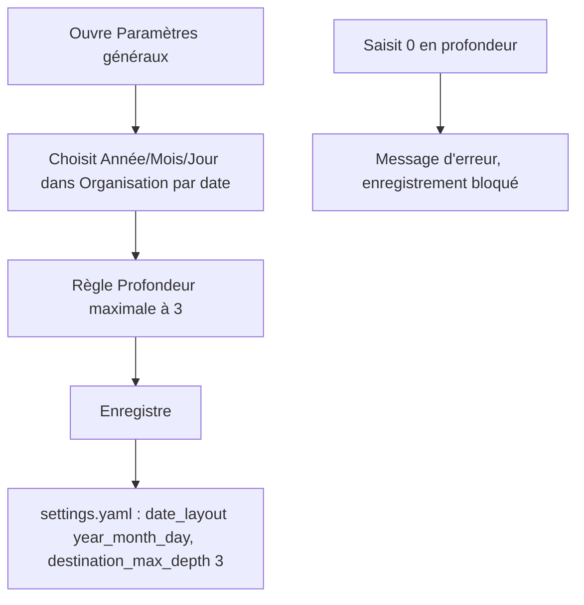
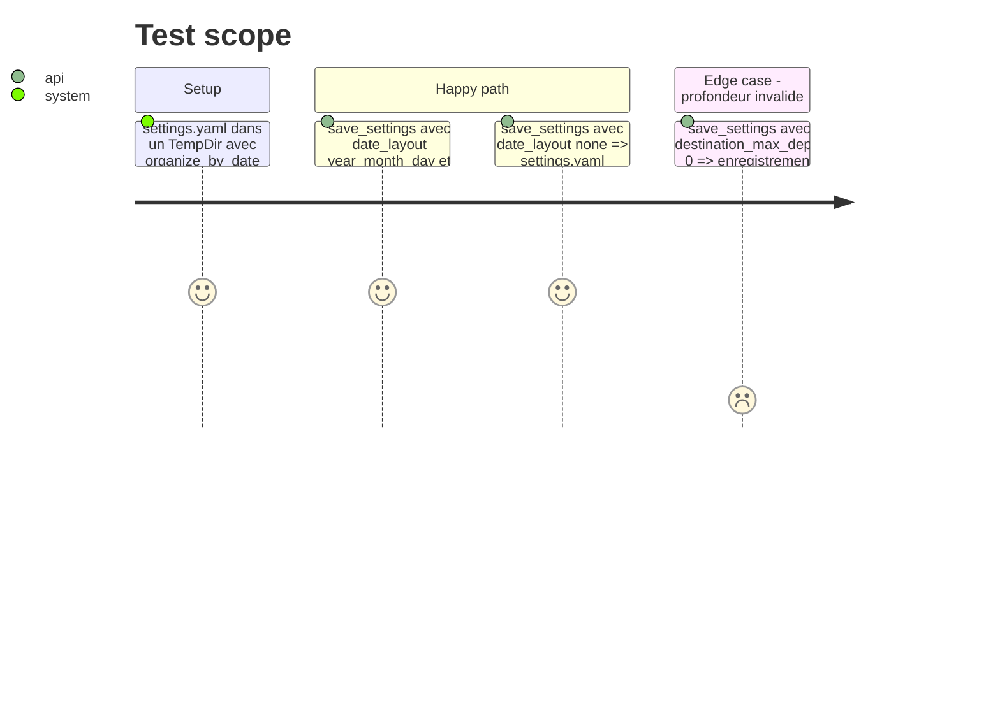

<!-- Fill or omit these sections; never add, rename, or reorder one. -->

# Instruction: Fenêtre de configuration, textes neutres, documentation

## Architecture projection

> Tree of the final files. ✅ create · ✏️ modify · ❌ delete

```txt
.
├── assets/
│   ├── config_window.html        ✏️ liste déroulante du motif de date et champ de profondeur maximale
│   ├── route_review.html         ✏️ placeholder neutre
│   └── destinations_window.html  ✏️ commentaire neutre
├── src/
│   ├── config.rs                 ✏️ doc-comment de notes_dir neutre
│   ├── dest_cmd.rs               ✏️ doc-comments neutres
│   ├── route.rs                  ✏️ doc-comments route_email / DEFAULT_BASE neutres
│   └── tray/
│       ├── ipc.rs                ✏️ SettingsData : date_layout et destination_max_depth ; save_settings validé
│       └── windows.rs            ✏️ JSON injecté dans la fenêtre : valeurs résolues des deux réglages
├── README.md                     ✏️ section réglages : motif de date et profondeur
└── aidd_docs/memory/
    ├── architecture.md           ✏️ module date_layout, nouveaux réglages
    ├── codebase_map.md           ✏️ entrée src/date_layout.rs
    └── project_brief.md          ✏️ repli et routage décrits sans YYYY/MM figé
```

## User Journey



## Test Scope



## Wireframe

```txt
┌──────────────────────────────────────────────────────────┐
│ (1) Exportation                                          │
│  Dossier de destination   [______________________]       │
│  Organisation par date    [ Année / Mois        ▾]       │
│  (2)                      aucune · année · année/mois ·  │
│                           année/mois/jour                │
│  Profondeur maximale      [ 2 ]  niveaux sous la branche │
│  (3)                      (erreur si < 1)                │
├──────────────────────────────────────────────────────────┤
│ (4) Comportement par défaut …                            │
└──────────────────────────────────────────────────────────┘
```

1. Section Exportation existante : les deux nouveaux réglages y vont, à côté du dossier.
2. Liste déroulante qui remplace la case « Classer par année/mois ».
3. Champ numérique, minimum 1, avec un message d'erreur sur le modèle de `quote-depth-error`.
4. Section suivante, inchangée.

## Tasks to do

### `1)` Formulaire IPC

> Le formulaire lit et écrit les deux nouveaux réglages.

1. `SettingsData` : `date_layout: DateLayout` (obligatoire, le HTML est compilé avec le binaire par `include_str!`) et `destination_max_depth: Option<usize>`. Supprimer `organize_by_date` et `default_organize_by_date_field`.
2. `save_settings` : `settings.set_date_layout(..)` et `settings.destination_max_depth = ..`. Le refus de 0 vient de `Settings::save` (phase 3), sans validation en double.
3. Helper de test `settings_data` (`ipc.rs:1742`) : remplacer `"organize_by_date": true` par `"date_layout": "year_month"`, sinon la désérialisation échoue.
4. `tray/windows.rs` : extraire de `build_config_window` une fonction pure `settings_window_json(&Settings) -> Result<String>`, testée dans le `mod tests` du fichier. Après `serde_json::to_value(&settings)`, elle écrit `date_layout = settings.date_layout()` et `destination_max_depth = settings.destination_max_depth()`. La fenêtre reçoit toujours des valeurs résolues : ni repli ni défaut dupliqués en JS.

### `2)` Fenêtre de configuration

> Les deux réglages s'éditent sans toucher au YAML.

1. Remplacer la case `organize-by-date` par un `<select id="date-layout">` (valeurs `none`, `year`, `year_month`, `year_month_day`).
2. Initialiser le `<select>` avec `data.date_layout` (toujours présent, tâche 1.4).
3. Ajouter `<input type="number" id="destination-max-depth" min="1">`, initialisé à `data.destination_max_depth` (toujours présent, tâche 1.4).
4. Validation côté client sur le modèle de `quote-depth` : bouton Enregistrer bloqué si la valeur est inférieure à 1.
5. Envoyer `date_layout` et `destination_max_depth` dans le message `save_settings`.

### `3)` Textes neutres

> Plus aucun texte n'impose `Catégorie/Sous-catégorie` ou `YYYY/MM`.

1. `route_review.html:627` : placeholder `Branche/Niveau/…`.
2. `route.rs:600` : message d'avertissement sur le repli, avec un suffixe date neutre.
3. Doc-comments de `config.rs:107`, `dest_cmd.rs:494-630`, `route.rs` (route_email, DEFAULT_BASE) et `destinations_window.html:895` : décrire « 1 à N niveaux » et « suffixe date selon `date_layout` ».

### `4)` Documentation

> La mémoire et le README décrivent les nouveaux réglages.

1. `README.md` : documenter `date_layout` (valeurs, défaut, compatibilité avec `organize_by_date`) et `destination_max_depth`. Remplacer `<Année>/<Mois>` par une mention du motif.
2. `aidd_docs/memory/architecture.md` : module `date_layout`, signatures de `route_email`, `scan_folders` et `email_stats`.
3. `aidd_docs/memory/codebase_map.md` : entrée `src/date_layout.rs`.
4. `aidd_docs/memory/project_brief.md` : repli et routage décrits sans `YYYY/MM` figé.

## Test acceptance criteria

| Task | Acceptance criteria |
| ---- | ------------------- |
| 1 | Après un `save_settings` avec `year_month_day` et 3, `settings.yaml` contient `date_layout: year_month_day`, `destination_max_depth: 3` et `organize_by_date: true`. |
| 1 | Un `save_settings` avec une profondeur de 0 renvoie une erreur et laisse `settings.yaml` intact. |
| 1 | Avec un `settings.yaml` qui contient `organize_by_date: false` sans `date_layout` ni `destination_max_depth`, le JSON injecté contient `"date_layout":"none"` et `"destination_max_depth":2`. |
| 2 | Sur ce même fichier, la fenêtre s'ouvre sur « aucune » et 2. |
| 2 | Avec 0 dans le champ de profondeur, la fenêtre affiche une erreur et n'envoie rien. |
| 3 | `grep -rn "Sous-cat\|<Category>/<Subcategory>" assets src` ne renvoie rien. |
| 4 | Le README décrit les deux clés avec leurs valeurs par défaut. |
