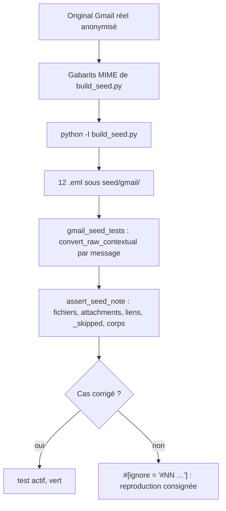

# Instruction : corpus Gmail et harnais de vérification en local

## Architecture projection

> Tree of the final files. ✅ create · ✏️ modify · ❌ delete

```txt
.
├── aidd_docs/memory/testing.md            ✏️ corpus Gmail, module partagé tests/common, commande de régénération
└── tests/
    ├── common/
    │   ├── mod.rs                          ✅ déclare gmail_seed
    │   └── gmail_seed.rs                   ✅ catalogue des 12 messages (Message-ID → attentes) + assert_seed_note()
    ├── fixtures/imap/
    │   ├── gmail/
    │   │   ├── build_seed.py               ✅ générateur déterministe (stdlib seule) : PNG/JPEG/PDF de taille cible + gabarits MIME Gmail
    │   │   └── README.md                   ✅ tableau cas → message → issue, procédure de calage sur un original Gmail
    │   └── seed/gmail/
    │       ├── c1-m1-retours-recette.eml        ✅ généré
    │       ├── c1-m2-re-retours-recette.eml     ✅ généré
    │       ├── c1-m3-re-re-retours-recette.eml  ✅ généré
    │       ├── c2-m4-qr-code.eml                ✅ généré
    │       ├── c2-m5-re-qr-code.eml             ✅ généré
    │       ├── c2-m6-capture-seule.eml          ✅ généré
    │       ├── c3-m7-notes-reunion.eml          ✅ généré
    │       ├── c3-m8-re-notes-reunion.eml       ✅ généré
    │       ├── c3-m9-image-absente.eml          ✅ généré
    │       ├── c4-m10-fwd-devis.eml             ✅ généré
    │       ├── c4-m11-fwd-piece-jointe.eml      ✅ généré
    │       └── c4-m12-re-fwd-devis.eml          ✅ généré
    └── rust_tests.rs                       ✏️ mod common ; module gmail_seed_tests (un test par message, via convert_raw_contextual)
```

## User Journey



## Test Scope

```mermaid
---
title: Test scope
---
journey
  section Setup
    Régénérer le corpus => octets identiques aux .eml versionnés: 5: cli
  section Happy path
    Convertir C1-M1 => 2 captures image.png écrites sans écrasement, dans l'ordre, logo de signature en _skipped: 5: system
    Convertir C1-M1 => listes ordonnée et à puces, deux liens et sauts de ligne présents dans le bloc email: 5: system
    Convertir C2-M5 => PDF, photo jointe, PNG au nom accentué et capture collée écrits et listés dans attachments: 5: system
    Convertir C4-M10 => captures du message transféré et du transfert écrites, tableau et en-têtes transférés lisibles: 5: system
  section Edge case - corps réduit à une image (C2-M6)
    GIF collé sans texte => convertir => note créée, GIF écrit et lié: 1: system
  section Edge case - transfert en pièce jointe (C4-M11)
    message/rfc822 avec capture => convertir => pièce jointe ou ses images écrites, jamais perdues: 1: system
  section Edge case - capture seule sans Content-Disposition (C2-M4, #14)
    multipart/related racine sans disposition => convertir => capture écrite et liée, sinon test ignoré "#14": 1: system
  section Edge case - texte seul avec marqueurs (C3-M8, #15)
    deux [image: image.png] et deux parties image => convertir => test ignoré "#15" tant que non relié: 1: system
  section Edge case - lignes coupées (C3-M7, #18)
    format=flowed et suite d'item de liste => convertir => test ignoré "#18" tant que coupé: 1: system
  section Teardown
    TempDir supprimé => aucun fichier hors du répertoire temporaire: 5: system
```

## Tasks to do

### `1)` Caler le gabarit MIME sur Gmail

> Les fixtures reproduisent la structure réelle de Gmail, pas une structure supposée.

1. Demander à l'utilisateur de composer dans l'interface web de Gmail, du compte A vers le compte B, un mail avec une capture collée, un logo dans la signature, une liste et un lien, puis un mail en mode « texte seul ». Récupérer leurs originaux côté B (« Afficher l'original » > « Télécharger »).
2. Relever l'imbrication MIME, les en-têtes des parties image (`Content-ID: <ii_…>`, `X-Attachment-Id`, présence ou absence de `Content-Disposition`), le balisage HTML (`div dir="ltr"`, `gmail_signature`, `gmail_quote`), et le `Content-Type` du texte seul (`format=flowed; delsp=yes` ?).
3. Sans original disponible, suivre la structure décrite dans #14 (`multipart/related` > `multipart/alternative` + `image/png`), et le noter dans le README des fixtures.
4. Ne versionner aucun octet de l'original : adresses, noms et contenus sont remplacés par des valeurs fictives (`example.com`).

### `2)` Générer le corpus

> Quatre conversations, douze messages, déterministes et régénérables. Une douzaine de messages par essai suffit, à condition que chaque cas soit couvert au moins une fois.

1. `build_seed.py` (stdlib seule, lancé avec `python -I`) produit des images valides d'une taille cible (bruit à graine fixe compressé par `zlib`), un JPEG et un PDF minimal.
2. En-têtes de chaque message :
   - Même sujet de base dans toute la conversation, préfixé `[email-to-markdown seed <run>]`, avec `Re: ` ou `Fwd: ` comme Gmail. Un sujet qui change d'un message à l'autre casserait le regroupement en fils.
   - `Message-ID` `<seed-cN-mN.<run>@email-to-markdown.test>`, `Date` fixe, et pour les réponses `In-Reply-To` et `References`.
   - Les `.eml` versionnés utilisent `<run>` = `fixture` et des adresses fictives (`alice@example.com`, `bob@example.com`).
   - Une fonction de substitution, partagée avec la phase 5, remplace `From`, `To` et `<run>` dans le sujet et les `Message-ID`. Le reste des octets n'est pas modifié.
   - La clé d'attente de chaque message est le préfixe `seed-cN-mN` de son `Message-ID`, retrouvé dans la note par `source.identity.message_id` du frontmatter (`contextual_export::read_source_proof`). Une note sans preuve d'origine est un échec, car la preuve conditionne aussi le ledger.
3. Contenu des messages :

   | Msg | Structure | Contenu | Cas #19 / issue |
   | --- | --------- | ------- | --------------- |
   | C1-M1 | mixed > related > alternative + 2 `image/png` inline + logo | lignes en `<div>` et lignes vides en `<div><br></div>` (balisage de Gmail web), liste `<ol>` de 3 items dont un long, `<ul>` imbriquée sur 2 niveaux, lien `<a href>` avec libellé, URL nue, URL avec parenthèses, lien `mailto:` ; 2 captures `image.png` (120 Ko et 30 Ko) ; signature `gmail_signature` avec logo `cid:` de 8 Ko et 2 icônes de 1 Ko | 2, 3, 4 |
   | C1-M2 | réponse à M1 | texte court + `gmail_quote` qui cite M1 avec sa capture réintégrée (nouveau `cid:`, mêmes octets) | 7 ; attendu : la capture citée est écrite et liée (le nom peut être dédoublonné, jamais d'écrasement), citation intacte |
   | C1-M3 | réponse à M2 | nouvelle capture collée au milieu d'un item de liste, même `cid:` référencé deux fois dans le HTML (attendu : un seul fichier, un seul lien), citation sur 2 niveaux | 2, 7 |
   | C2-M4 | related **racine** > alternative + 1 `image/png` **sans** `Content-Disposition` | une phrase, un QR code de 100 Ko, rien d'autre | 1, #14 |
   | C2-M5 | mixed > (related > alternative + capture 40 Ko) + `application/pdf` + `image/jpeg` jointe + `image/png` jointe au nom accentué (RFC 2231 : `capture d'écran été.png`) | liste à puces, lien | 5, 6 |
   | C2-M6 | related > alternative + 1 `image/gif` animé collé | aucun texte hors signature : le corps ne contient que la capture | 1 |
   | C3-M7 | mixed > `text/plain; format=flowed; delsp=yes` + `image/png` jointe | prose coupée à 76 colonnes, liste numérotée dont les items continuent sur la ligne suivante, ligne commençant par `»`, adresse postale sur 3 lignes courtes, signature après `-- ` | 8, #18 |
   | C3-M8 | mixed > `text/plain` (sans flowed, coupé à 72) + 2 `image/png` | deux marqueurs `[image: image.png]` | #15 |
   | C3-M9 | `text/plain` seul | un marqueur `[image: image.png]` sans partie image (message tronqué) | garde-fou, phase 2 |
   | C4-M10 | transfert en ligne de Gmail (`---------- Forwarded message ---------`), related > alternative + 2 `image/png` du message d'origine | en-têtes du message transféré, tableau HTML simple (3 lignes), capture du message d'origine et nouvelle capture ajoutée au transfert | 2, 4 |
   | C4-M11 | mixed > alternative + `message/rfc822` (transfert en pièce jointe) qui contient lui-même une capture | une phrase | attendu : le `.eml` joint est écrit et listé dans `### Pieces jointes :` (il contient la capture) ; à défaut, la capture est écrite ; jamais ni l'un ni l'autre |
   | C4-M12 | réponse à M10 | sujet en encoded-word avec accents et emoji, URL de plus de 76 caractères coupée dans le `text/plain`, caractères Markdown dans le texte (`*`, `_`, `[x]`) | 3, 4 ; attendu : sujet décodé dans le bloc, URL entière dans un seul lien, caractères présents (échappés ou non) |

   Les citations et transferts (C1-M2, C1-M3, C4-M10) restent dans le corps, sans perte et avec leur en-tête Gmail (`Le … a écrit :`, `---------- Forwarded message ---------`) intact : le découpage revient à `obs-mail split` (voir la frontière dans `plan.md`).

4. Les `.eml` générés sont versionnés sous `tests/fixtures/imap/seed/gmail/`. Ce sous-dossier n'est pas copié par la boucle `/seed/*.eml` de `compose.yaml`.
5. `README.md` des fixtures : tableau ci-dessus, commande de régénération, procédure de calage.

### `3)` Écrire les attentes partagées

> Un seul endroit décrit ce que chaque message doit produire.

1. `tests/common/gmail_seed.rs` : `SeedExpectation` par préfixe `seed-cN-mN`. Il décrit les fichiers attendus (taille, ordre), `attachments`, les entrées `![[…]]` de `### Images :` (où `email_block::render_media` déplace les images du corps), les URL attendues dans `### Liens :` et `- [[…]]` de `### Pieces jointes :`, le contenu attendu de `_skipped/`, les fragments de corps inclusifs et exclusifs, et `held_by_guard` (message conservé par le garde-fou de suppression).
   - Le corps se lit par `email_block::read_body` : si le bloc ne se relit pas en TOML, l'échec doit l'indiquer.
2. `assert_seed_note(note, attachments_dir, skipped_dir, expectation)`, avec des assertions inclusives et exclusives (règle `05-e2e-exclusive-asserts`) :
   - le texte est présent (`disponibles dans votre secteur`) et aucun collage n'apparaît (`dansvotre`) ;
   - les URL attendues sont dans `### Liens :` ou dans le corps (URL nue), aucune ligne isolée ne commence par `»` ;
   - `[image:` est absent, sauf pour un message dont l'attente le conserve explicitement (C3-M9 : marqueur sans image, laissé tel quel).
3. Pour toute image du message, vérifier l'invariant de #19 : elle est soit écrite, soit en quarantaine, jamais perdue.

### `4)` Harnais local

> Le corpus est vérifié à chaque `cargo test`, sans Docker.

1. Module `gmail_seed_tests` dans `tests/rust_tests.rs` : un test par message. Chacun lit le `.eml`, appelle `convert_raw_contextual` sur un `TempDir` avec un compte `skip_signature_images: true`, puis `assert_seed_note`.
2. Lancer les douze tests. Ceux qui échouent sont marqués `#[ignore = "#14 …"]` (ou `#15`, `#18`, garde-fou, ou `#19` pour un cas nouveau sans issue dédiée) et l'échec observé est noté en commentaire. C'est la reproduction attendue par #19.
3. Un test vérifie que `build_seed.py` régénère des octets identiques, s'il trouve `python` dans le `PATH`. Sinon il s'arrête avec un message explicite au lieu de passer en silence.
4. Mettre à jour `aidd_docs/memory/testing.md` (module `gmail_seed_tests`, `tests/common/`, exception à « No shared test helpers file »).

## Test acceptance criteria

| Task | Acceptance criteria |
| ---- | ------------------- |
| 1 | Le README des fixtures indique si le gabarit vient d'un original Gmail réel ou de la structure de #14, et aucune donnée réelle n'est versionnée |
| 2 | Régénérer le corpus donne des `.eml` identiques octet pour octet ; les 12 messages ont les structures du tableau |
| 3 | Chaque message a ses attentes dans `gmail_seed.rs`, avec au moins une assertion exclusive pour le corps |
| 4 | `cargo test gmail_seed` est vert ; chaque cas qui échoue aujourd'hui est ignoré avec le numéro de l'issue et l'échec observé |
