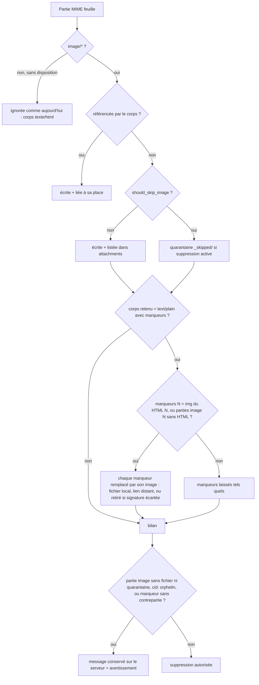
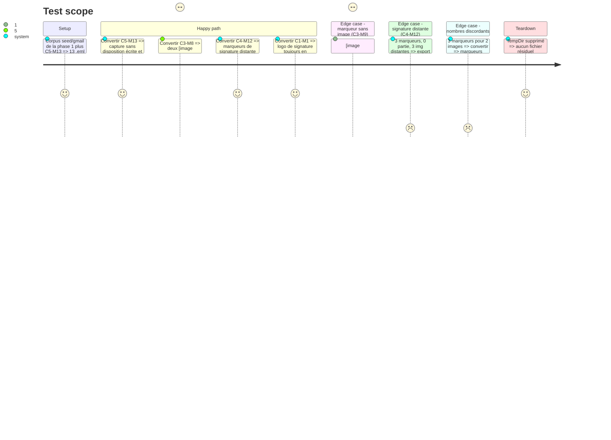

# Instruction : images, aucune perte silencieuse, `[image: …]` relié, garde-fou

## Architecture projection

> Tree of the final files. ✅ create · ✏️ modify · ❌ delete

```txt
.
├── README.md                          ✏️ garde-fou de suppression, marqueurs [image: …] reliés
├── aidd_docs/memory/architecture.md   ✏️ parties image sans disposition, réécriture des marqueurs, garde-fou
├── src/
│   ├── email_export.rs                ✏️ extract_attachments : une partie image/* feuille n'est plus sautée ;
│   │                                     marqueurs [image: …] appariés aux  du HTML ou aux parties image ;
│   │                                     bilan « image annoncée mais non conservée » remonté à la suppression
│   └── contextual_export.rs           ✏️ build_deletion_batch / ConversionStatus : même garde-fou pour l'export contextuel
└── tests/
    ├── common/gmail_seed.rs           ✏️ entrée C5-M13 au catalogue
    ├── fixtures/imap/gmail/
    │   ├── build_seed.py              ✏️ conversation C5 : message C5-M13
    │   └── README.md                  ✏️ C5-M13, cause de #14, état des cas
    ├── fixtures/imap/seed/gmail/
    │   └── c5-m13-capture-texte-seul.eml ✅ sortie régénérée du générateur
    └── rust_tests.rs                  ✏️ test C5-M13 ; réactive C3-M8, C4-M12 ; tests unitaires du garde-fou
```

## User Journey



## Test Scope



## Tasks to do

### `1)` Reproduire et expliquer la réouverture de #14

> C2-M4 ne reproduit pas #14 (constat de la phase 1) : sa capture est référencée par le HTML, donc écrite et liée.

1. Symptôme à reproduire : une note qui contient `[image: image.png]`, sans clé `attachments`, sans `### Images :`, et sans `_skipped/`. Le corps retenu est donc le `text/plain`, et l'image n'a été ni écrite ni mise en quarantaine.
2. Ajouter au générateur la conversation C5, avec un seul message, C5-M13 : `multipart/related` > `text/plain` avec `[image: image.png]` + `image/png` avec `Content-ID` mais sans `Content-Disposition` ni `filename`. Le corps ne référence aucun `cid:`, donc le `continue` de `extract_attachments` (`src/email_export.rs:1146`) saute la partie. Régénérer et versionner le `.eml`.
3. Ajouter C5-M13 au `CATALOGUE` (`images: 1`, aucun `held_by_guard`) et son test `test_gmail_seed_c5_m13`, en `#[ignore = "#14 …"]` jusqu'à la tâche 2. Le numéro 13 et la conversation C5 évitent qu'un préfixe `seed-c2-m4` désigne deux messages.
4. Vérifier par tests unitaires les deux autres chemins de la réouverture, et consigner le résultat dans le commentaire du test :
   - HTML qui référence un `cid:` mais que la conversion perd (`referenced_content_ids(&converted)` vide) : on retombe sur le `text/plain` et sur le cas C5-M13 ;
   - export contextuel (`contextual_export.rs:858`) : la quarantaine est active avec `delete_after_export`, et `discard_quarantined` ne la vide que si aucune note n'est installée.

### `2)` Ne plus sauter une partie image

> Toute partie `image/*` feuille aboutit à un fichier écrit ou mis en quarantaine.

1. Restreindre le `continue` aux parties sans disposition qui ne sont pas des images (les corps `text/plain` et `text/html`).
2. Nommer une image sans `filename` par `inline_image_name`, ou à défaut d'après son type MIME (`image.png`).
3. Elle passe ensuite par `should_skip_image` comme une pièce jointe non référencée.
4. Retirer `#[ignore]` de C5-M13.

### `3)` Relier les marqueurs `[image: …]` (#15)

> Un corps `text/plain` de Gmail pointe vers les images, et ne garde aucun marqueur dont la contrepartie est connue.

1. Le motif reconnaît un marqueur coupé sur deux lignes (`[image:\nlinkedin.png]`, C4-M12) : espaces et retour à la ligne permis après `image:`. Motif en `static LazyLock<Regex>` (règle du projet).
2. Liste de référence, dans l'ordre :
   - si le message a une partie `text/html`, la suite de ses `` (`cid:` ou URL distante) ;
   - sinon, les parties image feuilles dans l'ordre MIME (C3-M8).
3. Si le nombre de marqueurs égale la longueur de la liste, remplacer chaque marqueur par sa contrepartie :
   - image locale écrite : ``, au format de `rewrite_cid_images`, pour que `email_block::render_media` la place dans `### Images :` ;
   - image écartée par le filtre signature (quarantaine ou `skip_signature_images`) : marqueur retiré ;
   - image distante : marqueur retiré si `skip_signature_images` et si le nom, l'`alt` ou la position (`gmail_signature`) désignent une signature ; sinon lien simple `[nom](url)`, jamais une image intégrée, pour ne charger aucune ressource distante dans Obsidian.
4. Sinon, laisser le texte tel quel. Ne jamais lister deux fois une image reliée (corps et section média).
5. Ordre du pipeline : réécrire les marqueurs avant `cleaner::clean`, pour que `unwrap_lines` ne recolle pas une ligne à un marqueur. Le vérifier sur C3-M8 et C4-M12 (règle « pipeline order »).

### `4)` Garde-fou de suppression (#19)

> Ne jamais supprimer du serveur un message dont une image annoncée n'a été ni écrite ni mise en quarantaine.

1. Après extraction, faire un bilan par message quand la suppression est active. Chacune de ces conditions bloque la suppression :
   - une partie feuille `image/*` qui n'est ni écrite ni en quarantaine ;
   - un `cid:` encore présent dans le corps sans fichier ;
   - un marqueur `[image: …]` qui reste après la tâche 3 et n'a aucune contrepartie : le message n'a ni partie image ni `` dans son HTML en nombre suffisant. C3-M9 (un marqueur, rien d'autre) est bloqué. C4-M12 (trois marqueurs, trois `` distantes) ne l'est pas.
2. Remonter ce signal au chemin de suppression de l'export (`delete_validated`) et de l'export contextuel (`build_deletion_batch`). Le message reste sur le serveur et un avertissement est ajouté à `ctx.errors`.
3. Tests unitaires, suppression active : C3-M9 est conservé avec un avertissement ; un message dont une image sur deux n'est ni écrite ni en quarantaine est conservé ; C4-M12 et les messages complets restent supprimables.
4. Le champ `held_by_guard` du catalogue reste la source de vérité de la phase 5 : seul C3-M9 le porte.

### `5)` Réactiver les cas et documenter

> La reproduction de la phase 1 devient verte pour les images.

1. Retirer `#[ignore]` de C3-M8 et C4-M12. C3-M9 et C2-M4 sont déjà verts et le restent.
2. Mettre à jour `README.md`, `aidd_docs/memory/architecture.md` et le README des fixtures (C5-M13, cause de #14, tableau des cas).

## Test acceptance criteria

| Task | Acceptance criteria |
| ---- | ------------------- |
| 1 | C5-M13 reproduit le symptôme de #14 (marqueur seul, aucun fichier, aucune quarantaine) ; les deux autres chemins sont vérifiés par test, et la cause est écrite dans le commentaire du test |
| 2 | Une capture sans `Content-Disposition` est écrite, ou mise en quarantaine si elle ressemble à une signature, jamais ignorée ; C5-M13 est vert |
| 3 | Dans C3-M8, chaque marqueur devient un lien vers une image distincte, dans l'ordre ; dans C4-M12, aucun `[image:` ne reste ; avec des nombres discordants, le texte reste inchangé |
| 4 | Avec `delete_after_export: true`, C3-M9 et un message dont une image sur deux est perdue restent sur le serveur, et le rapport signale chacun ; C4-M12 et les messages complets restent supprimables |
| 5 | `cargo test` est vert sans `#[ignore]` lié à #14 ou #15 |

## Écarts au plan

- **`cid:` orphelin retiré des conditions de blocage (tâche 4).** Les réponses Gmail citent les `cid:` du message précédent sans joindre les parties (C1-M3). La copie serveur ne contient pas davantage ces images : bloquer la suppression n'aurait rien protégé, et aurait retenu toutes les réponses. Les conditions retenues sont une partie image illisible, un marqueur sans contrepartie, et des marqueurs plus nombreux que les parties image et les `` du HTML.
- **Image illisible avec suppression active, export contextuel.** La conversion refusait déjà un message à supprimer dont une pièce jointe est illisible : aucune note n'est écrite, et rien n'est supprimé. Le test vérifie ce refus au lieu de passer par `build_deletion_batch`.
- **Signal de blocage.** Il est porté par la note elle-même (clé `keep_on_server` du frontmatter), et non par un retour en mémoire. Chaque chemin de suppression le relit : lot contextuel, purge d'export, revue du tri.
- **Messages retenus rangés depuis la revue.** Ils sont inscrits dans `handled_messages.txt` avec une troisième colonne `held`. Sans ce marqueur, une ligne sans preuve aurait été la cible même de « Nettoyer le serveur ». Le recensement les affiche « retenu, image non conservée » et le nettoyage ne les vise pas. La purge d'export les compte à part.
