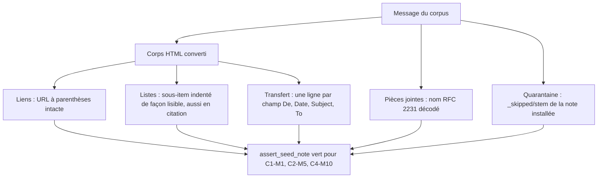
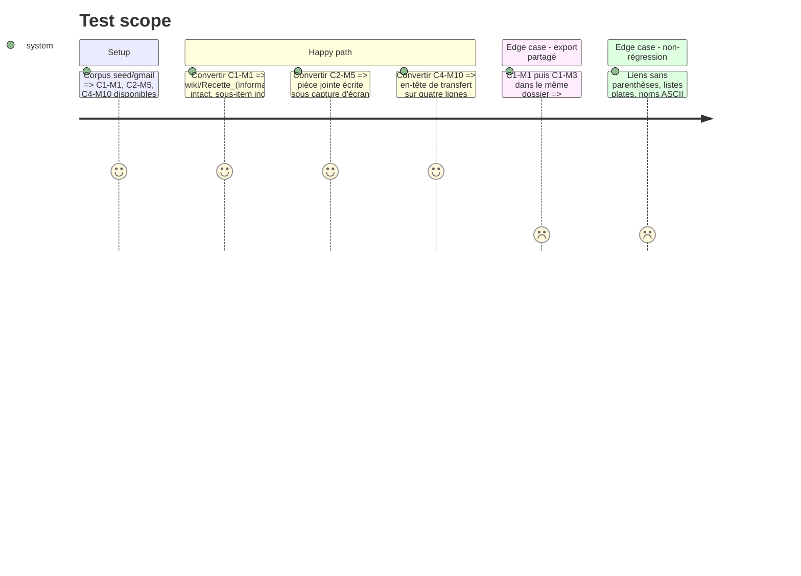

# Instruction : rendu HTML, noms de pièces jointes et quarantaine

Défauts révélés par le corpus en phase 1, sans issue dédiée : ils sont rattachés à #19, qui demande que chaque cas « arrive comme il convient ».

## Architecture projection

> Tree of the final files. ✅ create · ✏️ modify · ❌ delete

```txt
.
├── aidd_docs/memory/architecture.md   ✏️ liens à parenthèses, listes imbriquées, en-tête de transfert, RFC 2231, stem de quarantaine
├── src/
│   ├── email_export.rs                ✏️ extract_attachment_filename : nom RFC 2231 décodé ; dossier de quarantaine = stem de la note installée
│   ├── contextual_export.rs           ✏️ (selon la cause) quarantaine rattachée au nom final de la note
│   └── cleaner.rs / html_to_markdown  ✏️ (selon la cause) parenthèses d'URL, indentation des listes, <br> de gmail_attr
└── tests/
    ├── common/gmail_seed.rs           ✏️ assert_seed_note vérifie que la quarantaine est sous _skipped/<stem de la note>/
    ├── fixtures/imap/gmail/README.md  ✏️ défauts corrigés, état des cas
    └── rust_tests.rs                  ✏️ tests unitaires par défaut ; réactive C1-M1, C2-M5, C4-M10
```

## User Journey



## Test Scope



## Tasks to do

Chaque défaut suit le même déroulé : localiser l'étape fautive par un test unitaire sur l'entrée minimale, corriger, puis vérifier sur le message du corpus.

### `1)` URL à parenthèses (C1-M1)

> `https://fr.wikipedia.org/wiki/Recette_(informatique)` sort intacte.

1. Constaté : `Recette_/(informatique/` suivi d'une `)` parasite. Localiser l'étape : échappement de htmd, réécriture des liens, ou normalisation de chemins appliquée au corps.
2. Corriger pour que la destination du lien garde ses parenthèses, encodées ou non, et que le texte ne gagne aucune `)`.
3. Exclusif et inclusif (règle E2E) : l'URL entière est présente, `Recette_/(` et `[3])` sont absents.

### `2)` Listes imbriquées (C1-M1)

> Un sous-item reste visiblement sous son parent, y compris dans une citation.

1. Constaté : sous-item indenté d'un seul espace (` * menu`), imbrication perdue dans une citation. Localiser : sortie de htmd, ou nettoyage (`cleaner::clean`) qui rogne l'indentation.
2. Indenter le sous-item de façon qu'Obsidian l'affiche imbriqué (deux espaces au moins sous un item `-`, trois sous `1.`), y compris après le préfixe `> `.
3. L'exclusion `\n * menu tronqué` du catalogue devient vraie, et la liste ordonnée garde sa numérotation.

### `3)` Nom de pièce jointe RFC 2231 (C2-M5)

> `filename*=UTF-8''capture%20d%27%C3%A9cran%20%C3%A9t%C3%A9.png` donne `capture d'écran été.png`.

1. `extract_attachment_filename` lit le paramètre brut. Décoder `filename*` (charset, langue, pourcentages) et ses continuations `filename*0*`, de préférence par les paramètres déjà décodés de mailparse (`get_content_disposition().params`), à vérifier sur la version 0.14.
2. `name*` du `Content-Type` suit la même règle. Le nom décodé passe ensuite par `decode_mime_filename` et l'assainissement existant.

### `4)` En-tête de transfert (C4-M10)

> `De :`, `Date:`, `Subject:` et `To:` restent chacun sur leur ligne.

1. Constaté : les quatre champs fusionnent sur une ligne. Gmail les sépare par `<br>` dans `div.gmail_attr`. Localiser : conversion de `<br>` par htmd, ou recollage par `unwrap_lines` d'une ligne de plus de `UNWRAP_MIN_LEN` caractères.
2. Corriger à l'étape fautive. Si c'est `unwrap_lines`, protéger les lignes d'en-tête (`De :`, `From:`, `Date:`, `Subject:`, `Objet :`, `To:`, `À :`), et le noter pour la phase 4, qui étend cette fonction.
3. Vérifier sur C4-M10 et sur un transfert en `text/plain`.

### `5)` Stem de quarantaine dans un export partagé

> Les images écartées d'une note vont sous `_skipped/<stem de cette note>/`.

1. Constaté : quand plusieurs messages s'exportent dans le même dossier, la quarantaine de C1-M3 va sous le stem de base, partagé avec C1-M1 (`logo_2.png`), et non sous le stem suffixé de sa note. Localiser où le nom final est fixé : boucle `_{counter}` de `export_to_markdown`, ou installation par l'export contextuel.
2. Fixer le dossier de quarantaine sur le nom final, ou le renommer à l'installation de la note.
3. `assert_seed_note` vérifie que chaque fichier mis en quarantaine se trouve sous `_skipped/<stem de la note>/`.

### `6)` Réactiver les cas

> La reproduction de la phase 1 devient verte pour le rendu.

1. Retirer `#[ignore]` de C1-M1, C2-M5 et C4-M10 sans assouplir leurs attentes.
2. Mettre à jour `aidd_docs/memory/architecture.md` et le README des fixtures.

## Test acceptance criteria

| Task | Acceptance criteria |
| ---- | ------------------- |
| 1 | Le lien Wikipédia de C1-M1 est entier et cliquable ; aucune `)` parasite ; les liens sans parenthèses sont inchangés |
| 2 | Le sous-item de C1-M1 est imbriqué dans Obsidian, en corps comme en citation |
| 3 | La pièce jointe de C2-M5 est écrite et listée sous `capture d'écran été.png` ; un nom ASCII reste inchangé |
| 4 | L'en-tête de transfert de C4-M10 tient sur quatre lignes ; la prose coupée reste recollée |
| 5 | Dans un export partagé, la quarantaine de chaque note est sous son propre stem |
| 6 | `cargo test` est vert sans `#[ignore]` marqué `#19` |
