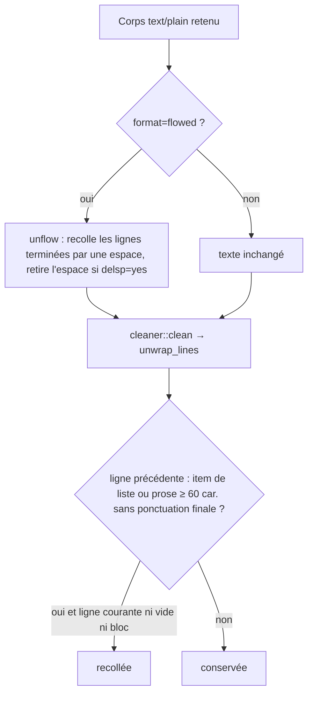
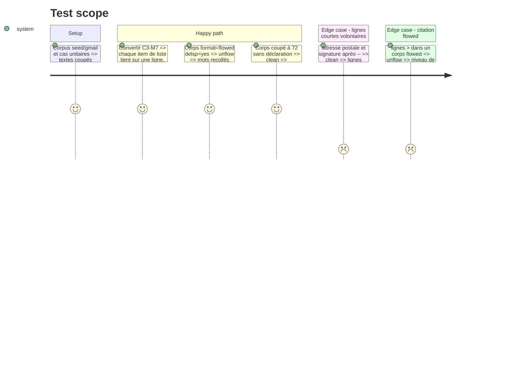

# Instruction : texte, recoller les lignes coupées du `text/plain`

## Architecture projection

> Tree of the final files. ✅ create · ✏️ modify · ❌ delete

```txt
.
├── aidd_docs/memory/architecture.md ✏️ format=flowed, règles de unwrap_lines
├── src/
│   ├── cleaner.rs                ✏️ unflow() RFC 3676 ; unwrap_lines recolle la suite d'un item de liste et une ligne commençant par »
│   └── email_export.rs           ✏️ collect_text_bodies garde format/delsp de la partie text/plain ; unflow appliqué avant cleaner::clean
└── tests/rust_tests.rs           ✏️ cleaner_tests (flowed, delsp, listes, lignes courtes) ; réactive C3-M7
```

## User Journey



## Test Scope



## Tasks to do

### `1)` Lire `format=flowed`

> Le cas déclaré est traité exactement, selon RFC 3676.

1. `collect_text_bodies` retient aussi les paramètres `format` et `delsp` du `ctype` de la partie `text/plain`.
2. `cleaner::unflow(text, delsp)` recolle chaque ligne terminée par une espace avec la suivante, et retire cette espace si `delsp=yes`.
3. `unflow` ne recolle jamais à travers un changement de niveau de citation `>` ni le séparateur `-- `. L'espace de bourrage en tête de ligne est retirée (*space-stuffing*).
4. Appeler `unflow` dans `extract_body_reporting`, uniquement quand le corps retenu est le `text/plain` déclaré `flowed`.

### `2)` Étendre `unwrap_lines`

> Le cas non déclaré recolle la suite d'un item de liste et un guillemet fermant isolé.

1. Une ligne qui suit un item de liste se recolle à cet item si elle n'est ni vide, ni un bloc protégé (`is_preserved_line`), et si l'item dépasse `UNWRAP_MIN_LEN` sans se terminer par une ponctuation finale.
2. Une ligne qui commence par `»` se recolle toujours à la précédente.
3. Les lignes courtes volontaires (adresse, signature après `-- `, salutation) restent inchangées. Les tests existants de `unwrap_lines` restent verts.
4. Les acquis des phases 2 et 3 restent verts : liens issus des marqueurs `[image: …]` (C3-M8, C4-M12), lignes d'en-tête de transfert protégées (C4-M10). Les tests du corpus sont relancés en entier, pas seulement C3-M7.

### `3)` Réactiver C3-M7

> La reproduction #18 du corpus devient verte.

1. Retirer `#[ignore]` de C3-M7. Ses assertions doivent vérifier que chaque item est recollé, qu'aucune ligne isolée ne commence par `»`, que l'adresse est intacte et que la signature est conservée.
2. Mettre à jour `aidd_docs/memory/architecture.md`.

## Test acceptance criteria

| Task | Acceptance criteria |
| ---- | ------------------- |
| 1 | Un corps `format=flowed; delsp=yes` ressort en paragraphes continus, sans mot collé ni espace en trop ; les citations et la signature gardent leurs retours à la ligne |
| 2 | Dans l'exemple de #18, chaque item numéroté tient sur une ligne et `»` suit le mot qu'il ferme ; une adresse sur trois lignes courtes est conservée |
| 3 | `cargo test` est vert sans aucun `#[ignore]` dans `gmail_seed_tests` |
