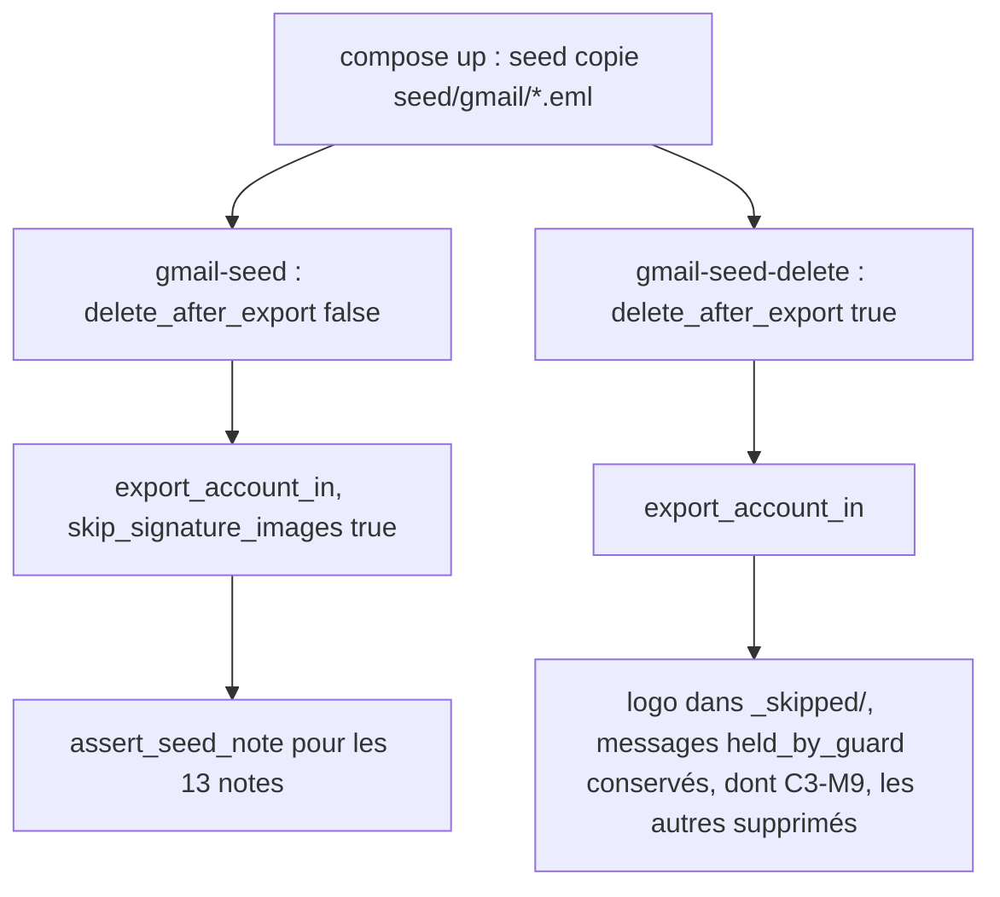
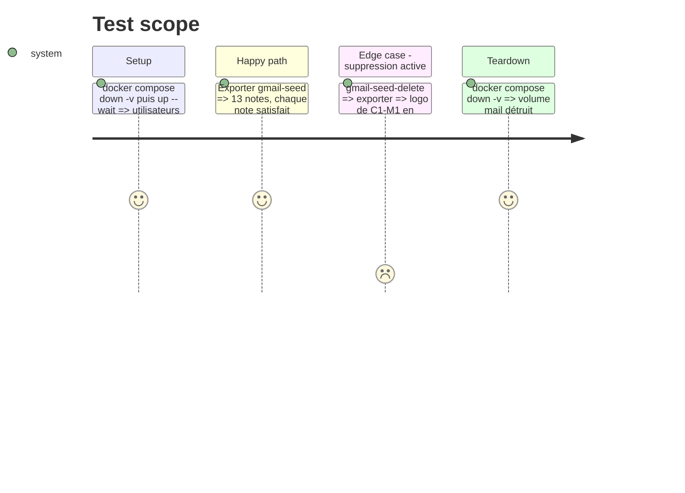

# Instruction : export réel sur Dovecot avec `skip_signature_images: true`

## Architecture projection

> Tree of the final files. ✅ create · ✏️ modify · ❌ delete

```txt
.
├── aidd_docs/memory/testing.md      ✏️ utilisateurs gmail-seed*, nouveaux tests Dovecot
└── tests/
    ├── fixtures/imap/compose.yaml   ✏️ utilisateurs gmail-seed et gmail-seed-delete, alimentés par /seed/gmail/*.eml
    └── imap_integration.rs          ✏️ mod common ; deux tests d'export du corpus par export_account_in
```

## User Journey



## Test Scope



## Tasks to do

### `1)` Utilisateurs Dovecot

> Deux boîtes dédiées au corpus, isolées des autres tests.

1. Dans `compose.yaml`, créer `gmail-seed` et `gmail-seed-delete` avec `cp /seed/gmail/*.eml` (sans les messages racine de `/seed/`).

### `2)` Tests d'intégration

> Le même corpus, exporté par le vrai chemin IMAP, satisfait les mêmes attentes.

1. `export_seed_corpus_keeps_every_image_and_text` : `export_dir("gmail-seed")` avec `skip_signature_images = true`, puis `export_account_in`. Vérifier les 13 notes par `assert_seed_note`, et `inbox_message_ids` inchangé.
2. `export_seed_corpus_with_deletion_quarantines_and_guards` : `delete_after_export = true`. Vérifier que le logo est dans `<export>/_skipped/`, que `inbox_message_ids` contient exactement les messages marqués `held_by_guard` dans `gmail_seed.rs` (au moins C3-M9), et que le rapport contient un avertissement par message conservé.
3. Les deux tests sont `#[ignore = "requires tests/fixtures/imap/compose.yaml …"]` comme les autres. Leur nom ne contient pas `gmail_` : le job CI `dovecot` lance `--ignored --skip gmail_`, qui sauterait `export_gmail_seed_*` (constat de la phase 1). Ainsi le job les exécute sans modification de la CI.
4. Avant de conclure, vérifier par `cargo test --test imap_integration -- --ignored --skip gmail_ --list` que les deux tests figurent dans la liste.

### `3)` Mémoire

> La mémoire reflète la nouvelle couverture.

1. Mettre à jour `aidd_docs/memory/testing.md` : utilisateurs `gmail-seed*`, nombre de tests, couverture du filtre signature en intégration (point manquant cité par #19).

## Test acceptance criteria

| Task | Acceptance criteria |
| ---- | ------------------- |
| 1 | Après `up --wait`, les deux utilisateurs ont exactement les 13 messages du corpus |
| 2 | Les deux tests passent localement et figurent dans la liste filtrée du job CI `dovecot` ; les autres tests Dovecot ne sont pas affectés |
| 3 | `testing.md` cite les nouveaux tests et les utilisateurs `gmail-seed*` |

## Écarts et notes

- **Le premier test active aussi la suppression.** La quarantaine `_skipped/` n'existe qu'avec `delete_after_export: true` : avec `false`, le logo écarté n'est ni écrit ni mis à l'abri, et `assert_seed_note` ne pourrait pas vérifier l'invariant de #19. Les deux tests exportent donc avec `skip_signature_images: true` et `delete_after_export: true`. Le premier vérifie en plus que les 13 messages restent sur le serveur : l'export ne supprime jamais ce qu'il vient d'exporter.
- **La suppression vient du tri, pas de l'export.** `export_account_in` ne supprime que les messages déjà traités dont le registre détient une preuve. Le second test rejoue donc le cycle réel : un premier export, puis l'enregistrement que fait `apply_review` (une preuve par note, une ligne `held` pour une note qui porte `keep_on_server`), puis un second export qui purge les messages prouvés. Seuls les messages retenus par le garde-fou restent dans l'INBOX (C3-M9).
- **Avertissements.** Le premier export signale chaque message retenu (`Message conservé sur le serveur…`), et le second le compte dans `held_on_server` et dans le résumé (`N message(s) retenu(s) sur le serveur`). Les deux sont vérifiés.
- **Quarantaine par note.** Le nombre d'images mises en quarantaine est compté dans `_skipped/<nom de la note>/`. Le chemin IMAP connaît le nom de la note avant d'écrire les images, il n'a donc pas besoin du dossier d'attente de la phase 3.
- **Résultat local** : les 13 tests Dovecot passent (`--ignored --skip gmail_ --test-threads=1`), et les deux nouveaux figurent dans la liste filtrée du job CI.
