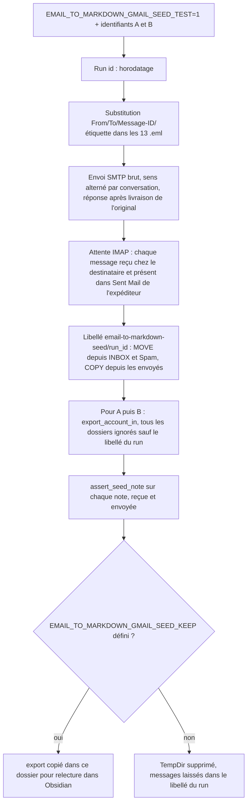
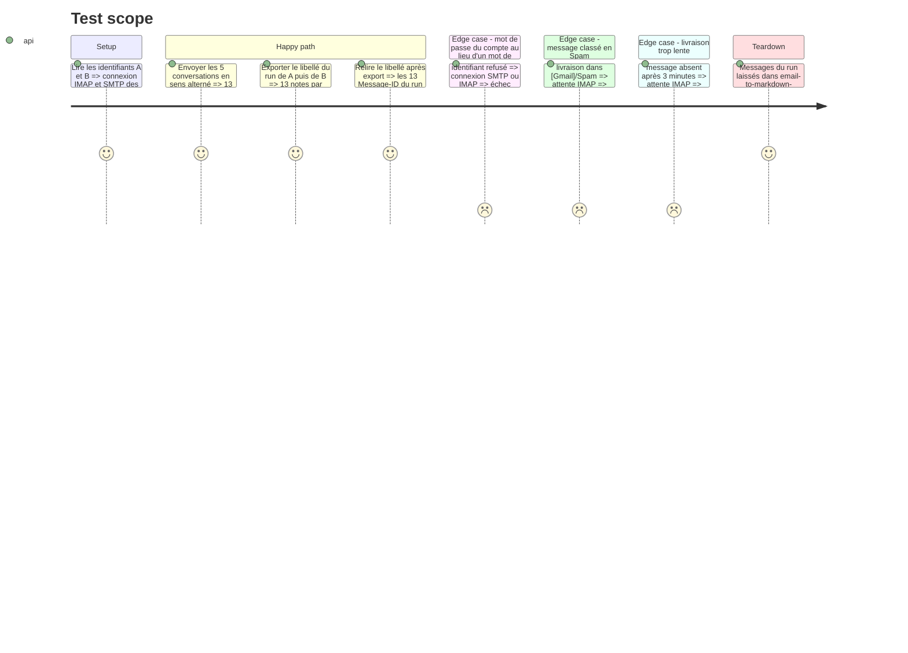

# Instruction : envoi du seed entre les deux comptes Gmail et export

## Architecture projection

> Tree of the final files. ✅ create · ✏️ modify · ❌ delete

```txt
.
├── Cargo.toml                          ✏️ [dev-dependencies] lettre (smtp-transport, native-tls), envoi brut uniquement
├── aidd_docs/memory/testing.md         ✏️ test Gmail seed, variables d'environnement, commande locale, mot de passe d'application
├── tests/fixtures/imap/gmail/README.md ✏️ préparer les deux comptes, lancer l'envoi et l'export, relire dans Obsidian
└── tests/imap_integration.rs           ✏️ gmail_seed_send_and_export : envoi SMTP A↔B, attente de livraison, libellé dédié, export, assertions
```

## User Journey



## Test Scope



## Tasks to do

### `1)` Préparer les comptes

> Les deux comptes acceptent IMAP et SMTP sans exposer d'identifiant dans le dépôt.

1. Prérequis, à faire par l'utilisateur : activer la validation en deux étapes et créer un mot de passe d'application sur chacun des deux comptes.
2. Variables d'environnement locales : `EMAIL_TO_MARKDOWN_GMAIL_A_USER`, `EMAIL_TO_MARKDOWN_GMAIL_A_PASSWORD`, `EMAIL_TO_MARKDOWN_GMAIL_B_USER`, `EMAIL_TO_MARKDOWN_GMAIL_B_PASSWORD`. Aucune valeur dans le dépôt, les logs ni les assertions.
3. Le README des fixtures décrit ces prérequis.

### `2)` Envoi réel

> Les 13 messages transitent par la livraison Gmail sans que leur MIME soit recomposé.

1. Ajouter `lettre` en dépendance de dev (`smtp-transport`, `native-tls`), et vérifier la licence et `cargo audit`.
2. `run_id` horodaté. Substituer dans chaque `.eml` (fonction `substitute` de la phase 1, déjà livrée) : `From` = compte expéditeur, `To` = l'autre compte, `<run>` = `run_id` dans les `Message-ID` et le sujet (`[email-to-markdown seed <run_id>]`). Gmail écarte un message dont le `Message-ID` existe déjà dans la boîte : le `run_id` rend chaque essai livrable.
3. Sens d'envoi alterné : C1 de A vers B (réponse de B vers A), C2 de B vers A (réponse de A vers B), C3 de A vers B (réponses de B vers A), C4 de B vers A (C4-M12 de A vers B), C5 de A vers B. Chaque compte voit ainsi 13 messages par essai, reçus et envoyés confondus, et rien de plus.
4. `send_raw` sur `smtp.gmail.com:465` avec l'enveloppe correspondante. N'envoyer une réponse qu'une fois son original livré.

### `3)` Attente et isolement

> Le test ne voit que les messages de son lancement.

1. Attendre par IMAP, avec 3 minutes au plus, chaque `Message-ID` du run : `UID SEARCH X-GM-RAW "rfc822msgid:<id>"` (extension Gmail, recherche exacte) dans INBOX, `[Gmail]/Spam` et le dossier des envoyés. Celui-ci se trouve par l'attribut `\Sent` de `LIST`, car son nom dépend de la langue. Si `X-GM-RAW` échoue, se rabattre sur `UID SEARCH HEADER Message-ID <id>`.
2. Créer le libellé `email-to-markdown-seed/<run_id>`, un par essai, puis y placer les messages du run : `UID MOVE` depuis INBOX et Spam (le message reçu quitte la boîte de réception), `UID COPY` depuis les envoyés (Gmail ajoute seulement le libellé, sans dupliquer ni retirer le libellé Sent). Seuls les UID trouvés par `Message-ID` sont touchés.
3. Signaler dans la sortie du test tout message trouvé dans Spam.

### `4)` Export et assertions

> L'export réel d'une boîte Gmail personnelle produit des notes conformes, sans rien supprimer.

1. Pour A, puis pour B : compte avec `skip_signature_images: true` et `delete_after_export: false`. `ignored_folders` contient tous les dossiers renvoyés par `LIST`, sauf `email-to-markdown-seed/<run_id>`. Les essais précédents restent dans leurs propres libellés et ne sont jamais réexportés.
2. `export_account_in` avec un `AppPaths` entièrement dans un `TempDir` (settings, destinations, ledger, journal de suppression, export) : ni la configuration ni le ledger réels de l'utilisateur ne sont lus ou écrits. On attend exactement 13 notes par compte, chacune retrouvée par le préfixe `seed-cN-mN` de son `Message-ID`.
3. `assert_seed_note` pour chaque copie (reçue et envoyée), et une seule note par message et par compte.
4. Après l'export, relire le libellé du run : les 13 `Message-ID` sont toujours présents. INBOX n'est pas comptée, car une boîte personnelle reçoit du courrier pendant le test.
5. Si `EMAIL_TO_MARKDOWN_GMAIL_SEED_KEEP=<dossier>` est défini, y copier l'export de chaque compte pour une relecture visuelle.

### `5)` Restitution de la campagne

> Les résultats demandés par #19 sont livrés.

1. Lancer le test en local avec `EMAIL_TO_MARKDOWN_GMAIL_SEED_KEEP`, puis relire les notes dans Obsidian. Le test s'appelle `gmail_seed_send_and_export` : le `--skip gmail_` du job CI `dovecot` l'exclut volontairement, il ne tourne qu'en local.
2. Confirmer le gabarit du corpus : composer dans l'interface web de Gmail, du compte A vers le compte B, un mail avec une capture collée, puis comparer son original (« Afficher l'original ») à la structure de C2-M4 et de C5-M13 (imbrication, `Content-Disposition`, `Content-ID`, `X-Attachment-Id`, balisage HTML). Tout écart devient une nouvelle fixture du corpus, anonymisée, et le README des fixtures est mis à jour.
3. Contrôler le passage de relais vers obs-mail, à la main et en simulation seulement : `python email_thread_split.py <export>` sans `--apply`. Les réponses et transferts de C1 et C4 doivent être détectés, sans aucun « découpage avec perte ». Un échec ici relève d'email2markdown s'il vient de l'export (en-tête Gmail altéré, bloc illisible), et d'obs-mail sinon.
4. Rédiger le résultat de chaque cas du tableau de #19 : version, fichiers écrits, `_skipped/`, `attachments`, corps. Indiquer que l'envoi vers un compte hors Gmail n'est pas couvert. Proposer le texte à l'utilisateur avant de le publier en commentaire de #19.
5. Mettre à jour `aidd_docs/memory/testing.md`.

## Test acceptance criteria

| Task | Acceptance criteria |
| ---- | ------------------- |
| 1 | Sans variables d'environnement, le test s'arrête avec un message qui liste les quatre variables attendues ; aucune adresse ni aucun mot de passe n'apparaît dans le dépôt |
| 2 | Les 13 messages arrivent chez leur destinataire avec le `Message-ID` et la structure MIME envoyés |
| 3 | Le libellé du run contient exactement les 13 messages du run ; les envoyés gardent leur libellé Sent ; aucun autre message n'est touché |
| 4 | Pour chaque compte, l'export contient exactement 13 notes et chacune satisfait `assert_seed_note` ; les 13 messages sont toujours dans le libellé ; aucun fichier n'est écrit hors du `TempDir` |
| 5 | Le gabarit du corpus est confirmé par un original Gmail réel, ou chaque écart a sa fixture ; le `split` simulé ne signale aucun « découpage avec perte » ; les résultats de chaque cas de #19 sont rédigés, et publiés en commentaire après accord de l'utilisateur |
